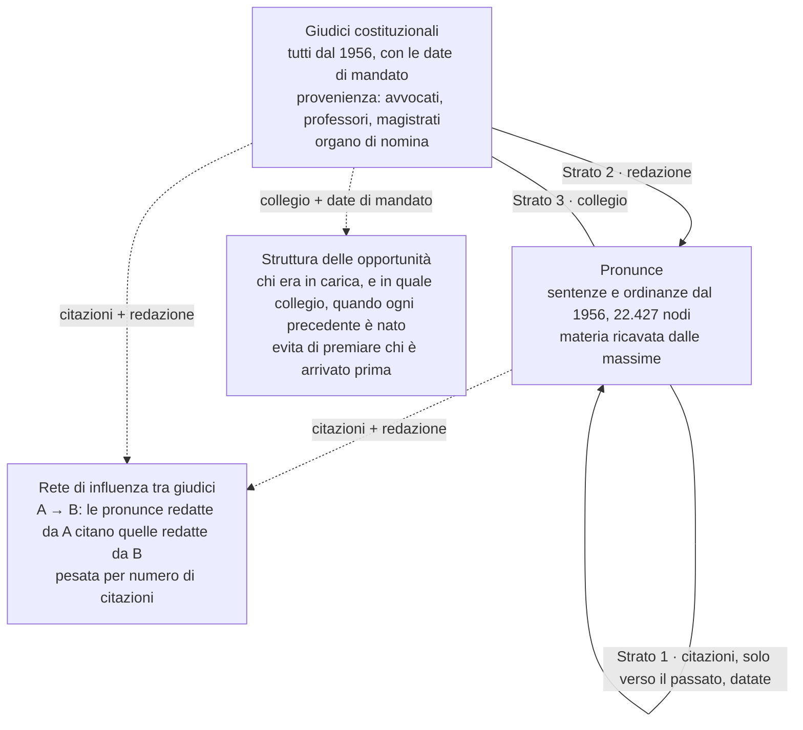
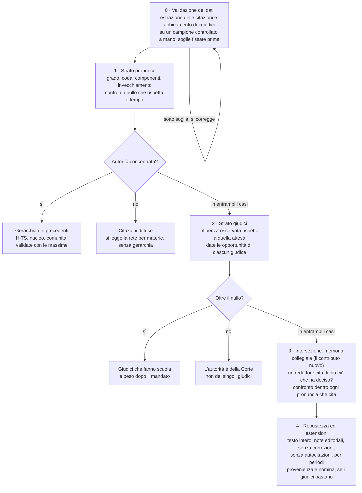

# La rete della Corte costituzionale — scheda del progetto

Social Media and Web Analytics (EM1421), a.a. 2026/27 · Umberto Toraldo

> Specifica di riferimento del progetto, esportata l'8/11/2026 dalla scheda su Claude Docs (https://claude.ai/artifact/2RiZnpECbMic7dfkfrXbeG). Le istruzioni operative per Claude Code sono in `CLAUDE.md`; le decisioni successive in `docs/decisions.md`. I grafici della scheda sono ridisegnati qui in Mermaid o come tabella.

## Sintesi

Il progetto costruisce la rete delle 22.427 pronunce della Corte costituzionale, dal 1956 a oggi (file scaricati l'8/11/2026). La incrocia con i giudici che le hanno redatte e decise. Serve a misurare dove sta l'autorità del precedente in un ordinamento in cui il precedente non è vincolante.

- **Titolo provvisorio:** Chi fa il precedente? Pronunce e giudici della Corte costituzionale, 1956–2026.
- **La domanda in una riga:** in un ordinamento in cui il precedente non vincola, la Corte costituzionale costruisce comunque una gerarchia di precedenti? E quanto di quell'autorità passa attraverso i giudici che redigono e decidono le pronunce?
- **Risultato principale:** l'effetto di D3, cioè quanto un redattore cita di più i precedenti decisi da collegi di cui faceva parte senza averli redatti (sezione Modelli nulli, punto 5).
- **Perché regge:** i dati sono aperti e coprono tutte le pronunce. Ogni legame ha un significato giuridico preciso, perché una citazione è un rinvio esplicito. La metrica centrale, hub e authority, è di Kleinberg, autore del testo del corso.
- **Cosa si consegna:** un repository pubblico con la pipeline dei dati e le analisi, una visualizzazione esplorabile della rete, una relazione scritta, la discussione all'orale.
- **Stato:** dati scaricati e ispezionati (`docs/data_schema.md`, `reports/data_inspection.md`); contesto istituzionale ricostruito sulle fonti in `docs/context.md`. Prima del 1987 il redattore non è registrato: si usa il relatore come approssimazione, con una variante di controllo dal 1987 (sezione Dati e Limiti).

## Domanda di ricerca

In un ordinamento in cui il precedente non vincola, la Corte costituzionale costruisce comunque una gerarchia di precedenti? E quanto di quell'autorità passa attraverso i giudici che redigono e decidono le pronunce?

> Questa è la formulazione unica della domanda. Si usa identica in sintesi, introduzione, risultati, discussione, abstract e, in parte, nel titolo (`docs/project_guide.md`, §1.3).

**Obiettivo.** Sulle 22.427 pronunce depositate dalla Corte costituzionale dal 1956 al 2026, misurare due cose:
- quanto è concentrata l'autorità dei precedenti, misurata con le citazioni ricevute;
- se un redattore cita di più i precedenti decisi da collegi di cui faceva parte, a parità di età e materia del precedente.

Strumenti: l'analisi delle reti di citazione, redazione e collegio, confrontata con modelli nulli che rispettano il tempo e le opportunità di ciascun giudice. Obiettivi secondari: la durata dei precedenti (D1b), l'influenza delle pronunce redatte da ciascun giudice (D2) e, se la potenza basta, l'omofilia tra giudici (D4).

**Perché non è scontata.** La Corte non è vincolata dai propri precedenti, ma li cita in modo sistematico: 17 pronunce distinte in ciascuna delle due sentenze controllate a campione. Studi di rete sui precedenti esistono per la Corte suprema statunitense, la Corte europea dei diritti dell'uomo e la Corte di giustizia dell'Unione europea (vedi Fonti).

**Cosa c'è già sulla Corte.** Agnoloni e Pagallo (2016, pp. 139–151, letto per intero) hanno costruito la rete delle citazioni tra le sole pronunce in via incidentale: 16.320 nodi e 41.858 archi, estratti con un parser validato su 60 pronunce (precisione 98,4%, richiamo 91,7%). I loro risultati principali:
- la distribuzione delle citazioni ricevute seguirebbe una legge di potenza, adattata sulla scala log-log senza test formali;
- nelle prime 30 pronunce l'ordine per authority coincide con quello per citazioni ricevute.

I giudici non entrano nell'analisi, e non ci sono modelli nulli. I due lavori del 2015 (ICAIL e JURIX) sono ancora da leggere oltre l'abstract.

Rispetto a loro questo progetto aggiunge tre cose:
- tutte le pronunce, non solo quelle in via incidentale;
- test contro modelli nulli che rispettano il tempo;
- gli strati di redazione e collegio.

Per D1 resta una domanda aperta: il loro risultato su authority e citazioni regge sulla rete completa e con un modello nullo? Nella Corte Suprema statunitense le authority spiegano solo in parte il conteggio delle citazioni (R² = 0,23) e prevedono meglio le citazioni future (Fowler et al. 2007, manoscritto pp. 13–17).

**Cosa si sa già sui giudici.** L'influenza dei singoli giudici misurata con le citazioni è studiata da tempo nelle corti statunitensi (Landes, Lessig e Solimine 1998; Kosma 1998; Choi e Gulati 2008). È studiata anche in una corte con giudice relatore e senza opinioni dissenzienti pubblicate, la Corte di giustizia dell'Unione europea (Frankenreiter 2017). Riferimenti completi in `docs/sources.md`. Gli studi sui giudici hanno già incontrato i nostri stessi problemi: le citazioni crescono con la durata del mandato e i clerk scrivono parte delle opinioni (Landes, Lessig e Solimine 1998, pp. 272–281); il presidente assegna le cause, quindi giudici simili ricevono cause simili e possono citarsi per sole ragioni giuridiche (Frankenreiter 2017, manoscritto pp. 19–21).

**La lacuna.** Non è noto se nella Corte costituzionale italiana l'autorità di un precedente dipenda dalle persone che lo hanno redatto e deciso, o appartenga solo alla Corte come istituzione. In particolare, non è noto se un giudice citi di più i precedenti decisi dai collegi di cui faceva parte. Il contributo difendibile è quindi più stretto dello studio dell'influenza dei giudici in sé:
- gli strati di redazione e collegio applicati alla Corte italiana;
- la memoria collegiale stimata sulle assenze dal collegio (D3).

Resta da fare prima di dichiararla nella relazione: leggere per intero Agnoloni e Pagallo, e cercare studi sui singoli giudici in altre corti costituzionali europee.

**Perché una legge di potenza non basta.** Agnoloni e Pagallo riportano distribuzioni a legge di potenza delle citazioni. Una distribuzione così però la producono anche pratiche di citazione ripetitive: non prova una gerarchia consapevole dei precedenti (Frankenreiter 2017, in risposta a Derlén e Lindholm). Per questo D1 si giudica solo contro modelli nulli e con test formali.

| Sotto-domanda | Ipotesi | Se confermata | Se smentita |
| --- | --- | --- | --- |
| D1 · Pronunce: l'autorità è concentrata in poche pronunce? Le authority coincidono con le più citate? | Citazioni ricevute con coda pesante; un nucleo di authority diverso dal semplice conteggio | Esiste una gerarchia di fatto dei precedenti | Le citazioni sono appoggi locali, senza gerarchia |
| D1b · Pronunce: quanto dura un precedente? | L'attenzione cala con l'età, tranne poche pronunce fondative | Pochi precedenti stabili fanno da ossatura | La giurisprudenza si rinnova senza ossatura |
| D2 · Giudici: l'influenza di un giudice supera quella attesa date le sue opportunità? Dura oltre il mandato? | Forte eterogeneità anche dopo il controllo | Alcuni giudici fanno scuola | L'autorità è della Corte come istituzione |
| D3 · Intersezione: a parità di età e materia, un redattore cita di più i precedenti decisi da collegi di cui faceva parte? | Sì, per memoria collegiale | Il precedente circola attraverso le persone | La Corte cita come istituzione, non come persone |
| D4 · Estensione: ci si cita di più tra giudici con la stessa provenienza o lo stesso organo di nomina? | Omofilia moderata | Provenienza e nomina pesano nel dialogo tra giudici | Nessuna traccia di appartenenze |

D4 si fa solo se il calcolo di potenza fatto prima lo consente (sezione Modelli nulli, punto 6).

## Dati

Tutti i dati vengono dal portale aperto della Corte, con licenza CC BY-SA 3.0. I file sono stati scaricati e ispezionati l'8/11/2026: i dettagli sono in `docs/data_schema.md`, il significato dei campi in `docs/context.md`.

| Dataset | Contenuto verificato | Formati e copertura | Uso nel progetto |
| --- | --- | --- | --- |
| [Archivio delle pronunce](https://dati.cortecostituzionale.it/Scarica_i_dati/Scarica_i_dati) | 22.427 pronunce (11.735 sentenze, 10.692 ordinanze), 1956–2026; presidente, relatore, redattore (dal 2002), date di decisione e deposito, collegio, testo | XML, CSV e JSON, in tre archivi con un file per anno; si usa l'XML | Nodi, citazioni estratte dal testo, redattore, collegio, date |
| Archivio delle massime | Sintesi dei principi di diritto, scritte dall'Ufficio del massimario della Corte | XML fino a oggi, un file per anno; CSV e JSON si fermano al 2015 | Materie, per validare le comunità. Non per misurare le citazioni dei giudici |
| Anagrafica dei giudici | Tutti i giudici, con date di giuramento e cessazione e una breve biografia | XML, CSV e JSON | Nodi giudici e mandati |
| [Elenco dei giudici sul sito](https://www.cortecostituzionale.it/contenuti/composizione/giudici-costituzionali) | Organo di nomina, date, provenienza: professori, magistrati, avvocati | Pagina web | Attributi per D4 |
| Registri degli atti di promovimento | Norme impugnate e parametri invocati | XML, CSV e JSON; sembrano riguardare solo le cause pendenti | Fuori dal nucleo del progetto |
| [Endpoint SPARQL del portale](https://dati.cortecostituzionale.it/sparql/endpoint) | Pronunce, massime, giudici, sedute; per le pronunce: numero, anno, relatore, presidente, tipo di procedimento, esito (`tipoDispositivo`, 33 tipi). Non espone redattore, date di decisione e deposito, collegio della pronuncia (solo i membri delle sedute dal 2004) | Servizio di interrogazione (API), aggiornato in continuo | Esito delle pronunce dal 2005; controllo incrociato dei conteggi (`reports/sparql_reconciliation.md`). I metadati restano quelli dei file |
| Wikipedia in italiano, link alle pronunce | Voci che rimandano a una pronuncia sul sito della Corte o su Consulta Online: circa 250–300 pronunce collegate; una sola voce dedicata a una sentenza | API di MediaWiki, aperte | Solo validazione descrittiva di D1; prima cosa da tagliare se manca tempo |

**Cosa è stato controllato sulle pronunce** (cinque, dal 2009 al 2024):

- ogni scheda indica presidente, redattore e date; il relatore compare nel testo;
- ogni testo elenca il collegio che ha deciso, da 13 a 15 giudici con nome e cognome;
- la sentenza 242/2019 contiene 40 citazioni a 17 pronunce distinte;
- la sentenza 242/2009 ne contiene 47 nella motivazione, 62 contando le note editoriali, sempre a 17 pronunce distinte;
- le ordinanze di correzione di errori materiali citano una sola pronuncia, quella da correggere.

**Due avvertenze sulla fonte.** La pagina dei download indica l'aggiornamento sia come quotidiano sia come settimanale. La licenza CC BY-SA obbliga a ripubblicare i dati derivati con la stessa licenza, citando la Corte.

**Cosa hanno mostrato i file** (`reports/data_inspection.md`):

- relatore e redattore sono campi separati, ma il redattore è registrato solo dal 2002. Dal dicembre 1986 al 2001 sta nelle firme in fondo al testo; prima del 23/12/1986 firmavano tutti i giudici e il redattore non è indicato da nessuna parte (`docs/context.md`, sezione 5). Per quel periodo si usa il relatore come approssimazione, e D2 e D3 si rifanno anche sulle sole pronunce dal 1987 (`docs/decisions.md`);
- il collegio è un testo libero, da 11 a 15 giudici, presente per tutte le pronunce;
- nelle ordinanze la motivazione sta nell'epigrafe, non nel testo;
- l'archivio delle massime copre tutte le pronunce fino al 2025 e dà il tipo di giudizio; la materia va ricavata dai titoli delle massime, da normalizzare;
- l'anagrafica ha 125 giudici, con 33 date di cessazione mancanti, da completare a mano;
- una sonda grezza riconosce circa 86.000 menzioni di pronunce in 15.600 testi; il numero vero di citazioni si saprà solo con l'estrattore validato.

**Prima dei dati, il contesto.** Una pronuncia la decide un collegio, a maggioranza e senza opinioni dissenzienti pubblicate; il redattore ne scrive la motivazione dopo la decisione, come il giudice estensore nei giudici comuni. Leggere i campi senza questo quadro porta a misurare altro da ciò che si crede. Per questo il lavoro sui dati comincia ricostruendo il contesto istituzionale e la corrispondenza tra concetti e campi (`docs/context.md`). Quel documento diventa poi l'introduzione della relazione.

## Costruzione della rete

**Tre strati sugli stessi dati: citazioni, redazione, collegio**

Le citazioni collegano le pronunce tra loro; redazione e collegio collegano i giudici alle pronunce. Incrociati, danno la rete di influenza tra giudici e il controllo delle opportunità: senza, chi è stato in carica prima o più a lungo risulterebbe influente per costruzione.

## Teoria dei grafi applicata al caso

Ogni concetto qui sotto ha un significato preciso in questa rete. Quelli che non ce l'hanno sono elencati in fondo, con il motivo.

| Concetto | Cosa è | Cosa significa qui |
| --- | --- | --- |
| Grafo diretto | Nodi collegati da archi con un verso | Strato delle citazioni: la pronuncia che cita punta al precedente |
| Grafo diretto aciclico | Grafo diretto senza cicli | Le citazioni vanno solo all'indietro nel tempo. Un ciclo segnala quasi sempre un errore di estrazione, quindi è anche un controllo di qualità |
| Grafo pesato | Archi con un valore | Nella rete tra giudici il peso è il numero di citazioni tra le loro pronunce |
| Rete bipartita e proiezione | Due tipi di nodi, legami solo tra tipi diversi; la proiezione collega i nodi di un tipo che hanno vicini in comune | Giudici–pronunce, per redazione e per collegio (Easley e Kleinberg, cap. 4). Proiettata, dice chi ha deciso insieme |
| Rete multistrato | Più tipi di legame sugli stessi nodi | Citazioni, redazione e collegio, costruiti sugli stessi dati |
| Grado in entrata e in uscita | Archi che arrivano e che partono | In entrata: quante volte una pronuncia è citata, cioè la sua autorità. In uscita: quanti precedenti usa per argomentare |
| Forza | Somma dei pesi degli archi | Influenza complessiva di un giudice, misurata in citazioni |
| Densità | Archi presenti su archi possibili | In un grafo aciclico va calcolata sugli archi possibili verso il passato |
| Distribuzione dei gradi | Quanti nodi hanno ciascun grado | Una coda pesante indica pochi precedenti molto citati. Si stima con il metodo di Clauset, Shalizi e Newman (2009), non a occhio |
| Cammini | Sequenze di archi | Catene di precedenti: attraverso quante generazioni di pronunce passa un principio |
| Componenti | Gruppi di nodi collegati tra loro | Quota di pronunce che formano un unico corpo giurisprudenziale; le isolate non citano e non sono citate |
| Co-citazione e accoppiamento | Due pronunce citate insieme, o che citano gli stessi precedenti | Misura la vicinanza tematica, ed è la base per clustering e comunità |
| Clustering e transitività | Quanti triangoli si chiudono | Sulla rete di co-citazione: precedenti usati insieme formano filoni |
| PageRank e HITS | Importanza che dipende dall'importanza di chi cita | Authority: pronuncia di riferimento. Hub: pronuncia che raccoglie e ordina i precedenti (Kleinberg 1999; Fowler et al. 2007) |
| Betweenness | Quanto un nodo sta sui cammini minimi tra gli altri | Pronunce o giudici che fanno da ponte tra filoni diversi |
| Assortatività | Se i nodi si collegano a nodi simili | Per grado: le pronunce importanti citano pronunce importanti? Per attributo: i giudici si citano tra simili? |
| k-core | Sottorete in cui ogni nodo ha almeno k legami interni | Il nucleo della giurisprudenza |
| Comunità e modularità | Gruppi più connessi al loro interno che verso l'esterno | Filoni giurisprudenziali: Leiden sulla co-citazione, Infomap sulla rete diretta; da validare con le massime |

**Metriche che qui non hanno senso:**

- **reciprocità tra pronunce:** nessuna pronuncia può citarne una futura, quindi è zero per costruzione;
- **componenti fortemente connesse tra pronunce:** in un grafo aciclico ogni nodo è una componente a sé;
- **clustering sulla rete diretta delle citazioni:** va calcolato sulla co-citazione o sulla versione non orientata;
- **metriche sulla sola rete dei collegi:** nello stesso periodo tutti siedono con tutti, quindi la rete è quasi completa. Serve solo come controllo delle opportunità.

## Strategia di network analysis

**Ogni passo dipende dal risultato del precedente**

Ogni bivio cambia cosa si cerca dopo, non se si va avanti. Se l'autorità non è concentrata, la rete si legge per filoni senza gerarchia. Se l'influenza dei giudici non supera il nullo, il risultato è che l'autorità appartiene alla Corte come istituzione. La memoria collegiale si verifica in ogni caso, ed è la parte che solo l'incrocio dei tre strati permette.

## Modelli nulli e controlli di validità

Ogni risultato si legge contro un'alternativa casuale che rispetta i vincoli del caso: il tempo per le pronunce, le opportunità per i giudici. Ogni risultato dichiara quale nullo ha usato. Le soglie di qualità si fissano prima di guardare i risultati.

**Ogni risultato è una stima, un intervallo e un confronto** (`docs/project_guide.md`, §1.9):
- la stima, con il suo intervallo di confidenza al 95%, ricavato dal modello oppure da un bootstrap;
- il valore atteso sotto il modello nullo, con la distribuzione delle randomizzazioni: almeno 1.000, con seed fisso.

Parole come "concentrata", "forte" o "alta" si usano solo con un test o un confronto dietro. Il livello di significatività è 0,05, bilaterale.

1. **Validazione dell'estrazione delle citazioni.** Un campione stratificato per decennio e per tipo (sentenze, ordinanze) si annota a mano e si confronta con l'estrattore.
   - L'unità di misura è la coppia di pronunce (citante, citata), la stessa degli archi della rete.
   - Le pronunce del campione si annotano per intero: il richiamo si misura solo se si conoscono tutte le citazioni presenti nel testo.
   - Servono circa 460 coppie per stimare una precisione di 0,95 con un margine di ±0,02 (1,96² × 0,95 × 0,05 / 0,02² ≈ 456).
   - Soglie: precisione almeno 0,95, richiamo almeno 0,90.
   - Controllo in più: il tipo scritto nella citazione (sentenza o ordinanza) si confronta con il tipo della pronuncia citata. Se non coincide, la citazione è probabilmente sbagliata.

   Sotto soglia si corregge l'estrattore o si restringe il periodo.
2. **Abbinamento dei giudici e collegio.** I nomi vanno normalizzati, perché compaiono a volte come solo cognome, a volte per esteso.
   - Redattore: almeno il 98% delle pronunce con il redattore abbinato all'anagrafica.
   - Collegio: almeno il 98% delle pronunce con il collegio riconosciuto per intero, tra 11 giudici (il numero legale, art. 16 della legge 87/1953) e 15, tutti abbinati all'anagrafica. Nelle pronunce controllate a campione erano da 13 a 15.
   - Una pronuncia può avere più redattori: nei dati succede in 17 pronunce, dal 2016. Come pesarle si decide in `docs/decisions.md`.
   - Controlli incrociati con l'endpoint SPARQL della Corte: il relatore dell'endpoint controlla quello dei file; i membri delle sedute dal 2004 controllano in parte i collegi estratti dal testo. È un controllo parziale, perché una seduta non coincide sempre con la camera di consiglio in cui si delibera. I tassi di concordanza si riportano tra le verifiche di qualità.
3. **Un nullo per ogni statistica, sempre rispettoso del tempo.** Un rimescolamento che ignora il tempo produce confronti falsi.
   - Coda delle citazioni ricevute (D1): i bersagli si rimescolano solo tra pronunce già depositate, conservando i gradi in uscita e la curva osservata delle citazioni per età del precedente. I gradi in entrata non si conservano, perché sono proprio ciò che si verifica.
   - Struttura oltre i gradi (co-citazione, comunità, authority confrontate con le pronunce più citate): scambi di citazioni ammessi solo tra coppie con lo stesso anno della pronuncia che cita e lo stesso anno della pronuncia citata (Uzzi et al. 2013, materiali supplementari, p. 5), e solo se per ogni citazione la data di deposito della citata resta precedente o uguale a quella della citante. Conservano citazioni ricevute, citazioni fatte e l'età delle citazioni. Variante: il modello di Karrer e Newman (2009, arXiv pp. 2, 5), che conserva citazioni ricevute, citazioni fatte e ordine nel tempo, ma non l'età delle citazioni.
   - **D1: authority e citazioni coincidono?** È un risultato secondario. Va fatto in tre passi:
     1. **Misure anno per anno.**
        - Per ogni anno *t*, da quando la rete ha almeno 1.000 pronunce, si calcolano authority e hub (HITS) sulla rete delle pronunce depositate fino a *t*. PageRank si calcola come variante.
        - Il rango percentile si calcola solo tra le pronunce depositate nello stesso anno: così una pronuncia del 2024 si confronta con le sue coetanee, non con quelle del 1970. È la logica di Mariani et al. 2016, da leggere prima di citarla. Una finestra di più anni è una variante di robustezza. La rete raggiunge 1.000 pronunce nel 1966; da allora il minimo di pronunce in un anno è 87 (1978).
        - Si riporta per ogni anno quante pronunce hanno authority nulla. HITS su una rete senza cicli può concentrare i punteggi su un solo gruppo e produrre blocchi di valori pari.
     2. **Confronto con le citazioni, contro il nullo.**
        - Tre misure: correlazione di Spearman tra i ranghi, sovrapposizione nell'1% più alto, R².
        - Confronto con gli scambi alla Uzzi, 1.000 ripetizioni.
        - Tre reti, in quest'ordine:
          - prima la replica di Agnoloni e Pagallo sul loro sottoinsieme: sentenze in via incidentale fino al 2014;
          - poi la rete completa;
          - poi le sole sentenze, perché le ordinanze, con richiami formulari, possono gonfiare le citazioni di poche sentenze.

          Se la replica non riproduce il loro risultato, lo si riporta come risultato. I confronti sulla rete completa e sulle sole sentenze valgono solo per la nostra rete, senza conclusioni sul loro lavoro. Ipotesi da verificare: nella loro tab. 5 (p. 144) l'authority sembra coincidere di fatto con le citazioni.
     3. **Un solo confronto di previsione, fissato prima di vedere i dati.**
        - Variabile da spiegare: le citazioni ricevute nell'anno *t*+1.
        - Due modelli binomiali negativi, uno con le sole citazioni fino a *t* (più età ed età²), uno con in più l'authority.
        - Stima sugli anni fino al 2010; verifica sul 2011–2025. Il 2026 è incompleto e non entra come variabile da spiegare.
        - Criterio, fissato ora: l'authority aggiunge informazione se riduce la devianza fuori campione di almeno il 2% rispetto al modello con le sole citazioni, e se l'intervallo al 95% della riduzione, stimato con bootstrap per pronuncia, esclude lo zero. La significatività dei coefficienti non è il criterio; gli errori standard, solo descrittivi, sono raggruppati per pronuncia.
     4. **Validazione descrittiva con Wikipedia, la prima cosa da tagliare se manca tempo.** Per ogni pronuncia si registra se una voce di Wikipedia in italiano rimanda a lei, con un link al sito della Corte o a Consulta Online. Poi si confronta la quota di pronunce collegate tra le più alte per authority, in percentile per annata, e tra le più alte per solo numero di citazioni. Nessun test: le pronunce collegate sono poche, circa 250–300, e quasi tutte celebri.
4. **Nullo per i giudici: le opportunità.** Per ogni pronuncia che cita si prende l'insieme dei precedenti disponibili in quel momento.
   - Ogni precedente ha una probabilità di essere scelto proporzionale alla curva osservata delle citazioni per età, non uniforme. Con una scelta uniforme risulterebbe influente, per costruzione, chi ha redatto in anni vicini alle pronunce che citano.
   - Da qui si calcola quante citazioni un giudice avrebbe ricevuto per caso, dato quanto e quando ha redatto. L'influenza è il rapporto tra citazioni osservate e attese.
   - Influenza dopo il mandato: la stessa finestra dopo la cessazione per tutti i giudici, esclusi quelli che non l'hanno ancora completata.
   - **Incertezza e test multipli.** Il rapporto tra osservate e attese di ogni giudice si riporta con il suo intervallo al 95%. Confrontare circa 125 giudici con il nullo vuol dire fare circa 125 test: per dire che un giudice "fa scuola" si applica ai valori p la correzione di Holm, che tiene sotto il 5% la probabilità anche di un solo falso positivo. Si testano solo i giudici con un numero minimo di pronunce redatte, fissato prima di guardare i risultati.
5. **Test della memoria collegiale (D3).** Dentro ogni pronuncia che cita si confrontano i precedenti citati con quelli disponibili e non citati. Lo strumento è la regressione logistica condizionata, con uno strato per pronuncia che cita: fuori programma, ma in linea con il corso.
   - **Dimensione.** Con tutti i precedenti disponibili sarebbero centinaia di milioni di righe. Per ogni pronuncia che cita si tengono tutti i precedenti citati e un campione casuale di 50–100 non citati. Con il campionamento casuale dei non citati le stime restano consistenti.
   - **Problema di identificazione.** Il collegio è quasi completo. Quindi "il redattore sedeva nel collegio del precedente" coincide quasi con "il precedente è successivo al suo giuramento", cioè con l'età del precedente, che è anche un controllo.
   - **Variabili del modello principale:** `self_drafted` (il redattore citante ha redatto il precedente) e `sat_not_drafted` (sedeva nel collegio senza redigerlo), tenute distinte perché l'effetto non venga tutto dalle autocitazioni. L'età del precedente si controlla con indicatori per classe di età, non con un termine lineare; la materia entra come controllo.
   - **Due fonti di variazione:**
     - le assenze dal collegio, cioè i precedenti decisi durante il mandato del redattore ma senza di lui: sono la base del risultato principale;
     - la soglia del giuramento: tra redattori di anzianità diversa, un precedente della stessa età cade dentro o fuori dal mandato.
   - **Risultato principale del progetto.** È l'odds ratio di `sat_not_drafted`, con intervallo di confidenza al 95%, stimato sulle assenze dal collegio:
     - per ogni pronuncia che cita si tengono solo i precedenti decisi durante il mandato del redattore;
     - si confrontano quelli in cui il redattore sedeva nel collegio senza redigerli con quelli in cui era assente;
     - `self_drafted`, le classi di età e la materia entrano come controlli;
     - gli errori standard sono raggruppati per redattore citante, perché le pronunce dello stesso redattore non sono indipendenti.

     È l'unico risultato da cui si traggono conclusioni formali. Il modello completo, che usa anche la soglia del giuramento, è un risultato secondario. Se le assenze sono troppe poche per un intervallo informativo, lo si dichiara: il risultato principale non si cambia dopo aver visto i dati.
6. **Test di permutazione per gli attributi (D4).** Provenienza e organo di nomina si rimescolano tra giudici in carica negli stessi anni. L'assortatività osservata si confronta con quella delle permutazioni.
   - **Criterio di potenza, fissato prima.** D4 si fa solo se una simulazione, fatta prima di guardare il risultato, dà una potenza di almeno 0,80, con α = 0,05, per l'effetto minimo d'interesse. La simulazione inserisce quell'effetto nei dati rimescolati e conta quante volte il test lo rileva. Se la potenza non basta, D4 si omette e lo si dichiara.
7. **Testo di base e robustezza.**
   - Testo di base: «Considerato in diritto» e dispositivo nelle sentenze, «Considerato che» e dispositivo nelle ordinanze.
   - Il «Ritenuto in fatto» («Ritenuto che…» nelle ordinanze) è escluso: riassume gli argomenti del giudice che ha sollevato la questione e delle parti, con le loro citazioni.
   - Le analisi principali si ripetono in sei varianti:
     - testo intero;
     - testo con le note editoriali;
     - senza le ordinanze di correzione;
     - senza le autocitazioni del redattore;
     - separando i periodi prima e dopo la riforma del Titolo V (2001);
     - per D2 e D3, solo le pronunce dalla 287/1986 in poi, citanti e citate, dove il redattore è osservato. Nell'analisi principale, prima di quella data il redattore è approssimato dal relatore.

8. **Topic sulle massime (la materia).** Le regole sono fissate prima di stimare il modello.
   - Documenti: il testo di ogni massima, 46.658 nei file. Si tolgono le parole vuote italiane e le parole presenti in più della metà delle massime.
   - Modello: LDA, con seed fisso.
   - Numero di topic: si prova K = 10, 20, 30, 40, 50, 60 e si sceglie il **K più piccolo con coerenza media (C_v) entro il 2% della massima**. La stabilità si controlla rifacendo la stima con 5 seed diversi.
   - **Dalle massime alla pronuncia:** la distribuzione di topic di una pronuncia è la media semplice di quelle delle sue massime, ciascuna con lo stesso peso. La materia è il topic con il peso medio più alto. Variante con più etichette: tutti i topic con peso almeno 0,2.
   - Pronunce senza massime: la materia si dichiara mancante, non si stima.
   - Verifica, descrittiva:
     - accordo tra topic dominante e prima voce del titolo della massima, normalizzata, misurato con informazione mutua normalizzata, sui titoli nel formato dal 2015;
     - concentrazione dei parametri costituzionali dentro ogni topic.

## Limiti e minacce alla validità

Il rischio principale è l'estrazione delle citazioni dal testo; il secondo è che il tema venga giudicato fuori dal corso. Gli altri limiti si gestiscono con varianti di analisi o si dichiarano.

| Limite | Effetto | Come si gestisce |
| --- | --- | --- |
| Formati di citazione difficili: anno indicato una volta per più numeri ("n. 26 e n. 320 del 2007"), "nn." al plurale, elenchi separati da virgole o con tipi diversi ("sentenza n. 26 del 2007 e ordinanza n. 5 del 2008"), forma con la barra, spazi mancanti, data per esteso nei testi più vecchi ("sentenza 26 giugno 1956, n. 1") | Archi mancanti o sbagliati | Estrattore che riconosce gli elenchi, validato a mano; la data per esteso va verificata sul campione 1956–1980 |
| Pronunce di altre corti (Cassazione, Consiglio di Stato, TAR) e atti amministrativi (per esempio le ordinanze della Protezione civile) hanno lo stesso formato | Archi falsi, invisibili quando il numero esiste anche alla Corte | Filtro sul contesto che precede la citazione; controllo del tipo; validazione a mano |
| Il «Ritenuto in fatto» riporta le citazioni del giudice che ha sollevato la questione e delle parti | Citazioni attribuite alla Corte che non sono sue | Escluso dal testo di base; incluso solo nella variante "testo intero" |
| Le ordinanze di rimessione dei giudici comuni si chiamano anch'esse "ordinanza" | Archi falsi | Escluse riconoscendo il numero di registro ("reg. ord.") |
| Rinvii senza numero ("la citata ordinanza") | Menzioni perse | La rete usa archi distinti tra coppie di pronunce, non il numero di menzioni: basta che il precedente sia citato una volta con il numero |
| Note editoriali delle massime | Citazioni scritte dall'Ufficio del massimario, non dai giudici | Escluse dalla rete dei giudici; usate solo come variante |
| Citare non vuol dire approvare | Un precedente può essere citato per discostarsene | Limite dichiarato; distinguere adesione e distinzione è un'estensione |
| Ordinanze ripetitive, come quelle di manifesta inammissibilità | Gonfiano pochi precedenti di formula | Analisi separate per sentenze e ordinanze |
| Le abitudini di citazione cambiano nei decenni | Le pronunce più vecchie citano meno | Confronti per periodo; modelli nulli che conservano l'età dei precedenti |
| Censura: le pronunce recenti hanno avuto meno tempo per essere citate | Citazioni ricevute, durata dei precedenti e influenza dopo il mandato sottostimate per le pronunce e i giudici recenti | Finestre fisse dopo il deposito o misure normalizzate per età; analisi della sopravvivenza per la durata dei precedenti (D1b); per D2 la stessa finestra dopo il mandato per tutti, esclusi i giudici che non l'hanno completata |
| Una pronuncia può avere più massime con materie diverse, e le massime possono mancare negli anni più vecchi | Materia ambigua o mancante, ma è un controllo di D3 | Regola da decidere (materia prevalente o più etichette); controllo della copertura delle massime per decennio |
| La pronuncia è della Corte, non del redattore: il collegio decide a maggioranza, il voto è segreto, non si pubblicano opinioni dissenzienti; il redattore scrive la motivazione, con l'aiuto dei suoi assistenti di studio | Attribuire l'influenza al redattore è un'approssimazione; sedere nel collegio non vuol dire essere d'accordo | Dichiarato; nei risultati si scrive "pronunce redatte da", non "decisioni di"; il collegio entra come controllo; ruoli definiti con le fonti in `docs/context.md` |
| Il Presidente designa il relatore, forse anche per competenza (lo stesso problema alla Corte di giustizia: Frankenreiter 2017) | I redattori possono essere specializzati per materia, e non assegnati a caso. Pesa soprattutto su `self_drafted` in D3 e su D2 | La materia entra come controllo in D2 e D3; il criterio di assegnazione si verifica in `docs/context.md` |
| L'ordine nel tempo dipende dalla data usata (decisione o deposito); pronunce dello stesso giorno potrebbero citarsi a vicenda | Cicli che non sono errori, o archi scartati per sbaglio | Data da scegliere e registrare in `docs/decisions.md`; le citazioni tra pronunce della stessa data si tengono a parte finché non si è capito se sono legittime |
| Redattore diverso dal relatore | Può segnalare un relatore rimasto in minoranza (da verificare nella letteratura) | I casi si marcano; possibile estensione |
| Fino alla pronuncia 286/1986 (5.678 pronunce su 22.427) il redattore non è registrato: firmavano tutti i giudici | Le pronunce redatte da un giudice diverso dal relatore vengono attribuite al giudice sbagliato. Dal 2002 succede in 93 casi su 8.384: l'errore attenua di poco le differenze tra giudici in D2 e D3 | Relatore come approssimazione, dichiarata; variante con le sole pronunce dalla 287/1986 |
| Nomi dei giudici scritti in modi diversi | Giudici confusi o duplicati | Soglia di abbinamento e controllo manuale dei casi dubbi |
| Provenienza e nomina vanno codificate dalle biografie | Errori di codifica | Codifica documentata e ripetibile |
| I giudici sono relativamente pochi | Test con poca potenza per D4 | Calcolo di potenza prima del test; se la potenza non basta, D4 si omette |
| Le assenze dal collegio possono non essere casuali: malattia, astensione, incompatibilità con la causa | Il risultato principale di D3 si basa sulle assenze. Se un giudice manca proprio dalle cause lontane dalla sua materia, i precedenti in cui sedeva sono più vicini a ciò che poi cita, e l'effetto risulta gonfiato | Materia come controllo; descrizione delle assenze per tipo di giudizio e materia; confronto con la stima che usa la soglia del giuramento |
| Circa 125 giudici confrontati con il nullo in D2 | Qualche giudice risulta "fare scuola" per puro caso | Correzione di Holm; soglia minima di pronunce redatte fissata prima |
| Solo pronunce della Corte | Citazioni a Cassazione, Corte EDU e Corte di giustizia escluse | Possibile estensione con nodi esterni |
| Non sono dati social | Il tema può essere giudicato fuori dal corso | Allargamento a topic, API e attenzione sul web; da concordare con il docente prima di iniziare |
| La materia viene dai testi delle massime, scritti dall'Ufficio del massimario, non dai giudici; nel 2026 il 27% delle pronunce non ha ancora massime | La materia è una classificazione d'ufficio; le pronunce più recenti restano senza materia | Dichiarato; le pronunce senza massime hanno materia mancante, e i controlli per materia in D2 e D3 le escludono o le trattano come categoria a parte |
| L'esito c'è nell'endpoint solo dal 2005 (64% delle pronunce nel 2005, quasi tutte dal 2006); una pronuncia può avere più esiti | Le analisi con l'esito coprono solo gli ultimi vent'anni | Esito dichiarato mancante prima del 2005; niente estrazione dal dispositivo. Si conservano tutte le etichette; nelle analisi, una variabile binaria: almeno una dichiarazione di illegittimità costituzionale |
| L'endpoint è aggiornato in continuo, i file sono una fotografia | Conteggi leggermente diversi (pronunce e massime depositate dopo il download, qualche massima aggiunta a posteriori) | Riconciliazione in `reports/sparql_reconciliation.md`; i dati dell'analisi sono quelli dei file, con la data del manifest |
| I link da Wikipedia riguardano poche pronunce, quasi tutte celebri | La validazione di D1 è solo descrittiva | Nessun test; la si taglia per prima |

## Allineamento con il corso

Il programma 2026/27 dichiara come obiettivo l'analisi di "dati digitali e dati dei social media", in sei contenuti. La rete delle citazioni da sola copre bene solo l'analisi delle reti e la visualizzazione. Il progetto è quindi allargato in tre punti, scelti perché servono comunque all'analisi, non per esercizio:
- l'estrazione di topic dalle massime, che dà la materia delle pronunce;
- l'endpoint SPARQL della Corte come API, per l'esito delle pronunce;
- i link da Wikipedia come misura esterna di attenzione sul web, solo per validare D1.

Il sentiment resta fuori. Che i dati non siano social resta comunque da chiarire con il docente, Pierluigi Zama Ramirez, prima di iniziare. Il §14.5 di Easley e Kleinberg mostra che il libro di testo tratta le citazioni tra sentenze come analisi dei link; non basta da solo a dire che il progetto rientri nel corso.

**Le regole del progetto** ([programma 2026/27](https://www.unive.it/data/insegnamento/790312/programma)): vale il 70% del voto ed è un'analisi originale con metodi e strumenti del corso. Si fa da soli o in due, con il tema concordato con il docente. Si valuta la qualità dell'esecuzione rispetto alle linee guida e la complessità tecnica. La discussione del progetto è ammessa solo dopo aver superato la parte teorica dell'orale, che vale il 30%.

| Argomento del corso | Dove entra nel progetto |
| --- | --- |
| Introduzione alla data science e all'analisi dei social | Pipeline riproducibile dai dati grezzi: download con manifest, ispezione, estrazione delle citazioni dal testo, validazione a mano |
| Analisi delle reti sociali | Il nucleo: tre strati, metriche di base, centralità, comunità, assortatività |
| Lavorare con le API | Endpoint SPARQL della Corte per l'esito delle pronunce (dal 2005) e per il controllo incrociato dei conteggi; API di MediaWiki per i link da Wikipedia. Il download degli archivi è da file statici, non da API |
| Visualizzazione | Rete esplorabile di pronunce e giudici; curve di invecchiamento dei precedenti; figure secondo `docs/project_guide.md`, §3 |
| Estrazione dei temi | Modello di topic sui testi delle massime: dà la materia di ogni pronuncia (controllo in D2 e D3) e serve a interpretare e validare le comunità |
| Analisi del sentiment | Fuori dal progetto: sulle motivazioni di una corte non ha un significato chiaro. Al suo posto, come attributo delle pronunce, l'esito preso dall'endpoint SPARQL, dal 2005 |

**Il legame con i testi del corso:** Easley e Kleinberg, capitolo 4 per le reti di affiliazione e capitolo 14 per hub, authority e PageRank; Barabási per distribuzioni dei gradi, attaccamento preferenziale e comunità.

**Da concordare con il docente:**

- che un tema giuridico, con dati aperti ma non social, rientri nel corso, con l'allargamento a topic, API e attenzione sul web;
- il perimetro: tutti e tre gli strati, con o senza l'estensione D4;
- se il progetto è individuale o in coppia;
- formato e scadenze della consegna;
- le regole del corso sull'uso dell'intelligenza artificiale.

## Strumenti e prodotti finali

Tutto in Python, in un repository pubblico che chiunque può rieseguire dai dati grezzi ai risultati.

| Fase | Strumenti |
| --- | --- |
| Lettura dei dati | pandas, lxml per l'XML; interrogazioni SPARQL all'endpoint della Corte; API di MediaWiki |
| Estrazione delle citazioni | Parser con espressioni regolari che riconosce gli elenchi; campione annotato a mano per la validazione |
| Normalizzazione dei giudici | Tabella di corrispondenza dei nomi, controllata a mano |
| Costruzione delle reti | NetworkX basta per le dimensioni previste; igraph se servono algoritmi più pesanti |
| Distribuzioni dei gradi | Pacchetto powerlaw, che applica il metodo di Clauset, Shalizi e Newman |
| Comunità | leidenalg (Leiden) e infomap |
| Modelli e test | statsmodels per la regressione logistica condizionata; permutazioni scritte a mano |
| Temi | LDA sui testi delle massime (gensim o scikit-learn), con seed fisso |
| Visualizzazione | Gephi per le figure statiche; una pagina web interattiva per esplorare la rete |

**Prodotti finali:**

- repository pubblico con codice, istruzioni per rieseguire e dati derivati con licenza CC BY-SA;
- relazione con domande, metodo, risultati e limiti;
- visualizzazione interattiva della rete;
- presentazione per la discussione all'orale.

## Prossimi passi

In ordine di dipendenza: ogni passo serve al successivo.

1. Comunicare a Mihretab e al docente che il progetto RfA in coppia viene lasciato.
2. Proporre il tema al docente con questa scheda, e chiarire i punti della sezione Allineamento.
3. Scaricare i file: pronunce dei tre periodi in XML o JSON, massime in XML, anagrafica dei giudici.
4. Con i file davanti, capire insieme il contesto e la struttura dei dati. Cioè:
   - come nasce una pronuncia e chi vi ha quale ruolo (presidente, relatore, redattore, collegio);
   - quali date e quali tipi di pronuncia, di giudizio e di esito esistono;
   - a quale campo corrisponde ciascun concetto, con quale copertura negli anni;
   - quante pronunce ci sono davvero.

   Risultati: `docs/context.md` e `docs/data_schema.md`. Nessun parser prima di averli compilati.
5. Costruire l'estrattore delle citazioni, validarlo sul campione e decidere se andare avanti, con le soglie della sezione Modelli nulli.
6. Normalizzare i nomi dei giudici e codificare provenienza e organo di nomina.
7. Costruire i tre strati e calcolare le metriche di base contro i modelli nulli.
8. Seguire il piano di analisi passo per passo (sezione Strategia).
9. Ripetere le analisi nelle varianti di robustezza.
10. Scrivere la relazione, preparare la visualizzazione, pubblicare il repository.

## Fonti

**Dati**

- [Corte costituzionale, Scarica i dati](https://dati.cortecostituzionale.it/Scarica_i_dati/Scarica_i_dati)
- [Portale open data della Corte](https://dati.cortecostituzionale.it)
- [Pagina open data sul sito della Corte](https://www.cortecostituzionale.it/contenuti/rapporti-cittadini/open-data)
- [I giudici costituzionali dal 1956](https://www.cortecostituzionale.it/contenuti/composizione/giudici-costituzionali)
- [Annuario 2020, i giudici](https://cortecostituzionale.it/annuario2020/giudici.html)
- [Elenco delle pronunce, esempio di pagina](https://www.cortecostituzionale.it/elenco-pronunce/1308)

**Pronunce controllate a campione**

- [Ordinanza 101/2024](https://www.cortecostituzionale.it/stampa-pdf-pronuncia/2024/101)
- [Ordinanza 226/2023](https://www.cortecostituzionale.it/scheda-pronuncia/2023/226)
- [Ordinanza 87/2020](https://www.cortecostituzionale.it/stampa-pdf-pronuncia/2020/87)
- [Ordinanza 209/2012](https://www.cortecostituzionale.it/stampa-pdf-pronuncia/2012/209)
- [Sentenza 242/2019, testo su Consulta Online](https://giurcost.org/decisioni/2019/0242s-19.html)
- [Sentenza 242/2009](https://www.cortecostituzionale.it/scheda-pronuncia/2009/242)

**Corso**

- [Social Media and Web Analytics, programma 2026/27](https://www.unive.it/data/insegnamento/790312/programma)
- [Pierluigi Zama Ramirez, pagina docente](https://www.unive.it/data/persone/29529719)

**Letteratura**

- [Agnoloni e Pagallo (2016), The Case Law of the Italian Constitutional Court between Network Theory and Philosophy of Information, Informatica e diritto](https://www.ittig.cnr.it/EditoriaServizi/AttivitaEditoriale/InformaticaEDiritto/AgnoloniPagallo.Ied.1-2016.html)
- [Fowler, Johnson, Spriggs, Jeon e Wahlbeck (2007), Network Analysis and the Law, Political Analysis](https://www.cambridge.org/core/journals/political-analysis/article/network-analysis-and-the-law-measuring-the-legal-importance-of-precedents-at-the-us-supreme-court/D9B2F13BE2594E1527780AAFDD6BF164)
- [Lupu e Voeten (2012), Precedent in International Courts, British Journal of Political Science](https://econpapers.repec.org/RePEc:cup:bjposi:v:42:y:2012:i:02:p:413-439_00)
- [Derlén e Lindholm (2014), sulla Corte di giustizia dell'UE, European Law Journal](https://zendy.io/title/10.1111/eulj.12077)

Riferimenti bibliografici da recuperare, senza pagina consultata:

- Kleinberg (1999), Authoritative Sources in a Hyperlinked Environment, Journal of the ACM
- Easley e Kleinberg (2010), Networks, Crowds, and Markets, testo del corso
- Barabási (2016), Network Science, testo del corso
- Karrer e Newman (2009), Random graph models for directed acyclic networks, Physical Review E
- Clauset, Shalizi e Newman (2009), Power-law distributions in empirical data, SIAM Review
- Rosvall e Bergstrom (2008), Maps of random walks on complex networks reveal community structure, PNAS
- Traag, Waltman e van Eck (2019), From Louvain to Leiden, Scientific Reports
