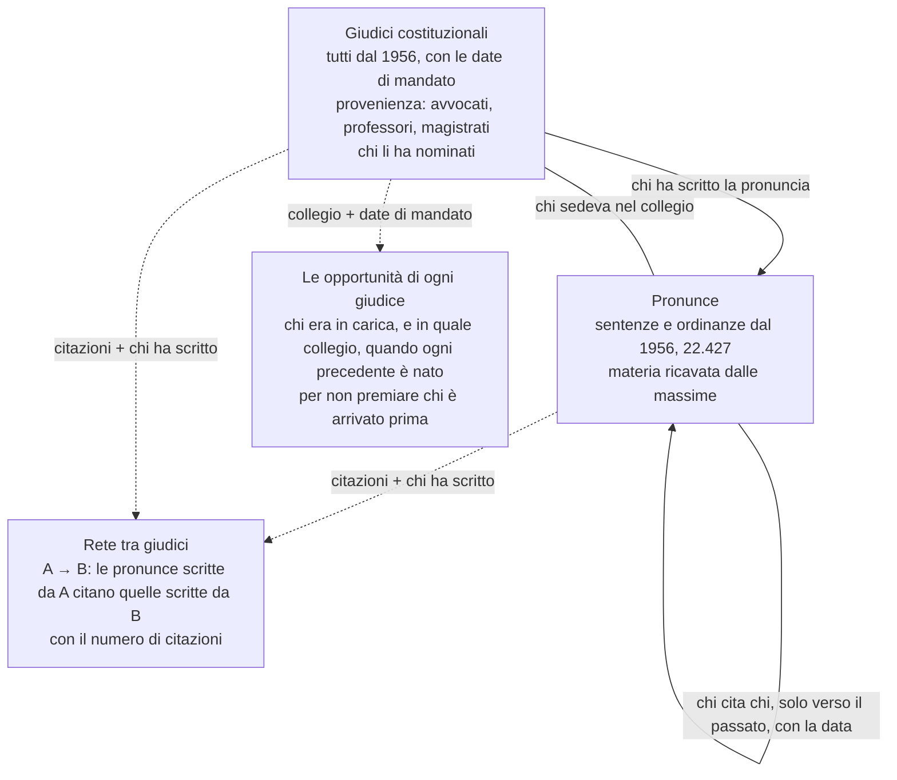

# La rete della Corte costituzionale — il piano del progetto

Social Media and Web Analytics (EM1421), anno accademico 2026/27 · Umberto Toraldo

> Questo è il piano del progetto, scritto prima dei risultati: dice che cosa si voleva fare e come. È stato esportato l'8/11/2026 dalla scheda su Claude Docs (https://claude.ai/artifact/2RiZnpECbMic7dfkfrXbeG) e poi tenuto aggiornato fino al 18/11/2026. Che cosa è stato fatto davvero e che cosa si è trovato è nella relazione (`reports/relazione_for_dummies.md`); le scelte fatte dopo, con le date, sono nel registro (`docs/decisions.md`); le istruzioni di lavoro per l'assistente sono in `CLAUDE.md`. I grafici della scheda originale sono ridisegnati qui come diagrammi o tabelle.

## In breve

Il progetto costruisce la rete delle 22.427 pronunce della Corte costituzionale dal 1956 a oggi (file scaricati l'8/11/2026), cioè chi cita chi, e la incrocia con i giudici che le hanno scritte e decise. Serve a capire dove sta l'autorità dei precedenti in un sistema in cui il precedente non obbliga la Corte a decidere allo stesso modo.

- **Titolo provvisorio:** Chi fa il precedente? Pronunce e giudici della Corte costituzionale, 1956–2026.
- **La domanda in una riga:** in un ordinamento in cui il precedente non vincola, la Corte costituzionale costruisce comunque una gerarchia di precedenti? E quanto di quell'autorità passa attraverso i giudici che redigono e decidono le pronunce?
- **Il risultato principale:** l'effetto misurato in D3, cioè quanto un giudice che scrive una pronuncia cita di più i precedenti decisi da collegi in cui sedeva senza averli scritti (sezione "Come si controlla", punto 5).
- **Perché il progetto sta in piedi:** i dati sono aperti e coprono tutte le pronunce. Ogni legame ha un significato giuridico preciso, perché una citazione è un rimando esplicito. Lo strumento centrale, l'algoritmo HITS che distingue le pronunce "autorevoli", è di Kleinberg, uno degli autori del libro di testo del corso.
- **Che cosa si consegna:** un repository pubblico con i programmi che trattano i dati e fanno le analisi, una rete da esplorare nel browser, una relazione scritta, la discussione all'orale.
- **A che punto era (8/11):** dati scaricati e controllati (`docs/data_schema.md`, `reports/data_inspection.md`); il funzionamento della Corte ricostruito sulle fonti in `docs/context.md`. Prima del 1987 il nome di chi scrive la pronuncia non è registrato: si usa il relatore al suo posto, con una prova di controllo dal 1987 (sezioni "I dati" e "I limiti").

## La domanda

In un ordinamento in cui il precedente non vincola, la Corte costituzionale costruisce comunque una gerarchia di precedenti? E quanto di quell'autorità passa attraverso i giudici che redigono e decidono le pronunce?

> È l'unica formulazione della domanda, e si usa identica in tutti i testi del progetto (`docs/project_guide.md`, §1.3).

**L'obiettivo.** Sulle 22.427 pronunce depositate dalla Corte dal 1956 al 2026, misurare due cose:
- quanto è concentrata l'autorità dei precedenti, misurata con le citazioni che ricevono;
- se un giudice che scrive una pronuncia cita di più i precedenti decisi da collegi di cui faceva parte, a parità di età e materia del precedente.

Lo strumento è l'analisi delle reti (citazioni, chi scrive, chi siede nel collegio), con ogni risultato confrontato con ciò che darebbe il caso, rispettando l'ordine del tempo e le opportunità di ciascun giudice. Obiettivi secondari: quanto dura un precedente (D1b), quanto sono citate le pronunce scritte da ciascun giudice (D2) e, se i dati bastano, se i giudici simili si citano tra loro (D4).

**Perché la risposta non è scontata.** La Corte non è obbligata a seguire i propri precedenti, ma li cita di continuo: in ciascuna delle due sentenze controllate a mano compaiono 17 pronunce diverse. Studi di rete sui precedenti esistono per la Corte suprema degli Stati Uniti, la Corte europea dei diritti dell'uomo e la Corte di giustizia dell'Unione europea (vedi Fonti).

**Che cosa si sa già sulla Corte italiana.** Agnoloni e Pagallo (2016, pp. 139–151, letto per intero) hanno costruito la rete delle citazioni tra le sole pronunce in via incidentale (le questioni sollevate da un giudice durante una causa): 16.320 pronunce e 41.858 citazioni, ricavate con un programma controllato su 60 pronunce (precisione 98,4%, richiamo 91,7%). I loro risultati principali:
- le citazioni ricevute seguirebbero una "legge di potenza" (pochissime pronunce citatissime, moltissime poco citate, secondo una regola matematica precisa), ricavata guardando un grafico, senza test;
- tra le prime 30 pronunce, l'ordine per autorevolezza (HITS) coincide con quello per numero di citazioni.

I giudici non entrano nella loro analisi, e i risultati non sono confrontati con il caso. I due lavori del 2015 (ICAIL e JURIX) sono ancora da leggere oltre il riassunto.

Rispetto a loro questo progetto aggiunge tre cose:
- tutte le pronunce, non solo quelle in via incidentale;
- il confronto con versioni casuali dei dati che rispettano l'ordine del tempo;
- chi scrive e chi siede nel collegio.

Per D1 resta una domanda aperta: il loro risultato su autorevolezza e citazioni regge sulla rete completa e contro il caso? Nella Corte suprema degli Stati Uniti l'autorevolezza spiega solo in parte il numero di citazioni (R² = 0,23, cioè circa un quarto) e prevede meglio le citazioni future (Fowler e altri 2007, manoscritto pp. 13–17).

**Che cosa si sa già sui giudici.** Quanto pesa un singolo giudice, misurato con le citazioni, è studiato da tempo nelle corti degli Stati Uniti (Landes, Lessig e Solimine 1998; Kosma 1998; Choi e Gulati 2008). È studiato anche in una corte in cui scrive il giudice relatore e non si pubblicano opinioni dissenzienti, la Corte di giustizia dell'Unione europea (Frankenreiter 2017). I riferimenti completi sono in `docs/sources.md`. Questi studi hanno già incontrato gli stessi problemi del progetto: le citazioni crescono con la durata del mandato, e gli assistenti scrivono parte dei testi (Landes, Lessig e Solimine 1998, pp. 272–281); il presidente assegna le cause, quindi giudici simili ricevono cause simili e possono citarsi solo per ragioni giuridiche (Frankenreiter 2017, manoscritto pp. 19–21).

**Che cosa non si sa.** Non si sa se nella Corte costituzionale italiana l'autorità di un precedente dipenda dalle persone che lo hanno scritto e deciso, o appartenga solo alla Corte come istituzione. In particolare, non si sa se un giudice citi di più i precedenti decisi dai collegi di cui faceva parte. Il contributo del progetto è quindi più stretto dello studio del peso dei giudici in sé:
- chi scrive e chi siede nel collegio, applicati alla Corte italiana;
- l'effetto di aver partecipato a una decisione, misurato sfruttando le assenze dal collegio (D3).

Prima di dirlo nella relazione restava da leggere per intero Agnoloni e Pagallo e da cercare studi sui singoli giudici in altre corti costituzionali europee.

**Perché una legge di potenza non basta.** Agnoloni e Pagallo trovano che le citazioni seguono una legge di potenza. Una distribuzione di questo tipo la producono anche abitudini di citazione ripetitive: non prova che la Corte costruisca consapevolmente una gerarchia (Frankenreiter 2017, in risposta a Derlén e Lindholm). Per questo D1 si giudica solo con test veri e con il confronto con il caso.

| Domanda | Che cosa ci si aspetta | Se è vero | Se è falso |
| --- | --- | --- | --- |
| D1 · Pronunce: l'autorità è concentrata in poche pronunce? Le pronunce "autorevoli" coincidono con le più citate? | Poche pronunce con moltissime citazioni; un nucleo di pronunce autorevoli diverso dal semplice conteggio | Esiste una gerarchia di fatto dei precedenti | Le citazioni sono appoggi locali, senza gerarchia |
| D1b · Pronunce: quanto dura un precedente? | L'attenzione cala con l'età, tranne poche pronunce fondamentali | Pochi precedenti stabili fanno da ossatura | La giurisprudenza si rinnova senza ossatura |
| D2 · Giudici: le pronunce di un giudice sono citate più di quanto ci si aspetta, date le sue opportunità? Anche dopo il mandato? | Grandi differenze tra giudici, anche tenendo conto delle opportunità | Alcuni giudici fanno scuola | L'autorità è della Corte come istituzione |
| D3 · Incrocio: a parità di età e materia, un giudice che scrive cita di più i precedenti decisi da collegi di cui faceva parte? | Sì, per memoria di ciò che si è deciso insieme | Il precedente circola attraverso le persone | La Corte cita come istituzione, non come persone |
| D4 · Estensione: ci si cita di più tra giudici con la stessa provenienza o nominati dallo stesso organo? | Un po' | Provenienza e nomina pesano nel dialogo tra giudici | Nessuna traccia di appartenenze |

D4 si fa solo se un calcolo fatto prima dice che i dati bastano a vedere l'effetto cercato (sezione "Come si controlla", punto 6).

## I dati

Tutti i dati vengono dal portale aperto della Corte, con licenza CC BY-SA 3.0. I file sono stati scaricati e controllati l'8/11/2026: i dettagli sono in `docs/data_schema.md`, il significato dei campi in `docs/context.md`.

| Raccolta di dati | Che cosa contiene (controllato) | Formati e copertura | A che cosa serve |
| --- | --- | --- | --- |
| [Archivio delle pronunce](https://dati.cortecostituzionale.it/Scarica_i_dati/Scarica_i_dati) | 22.427 pronunce (11.735 sentenze, 10.692 ordinanze), 1956–2026: presidente, relatore, chi ha scritto (dal 2002), date di decisione e deposito, collegio, testo | XML, CSV e JSON, in tre archivi con un file per anno; si usa l'XML | Le pronunce, le citazioni ricavate dal testo, chi ha scritto, il collegio, le date |
| Archivio delle massime | I riassunti dei principi stabiliti da ogni pronuncia, scritti da un ufficio della Corte (l'Ufficio del massimario) | XML fino a oggi, un file per anno; CSV e JSON si fermano al 2015 | La materia delle pronunce e il controllo dei filoni della rete. Non per misurare le citazioni dei giudici |
| Elenco dei giudici | Tutti i giudici, con date di giuramento e di fine mandato e una breve biografia | XML, CSV e JSON | I giudici e i loro mandati |
| [Elenco dei giudici sul sito](https://www.cortecostituzionale.it/contenuti/composizione/giudici-costituzionali) | Chi ha nominato ciascun giudice, date, provenienza (professori, magistrati, avvocati) | Pagina web | Le caratteristiche dei giudici per D4 |
| Registri delle cause in corso | Leggi impugnate e norme della Costituzione invocate | XML, CSV e JSON; sembrano riguardare solo le cause non ancora decise | Fuori dal progetto |
| [Banca dati SPARQL del portale](https://dati.cortecostituzionale.it/sparql/endpoint) | Pronunce, massime, giudici, udienze. Per le pronunce: numero, anno, relatore, presidente, tipo di procedimento, esito (33 tipi). Non contiene chi ha scritto, le date di decisione e di deposito, il collegio (solo i presenti alle udienze dal 2004) | Un servizio che risponde a domande fatte da un programma (API), aggiornato in continuo | L'esito delle pronunce dal 2005; il controllo dei conteggi (`reports/sparql_reconciliation.md`). Gli altri dati restano quelli dei file |
| Wikipedia in italiano, link alle pronunce | Le voci che rimandano a una pronuncia sul sito della Corte o su Consulta Online: circa 250–300 pronunce; una sola voce dedicata a una sentenza | Interfaccia di Wikipedia (MediaWiki), aperta | Solo come confronto descrittivo per D1; la prima cosa da togliere se manca tempo |

**Che cosa è stato controllato a mano su cinque pronunce** (dal 2009 al 2024):

- ogni scheda indica presidente, chi ha scritto e date; il relatore compare nel testo;
- ogni testo elenca il collegio che ha deciso, da 13 a 15 giudici con nome e cognome;
- la sentenza 242/2019 contiene 40 citazioni di 17 pronunce diverse;
- la sentenza 242/2009 ne contiene 47 nella motivazione, 62 contando le note aggiunte dagli uffici, sempre di 17 pronunce diverse;
- le ordinanze che correggono errori materiali citano una sola pronuncia, quella da correggere.

**Due avvertenze sulla fonte.** La pagina dei download dice che i dati si aggiornano sia ogni giorno sia ogni settimana. La licenza CC BY-SA obbliga a ripubblicare i dati derivati con la stessa licenza, citando la Corte.

**Che cosa hanno mostrato i file** (`reports/data_inspection.md`):

- relatore e chi ha scritto sono campi separati, ma il secondo è compilato solo dal 2002. Dal dicembre 1986 al 2001 il nome sta nelle firme in fondo al testo; prima del 23/12/1986 firmavano tutti i giudici e chi ha scritto non è indicato da nessuna parte (`docs/context.md`, sezione 5). Per quel periodo si usa il relatore al suo posto, e D2 e D3 si rifanno anche sulle sole pronunce dal 1987 (`docs/decisions.md`);
- il collegio è un testo libero, da 11 a 15 giudici, presente in tutte le pronunce;
- nelle ordinanze il ragionamento della Corte sta nell'intestazione, non nel testo;
- l'archivio delle massime copre tutte le pronunce fino al 2025 e dice il tipo di giudizio; la materia va ricavata dai titoli delle massime, da uniformare;
- l'elenco ha 125 giudici, con 33 date di fine mandato mancanti, da completare a mano;
- un primo conteggio grezzo trova circa 86.000 menzioni di pronunce in 15.600 testi; il numero vero di citazioni si saprà solo con un programma di estrazione controllato.

**Prima dei dati, il contesto.** Una pronuncia la decide un collegio, a maggioranza e senza opinioni dissenzienti pubblicate; chi la scrive ne stende le motivazioni dopo la decisione, come il giudice estensore nei tribunali ordinari. Leggere i campi senza saperlo porta a misurare altro da ciò che si crede. Per questo il lavoro sui dati comincia ricostruendo come funziona la Corte e che cosa vuol dire ogni campo (`docs/context.md`), che poi diventa la base delle spiegazioni della relazione.

## Come si costruisce la rete

**Tre reti sugli stessi dati: chi cita chi, chi ha scritto, chi sedeva nel collegio**

Le citazioni collegano le pronunce tra loro; chi ha scritto e chi sedeva nel collegio collegano i giudici alle pronunce. Incrociandole si ottiene la rete tra giudici e il controllo delle opportunità: senza, chi è stato in carica prima o più a lungo risulterebbe influente solo per questo.

## I concetti delle reti applicati a questo caso

Ogni concetto qui sotto ha un significato preciso in questa rete. Quelli che non ce l'hanno sono elencati in fondo, con il motivo.

| Concetto | Che cos'è | Che cosa vuol dire qui |
| --- | --- | --- |
| Rete con verso | Nodi collegati da legami che hanno una direzione | La rete delle citazioni: la pronuncia che cita punta al precedente |
| Rete con verso senza cicli | Seguendo i legami non si torna mai al punto di partenza | Le citazioni vanno solo all'indietro nel tempo. Un ciclo segnala quasi sempre un errore di estrazione, quindi è anche un controllo di qualità |
| Rete pesata | I legami hanno un valore | Nella rete tra giudici il valore è il numero di citazioni tra le loro pronunce |
| Rete con due tipi di nodi, e sua proiezione | Legami solo tra nodi di tipo diverso; la proiezione collega i nodi di un tipo che hanno vicini in comune | Giudici e pronunce, per chi ha scritto e per chi sedeva (Easley e Kleinberg, capitolo 4). Proiettata, dice chi ha deciso insieme |
| Rete a più strati | Più tipi di legame sugli stessi nodi | Citazioni, chi ha scritto e collegio, costruiti sugli stessi dati |
| Legami in entrata e in uscita | Quanti legami arrivano e quanti partono da un nodo | In entrata: quante volte una pronuncia è citata, cioè la sua autorità. In uscita: quanti precedenti usa per ragionare |
| Forza | La somma dei valori dei legami | Quanto pesa un giudice, misurato in citazioni |
| Densità | Legami presenti su legami possibili | In una rete che cita solo il passato va calcolata sui legami possibili verso il passato |
| Distribuzione dei legami | Quanti nodi hanno ciascun numero di legami | Pochi precedenti citatissimi danno una "coda pesante". Si stima con il metodo di Clauset, Shalizi e Newman (2009), non a occhio |
| Cammini | Sequenze di legami | Catene di precedenti: attraverso quante generazioni di pronunce passa un principio |
| Componenti | Gruppi di nodi collegati tra loro | Quante pronunce formano un unico corpo; le isolate non citano e non sono citate |
| Co-citazione e accoppiamento | Due pronunce citate insieme, o che citano gli stessi precedenti | Misura la vicinanza di argomento, ed è la base per trovare filoni |
| Clustering e transitività | Quanti triangoli si chiudono | Sulla rete delle co-citazioni: precedenti usati insieme formano filoni |
| PageRank e HITS | Importanza che dipende dall'importanza di chi cita | Pronuncia "autorevole" (authority): un punto di riferimento. "Hub": una pronuncia che raccoglie e ordina i precedenti (Kleinberg 1999; Fowler e altri 2007) |
| Betweenness | Quanto un nodo sta sui cammini più brevi tra gli altri | Pronunce o giudici che fanno da ponte tra filoni diversi |
| Assortatività | Se i nodi si collegano a nodi simili | Per numero di legami: le pronunce importanti citano pronunce importanti? Per caratteristiche: i giudici si citano tra simili? |
| k-core | La parte della rete in cui ogni nodo ha almeno k legami interni | Il nucleo della giurisprudenza |
| Comunità e modularità | Gruppi più collegati al loro interno che verso l'esterno | Filoni della giurisprudenza: metodo di Leiden sulle co-citazioni, Infomap sulla rete con verso; da confrontare con le massime |

**Misure che qui non hanno senso:**

- **reciprocità tra pronunce** (quanto spesso A cita B e B cita A): nessuna pronuncia può citarne una futura, quindi è zero per costruzione;
- **gruppi che si raggiungono a vicenda seguendo il verso**: in una rete senza cicli ogni pronuncia fa gruppo a sé;
- **clustering sulla rete delle citazioni con il verso**: va calcolato sulle co-citazioni o sulla rete senza verso;
- **misure sulla sola rete dei collegi**: nello stesso periodo tutti siedono con tutti, quindi la rete è quasi completa. Serve solo per controllare le opportunità.

## Il piano delle analisi

**Ogni passo dipende dal risultato del precedente**

Ogni bivio cambia che cosa si cerca dopo, non se si va avanti. Se l'autorità non è concentrata, la rete si legge per filoni, senza gerarchia. Se le pronunce dei giudici non sono citate più del caso, il risultato è che l'autorità appartiene alla Corte come istituzione. L'effetto di aver partecipato a una decisione si verifica in ogni caso: è la parte che solo l'incrocio delle tre reti permette.

## Come si controlla ogni risultato

Ogni risultato si confronta con un'alternativa casuale che rispetta i vincoli del caso: il tempo per le pronunce, le opportunità per i giudici. Ogni risultato dice con quale alternativa è confrontato. Le soglie di qualità si fissano prima di guardare i risultati.

**Ogni risultato è una stima, un intervallo e un confronto** (`docs/project_guide.md`, §1.9):
- la stima, con il suo intervallo di confidenza al 95% (i valori compatibili con i dati), ricavato dal modello oppure ricampionando i dati (bootstrap);
- il valore che darebbe il caso, con la distribuzione delle versioni casuali: almeno 1.000, sempre con lo stesso seme del generatore casuale.

Parole come "concentrata", "forte" o "alta" si usano solo con un test o un confronto dietro. Una differenza si considera reale se il valore p è sotto 0,05, guardando in entrambe le direzioni.

1. **Controllo dell'estrazione delle citazioni.** Un campione di pronunce, scelto in modo da coprire ogni decennio e i due tipi (sentenze, ordinanze), si legge a mano e si confronta con il programma.
   - Si contano le coppie "pronuncia che cita – pronuncia citata", le stesse della rete.
   - Le pronunce del campione si leggono per intero: il richiamo si misura solo se si conoscono tutte le citazioni del testo.
   - Servono circa 460 coppie per stimare una precisione di 0,95 con un margine di ±0,02 (1,96² × 0,95 × 0,05 / 0,02² ≈ 456).
   - Soglie: precisione almeno 0,95, richiamo almeno 0,90.
   - Controllo in più: il tipo scritto nella citazione (sentenza o ordinanza) si confronta con il tipo vero della pronuncia citata. Se non coincide, la citazione è probabilmente sbagliata.

   Sotto la soglia si corregge il programma o si restringe il periodo.
2. **Riconoscimento dei giudici e del collegio.** I nomi vanno uniformati, perché a volte compare solo il cognome, a volte nome e cognome.
   - Chi ha scritto: almeno il 98% delle pronunce con il nome collegato all'elenco dei giudici.
   - Collegio: almeno il 98% delle pronunce con il collegio riconosciuto per intero, tra 11 giudici (il minimo per decidere, art. 16 della legge 87/1953) e 15, tutti collegati all'elenco. Nelle pronunce controllate a mano erano da 13 a 15.
   - Una pronuncia può essere scritta da più giudici: nei dati succede in 17 pronunce, dal 2016. Come contarle si decide nel registro.
   - Controlli con la banca dati SPARQL della Corte: il relatore della banca dati controlla quello dei file; i presenti alle udienze dal 2004 controllano in parte i collegi ricavati dal testo. È un controllo parziale, perché in un'udienza si discutono più cause. Le percentuali di accordo si riportano tra i controlli di qualità.
3. **Un confronto con il caso per ogni domanda, sempre rispettando il tempo.** Un rimescolamento che ignora il tempo produce confronti falsi.
   - Concentrazione delle citazioni ricevute (D1): le citazioni si mandano a caso solo verso pronunce già depositate, conservando quante citazioni fa ogni pronuncia e quanto sono vecchi i precedenti citati. Le citazioni ricevute non si conservano, perché sono proprio ciò che si misura.
   - Struttura oltre il numero di citazioni (co-citazioni, filoni, autorevolezza confrontata con le pronunce più citate): si scambiano citazioni solo tra coppie con lo stesso anno della pronuncia che cita e lo stesso anno di quella citata (Uzzi e altri 2013, materiali aggiuntivi, p. 5), e solo se la citata resta più vecchia o dello stesso giorno della citante. Così si conservano le citazioni ricevute, quelle fatte e la loro età. Variante: il modello di Karrer e Newman (2009, arXiv pp. 2, 5), che conserva citazioni ricevute, citazioni fatte e ordine nel tempo, ma non l'età delle citazioni.
   - **D1: le pronunce "autorevoli" sono le più citate?** È un risultato secondario, in tre passi:
     1. **Misure anno per anno.**
        - Per ogni anno, da quando la rete ha almeno 1.000 pronunce, si calcolano autorevolezza (authority) e hub con HITS sulla rete delle pronunce depositate fino a quell'anno. PageRank si calcola come variante.
        - La posizione in classifica si calcola solo tra le pronunce depositate nello stesso anno: così una pronuncia del 2024 si confronta con le sue coetanee, non con quelle del 1970 (è l'idea di Mariani e altri 2016, da leggere prima di citarla). Una finestra di più anni è una variante. La rete arriva a 1.000 pronunce nel 1966; da allora il minimo di pronunce in un anno è 87 (1978).
        - Si riporta ogni anno quante pronunce hanno autorevolezza zero: HITS su una rete senza cicli può concentrare tutto su un solo gruppo.
     2. **Confronto con le citazioni, contro il caso.**
        - Tre misure: l'accordo tra le due classifiche (correlazione di Spearman), quante pronunce stanno nell'1% più alto di entrambe, R².
        - Confronto con 1.000 versioni a citazioni scambiate (gli scambi alla Uzzi descritti sopra).
        - Tre reti, in quest'ordine:
          - prima la ripetizione del lavoro di Agnoloni e Pagallo sul loro insieme: sentenze in via incidentale fino al 2014;
          - poi la rete completa;
          - poi le sole sentenze, perché le ordinanze, con richiami di formula, possono gonfiare le citazioni di poche sentenze.

          Se la ripetizione non dà il loro risultato, lo si riporta come risultato. I confronti sulla rete completa e sulle sole sentenze valgono solo per questa rete, senza conclusioni sul loro lavoro. Ipotesi da verificare: nella loro tabella 5 (p. 144) l'autorevolezza sembra coincidere di fatto con il numero di citazioni.
     3. **Un solo confronto di previsione, deciso prima di vedere i dati.**
        - Che cosa si prevede: le citazioni ricevute l'anno dopo.
        - Due modelli statistici per conteggi (binomiale negativa), uno con le sole citazioni già ricevute (più età ed età al quadrato), uno con in più l'autorevolezza.
        - Si stimano sugli anni fino al 2010 e si provano sul 2011–2025. Il 2026 è incompleto e non entra.
        - Criterio, deciso ora: l'autorevolezza aggiunge informazione se riduce l'errore di previsione fuori dagli anni di stima di almeno il 2%, e se l'intervallo al 95% della riduzione, ottenuto ricampionando le pronunce, esclude lo zero. Il fatto che un coefficiente sia "significativo" non è il criterio.
     4. **Confronto descrittivo con Wikipedia, la prima cosa da togliere se manca tempo.** Per ogni pronuncia si annota se una voce di Wikipedia in italiano rimanda a lei, con un link al sito della Corte o a Consulta Online. Poi si confronta la quota di pronunce citate su Wikipedia tra le più autorevoli e tra le più citate. Nessun test: le pronunce citate su Wikipedia sono poche, circa 250–300, e quasi tutte famose.
4. **Il confronto con il caso per i giudici: le opportunità.** Per ogni pronuncia che cita si prende l'insieme dei precedenti disponibili in quel momento.
   - Ogni precedente ha una probabilità di essere scelto che segue la curva vera delle citazioni per età, non uguale per tutti: altrimenti risulterebbe influente, solo per questo, chi ha scritto in anni vicini alle pronunce che citano.
   - Da qui si calcola quante citazioni un giudice avrebbe ricevuto per caso, dato quanto e quando ha scritto. Il suo peso è il rapporto tra citazioni ricevute e attese.
   - Peso dopo il mandato: lo stesso periodo dopo la fine del mandato per tutti i giudici, esclusi quelli che non l'hanno ancora completato.
   - **Incertezza e molti confronti insieme.** Il rapporto di ogni giudice si riporta con il suo intervallo al 95%. Confrontare circa 125 giudici con il caso vuol dire fare circa 125 test: per dire che un giudice "fa scuola" si applica la correzione di Holm, che tiene sotto il 5% la probabilità anche di un solo falso allarme. Si studiano solo i giudici con un numero minimo di pronunce scritte, deciso prima di guardare i risultati.
5. **La prova dell'effetto di aver partecipato (D3).** Dentro ogni pronuncia che cita si confrontano i precedenti citati con quelli disponibili e non citati. Lo strumento è la regressione logistica condizionata, che fa il confronto separatamente dentro ogni pronuncia che cita: è fuori dal programma del corso, ma nel suo spirito.
   - **Dimensione.** Con tutti i precedenti disponibili sarebbero centinaia di milioni di righe. Per ogni pronuncia che cita si tengono tutti i precedenti citati e un campione a caso di 50–100 non citati. Scegliendo i non citati a caso, le stime restano corrette.
   - **Il problema da risolvere.** Il collegio è quasi sempre completo. Quindi "chi scrive sedeva nel collegio del precedente" coincide quasi con "il precedente è successivo al suo arrivo alla Corte", cioè con l'età del precedente.
   - **Le caratteristiche nel modello principale:** "l'ha scritto lui" (`self_drafted`) e "sedeva nel collegio senza scriverlo" (`sat_not_drafted`), tenute separate perché l'effetto non venga tutto dalle citazioni di sé stessi. L'età del precedente entra per classi (0–1 anni, 1–2 e così via), non come una linea retta; anche la materia entra come controllo.
   - **Due modi di fare il confronto:**
     - le assenze dal collegio, cioè i precedenti decisi durante il mandato di chi scrive ma senza di lui: sono la base del risultato principale;
     - la data di arrivo alla Corte: tra giudici arrivati in anni diversi, un precedente della stessa età cade dentro o fuori dal mandato.
   - **Il risultato principale del progetto.** È l'odds ratio di "sedeva nel collegio senza scriverlo", con il suo intervallo al 95%, stimato sulle assenze:
     - per ogni pronuncia che cita si tengono solo i precedenti decisi durante il mandato di chi scrive;
     - si confrontano quelli in cui sedeva nel collegio senza scriverli con quelli in cui era assente;
     - "l'ha scritto lui", le classi di età e la materia entrano come controlli;
     - l'incertezza si calcola raggruppando per giudice che scrive, perché le sue pronunce non sono indipendenti tra loro.

     È l'unico risultato da cui si traggono conclusioni certe. Il confronto che usa anche la data di arrivo è secondario. Se le assenze sono troppo poche per un intervallo utile, lo si dichiara: il risultato principale non si cambia dopo aver visto i dati.
6. **D4: provenienza e nomina.** Provenienza e organo di nomina si rimescolano a caso tra giudici in carica negli stessi anni, e quanto i giudici simili si citano tra loro si confronta con le versioni rimescolate.
   - **Prima, il calcolo della potenza.** D4 si fa solo se una simulazione, fatta prima di guardare il risultato, dice che la probabilità di accorgersi dell'effetto minimo d'interesse è almeno 0,80 (con una soglia di 0,05). La simulazione inserisce quell'effetto nei dati rimescolati e conta quante volte il test lo trova. Se la probabilità non basta, D4 si omette e lo si dichiara.
7. **Che testo si legge, e le prove di robustezza.**
   - Il testo di base: «Considerato in diritto» e dispositivo nelle sentenze, «Considerato che» e dispositivo nelle ordinanze.
   - Il «Ritenuto in fatto» («Ritenuto che…» nelle ordinanze) è escluso: riassume gli argomenti del giudice che ha sollevato la questione e delle parti, con le loro citazioni.
   - Le analisi principali si rifanno in sei modi:
     - con il testo intero;
     - con il testo più le note aggiunte dagli uffici;
     - senza le ordinanze di correzione;
     - senza le citazioni di chi scrive a pronunce scritte da lui;
     - separando gli anni prima e dopo la riforma costituzionale del 2001;
     - per D2 e D3, con le sole pronunce dalla 287/1986, che citano e citate, dove il nome di chi scrive è noto. Nell'analisi principale, prima di quella data si usa il relatore al suo posto.
8. **La materia, dai temi delle massime.** Le regole sono decise prima di stimare il modello.
   - Documenti: il testo di ogni massima, 46.658 nei file. Si tolgono le parole vuote italiane e quelle presenti in più della metà delle massime.
   - Modello: LDA (un programma che raggruppa in temi le parole che compaiono spesso insieme), con seme fisso.
   - Numero di temi: si provano 10, 20, 30, 40, 50 e 60 e si sceglie **il numero più piccolo i cui temi sono coerenti quasi quanto i migliori (entro il 2%)**. La stabilità si controlla rifacendo la stima con 5 semi diversi.
   - **Dalle massime alla pronuncia:** i temi di una pronuncia sono la media semplice di quelli delle sue massime, ciascuna con lo stesso peso. La materia è il tema con il peso medio più alto. Variante con più etichette: tutti i temi con peso almeno 0,2.
   - Pronunce senza massime: la materia si dichiara mancante, non si stima.
   - Controlli, descrittivi:
     - accordo tra il tema principale e la prima voce del titolo della massima, misurato con l'informazione mutua normalizzata (da 0 a 1), sui titoli scritti nel formato in uso dal 2015;
     - quanto gli articoli della Costituzione invocati si concentrano dentro ogni tema.

## I limiti e i rischi

Il rischio principale è l'estrazione delle citazioni dai testi; il secondo è che il tema venga giudicato fuori dal corso. Gli altri limiti si gestiscono con prove di robustezza o si dichiarano.

| Limite | Che effetto ha | Come si gestisce |
| --- | --- | --- |
| Forme di citazione difficili: l'anno detto una volta per più numeri ("n. 26 e n. 320 del 2007"), "nn." al plurale, elenchi separati da virgole o con tipi diversi ("sentenza n. 26 del 2007 e ordinanza n. 5 del 2008"), la barra, spazi mancanti, data per esteso nei testi più vecchi ("sentenza 26 giugno 1956, n. 1") | Citazioni mancanti o sbagliate | Un programma che riconosce gli elenchi, controllato a mano; la data per esteso va verificata sul campione 1956–1980 |
| Le decisioni di altre corti (Cassazione, Consiglio di Stato, TAR) e alcuni atti amministrativi (per esempio le ordinanze della Protezione civile) si scrivono nello stesso modo | Citazioni false, invisibili quando lo stesso numero esiste anche alla Corte | Filtro sulle parole che precedono la citazione; controllo del tipo; controllo a mano |
| Il «Ritenuto in fatto» riporta le citazioni del giudice che ha sollevato la questione e delle parti | Citazioni attribuite alla Corte che non sono sue | Escluso dal testo di base; incluso solo nella prova "testo intero" |
| Anche gli atti con cui un giudice porta una questione alla Corte si chiamano "ordinanza" | Citazioni false | Esclusi riconoscendo il numero di registro ("reg. ord.") |
| Rimandi senza numero ("la citata ordinanza") | Menzioni perse | La rete conta le coppie di pronunce, non le menzioni: basta che il precedente sia citato una volta con il numero |
| Note aggiunte dagli uffici alle massime | Citazioni scritte dall'Ufficio del massimario, non dai giudici | Escluse dalla rete dei giudici; usate solo come prova in più |
| Citare non vuol dire approvare | Un precedente può essere citato per prenderne le distanze | Limite dichiarato; distinguere adesione e distinzione è un'estensione |
| Ordinanze ripetitive, come quelle che dichiarano una questione manifestamente inammissibile | Gonfiano pochi precedenti citati per formula | Analisi separate per sentenze e ordinanze |
| Le abitudini di citazione cambiano nei decenni | Le pronunce più vecchie citano meno | Confronti per periodo; versioni casuali che conservano l'età dei precedenti |
| Le pronunce recenti hanno avuto meno tempo per essere citate | Citazioni ricevute, durata dei precedenti e peso dopo il mandato sottostimati per pronunce e giudici recenti | Periodi fissi dopo il deposito o misure che tengono conto dell'età; curve di sopravvivenza per la durata dei precedenti; per D2 lo stesso periodo dopo il mandato per tutti, esclusi i giudici che non l'hanno completato |
| Una pronuncia può avere più massime con materie diverse, e le massime possono mancare negli anni più vecchi | Materia ambigua o mancante, ma serve come controllo in D3 | Regola da decidere (materia prevalente o più etichette); controllo della copertura delle massime per decennio |
| La pronuncia è della Corte, non di chi la scrive: il collegio decide a maggioranza, il voto non è pubblico, non si pubblicano opinioni dissenzienti; chi scrive stende le motivazioni con l'aiuto dei suoi assistenti | Attribuire il peso a chi scrive è un'approssimazione; sedere nel collegio non vuol dire essere d'accordo | Dichiarato; nei risultati si scrive "pronunce redatte da", non "decisioni di"; il collegio entra come controllo; i ruoli sono definiti con le fonti in `docs/context.md` |
| Il Presidente sceglie il relatore, forse anche per competenza (lo stesso problema alla Corte di giustizia: Frankenreiter 2017) | I giudici possono essere specializzati per materia, non assegnati a caso. Pesa soprattutto su "l'ha scritto lui" in D3 e su D2 | La materia entra come controllo in D2 e D3; il criterio di assegnazione si verifica in `docs/context.md` |
| L'ordine nel tempo dipende dalla data usata (decisione o deposito); pronunce dello stesso giorno potrebbero citarsi a vicenda | Cicli che non sono errori, o citazioni scartate per sbaglio | Data da scegliere e registrare nel registro; le citazioni tra pronunce della stessa data si tengono da parte finché non si capisce se sono legittime |
| Chi scrive diverso dal relatore | Può segnalare un relatore rimasto in minoranza (da verificare negli studi) | I casi si segnano; possibile estensione |
| Fino alla pronuncia 286/1986 (5.678 pronunce su 22.427) il nome di chi scrive non è registrato: firmavano tutti i giudici | Le pronunce scritte da un giudice diverso dal relatore vengono attribuite al giudice sbagliato. Dal 2002 succede in 93 casi su 8.384: l'errore attenua di poco le differenze tra giudici in D2 e D3 | Relatore usato al suo posto, dichiarato; prova con le sole pronunce dalla 287/1986 |
| Nomi dei giudici scritti in modi diversi | Giudici confusi o contati due volte | Soglia di riconoscimento e controllo a mano dei casi dubbi |
| Provenienza e nomina vanno ricavate dalle biografie | Errori di classificazione | Classificazione documentata e ripetibile |
| I giudici sono relativamente pochi | Test con poca probabilità di vedere un effetto in D4 | Calcolo della potenza prima del test; se non basta, D4 si omette |
| Le assenze dal collegio possono non essere casuali: malattia, astensione, incompatibilità con la causa | Il risultato principale di D3 si basa sulle assenze. Se un giudice manca proprio dalle cause lontane dalla sua materia, i precedenti in cui sedeva sono più vicini a ciò che poi cita, e l'effetto risulta gonfiato | Materia come controllo; descrizione delle assenze per tipo di giudizio e materia; confronto con la stima che usa la data di arrivo |
| Circa 125 giudici confrontati con il caso in D2 | Qualche giudice risulta "fare scuola" per puro caso | Correzione di Holm; numero minimo di pronunce scritte deciso prima |
| Solo pronunce della Corte | Le citazioni di Cassazione, Corte europea dei diritti dell'uomo e Corte di giustizia restano fuori | Possibile estensione con nodi esterni |
| Non sono dati di social network | Il tema può essere giudicato fuori dal corso | Allargamento a temi, API e attenzione sul web; da concordare con il docente prima di iniziare |
| La materia viene dai testi delle massime, scritti da un ufficio, non dai giudici; nel 2026 il 27% delle pronunce non ha ancora massime | La materia è una classificazione d'ufficio; le pronunce più recenti restano senza materia | Dichiarato; le pronunce senza massime hanno materia mancante, e i controlli per materia in D2 e D3 le escludono o le trattano a parte |
| L'esito è nella banca dati solo dal 2005 (64% delle pronunce nel 2005, quasi tutte dal 2006); una pronuncia può avere più esiti | Le analisi con l'esito coprono solo gli ultimi vent'anni | Esito dichiarato mancante prima del 2005; nessuna estrazione dal dispositivo. Si conservano tutte le etichette; nelle analisi conta se c'è almeno una dichiarazione di illegittimità |
| La banca dati è aggiornata in continuo, i file sono una fotografia | Conteggi leggermente diversi | Confronto in `reports/sparql_reconciliation.md`; i dati dell'analisi sono quelli dei file, con la data del manifest |
| I link da Wikipedia riguardano poche pronunce, quasi tutte famose | Il confronto con Wikipedia è solo descrittivo | Nessun test; lo si toglie per primo |

## Il legame con il corso

Il programma 2026/27 dice che il corso tratta l'analisi di "dati digitali e dati dei social media", in sei argomenti. La rete delle citazioni da sola copre bene solo l'analisi delle reti e la visualizzazione. Il progetto è quindi allargato in tre punti, scelti perché servono comunque all'analisi, non come esercizio:
- i temi ricavati dalle massime, che danno la materia delle pronunce;
- la banca dati SPARQL della Corte come API, per l'esito delle pronunce;
- i link da Wikipedia come misura esterna dell'attenzione sul web, solo per D1.

Il sentiment, escluso il 12/11, è stato affrontato il 18/11/2026 su richiesta di Umberto come polarità delle citazioni: le regole non hanno superato la soglia di qualità decisa prima, quindi non entrano nelle analisi (`docs/decisions.md`). Che i dati non siano di social network resta comunque da chiarire con il docente, Pierluigi Zama Ramirez. Il §14.5 di Easley e Kleinberg mostra che il libro di testo tratta le citazioni tra sentenze come un'analisi dei link; non basta da solo a dire che il progetto rientri nel corso.

**Le regole del progetto d'esame** ([programma 2026/27](https://www.unive.it/data/insegnamento/790312/programma)): vale il 70% del voto ed è un'analisi originale con i metodi e gli strumenti del corso. Si fa da soli o in due, con il tema concordato con il docente. Si valutano la qualità del lavoro rispetto alle indicazioni e la sua complessità tecnica. La discussione del progetto è ammessa solo dopo aver superato la parte teorica dell'orale, che vale il 30%.

| Argomento del corso | Dove entra nel progetto |
| --- | --- |
| Introduzione alla data science e all'analisi dei social | Una sequenza di programmi ripetibile dai dati grezzi: download con registro delle versioni, controllo dei file, estrazione delle citazioni dal testo, controllo a mano |
| Analisi delle reti sociali | Il nucleo: tre reti, misure di base, importanza dei nodi, filoni; dal 18/11/2026 anche le misure dei libri di testo (`src/analysis/course_measures.py`). Mappa completa in `docs/course_mapping.md` |
| Lavorare con le API | La banca dati SPARQL della Corte per l'esito delle pronunce (dal 2005) e per il controllo dei conteggi; l'interfaccia di Wikipedia. Gli archivi invece si scaricano come file |
| Visualizzazione | Una rete da esplorare con il nucleo delle pronunce (`reports/rete_interattiva.html`; quella dei giudici non è stata fatta); curve di invecchiamento dei precedenti; figure secondo `docs/project_guide.md`, §3 |
| Estrazione dei temi | Un modello di temi sulle massime: dà la materia di ogni pronuncia (controllo in D2 e D3) e aiuta a leggere i filoni |
| Analisi del sentiment | In forma adattata: la polarità delle citazioni (quando la Corte prende le distanze da un precedente), con regole provate alla cieca (`src/polarity/`); il 18/11/2026 la precisione (0,76) è rimasta sotto la soglia di 0,80, quindi nessuna analisi. Come caratteristica delle pronunce resta l'esito, preso dalla banca dati SPARQL, dal 2005 |

**I libri di testo del corso:** Easley e Kleinberg, capitolo 4 per le reti di affiliazione e capitolo 14 per hub, authority e PageRank; Barabási per le distribuzioni dei legami, l'attaccamento preferenziale e i filoni.

**Da concordare con il docente:**

- che un tema giuridico, con dati aperti ma non di social network, rientri nel corso, con l'allargamento a temi, API e attenzione sul web;
- il perimetro: tutte e tre le reti, con o senza D4;
- se il progetto è individuale o in coppia;
- forma e scadenze della consegna;
- le regole del corso sull'uso dell'intelligenza artificiale.

## Strumenti e prodotti finali

Tutto in Python, in un repository pubblico che chiunque può rieseguire dai dati grezzi ai risultati. (Il corso potrebbe chiedere R: la migrazione è prevista dopo la fine del lavoro.)

| Fase | Strumenti |
| --- | --- |
| Lettura dei dati | pandas, lxml per l'XML; domande SPARQL alla banca dati della Corte; interfaccia di Wikipedia |
| Estrazione delle citazioni | Un programma con espressioni regolari che riconosce gli elenchi; un campione letto a mano per il controllo |
| Nomi dei giudici | Una tabella di corrispondenza dei nomi, controllata a mano |
| Costruzione delle reti | NetworkX basta per queste dimensioni; igraph per i calcoli più pesanti |
| Distribuzioni delle citazioni | Il pacchetto powerlaw, che applica il metodo di Clauset, Shalizi e Newman |
| Filoni | leidenalg (Leiden) e infomap |
| Modelli e test | statsmodels per la regressione logistica condizionata; rimescolamenti scritti a mano |
| Temi | LDA sulle massime (gensim o scikit-learn), con seme fisso |
| Visualizzazione | Gephi per le figure; una pagina web per esplorare la rete |

**Prodotti finali:**

- un repository pubblico con il codice, le istruzioni per rieseguire tutto e i dati derivati con licenza CC BY-SA;
- una relazione con domanda, metodo, risultati e limiti;
- una rete da esplorare nel browser;
- una presentazione per la discussione all'orale.

## Prossimi passi (al 8/11/2026)

In ordine: ogni passo serve al successivo.

1. Comunicare a Mihretab e al docente che il progetto RfA in coppia viene lasciato.
2. Proporre il tema al docente con questa scheda, e chiarire i punti della sezione "Il legame con il corso".
3. Scaricare i file: pronunce dei tre periodi in XML o JSON, massime in XML, elenco dei giudici.
4. Con i file davanti, capire insieme il contesto e la struttura dei dati:
   - come nasce una pronuncia e chi ha quale ruolo (presidente, relatore, chi scrive, collegio);
   - quali date e quali tipi di pronuncia, di giudizio e di esito esistono;
   - a quale campo corrisponde ciascun concetto, e per quali anni c'è;
   - quante pronunce ci sono davvero.

   Risultati: `docs/context.md` e `docs/data_schema.md`. Nessun programma di lettura prima di averli scritti.
5. Costruire il programma che estrae le citazioni, controllarlo sul campione e decidere se andare avanti, con le soglie della sezione "Come si controlla".
6. Uniformare i nomi dei giudici e ricavare provenienza e organo di nomina.
7. Costruire le tre reti e calcolare le misure di base contro il caso.
8. Seguire il piano delle analisi passo per passo.
9. Rifare le analisi nelle prove di robustezza.
10. Scrivere la relazione, preparare la rete da esplorare, pubblicare il repository.

## Fonti

**Dati**

- [Corte costituzionale, Scarica i dati](https://dati.cortecostituzionale.it/Scarica_i_dati/Scarica_i_dati)
- [Portale open data della Corte](https://dati.cortecostituzionale.it)
- [Pagina open data sul sito della Corte](https://www.cortecostituzionale.it/contenuti/rapporti-cittadini/open-data)
- [I giudici costituzionali dal 1956](https://www.cortecostituzionale.it/contenuti/composizione/giudici-costituzionali)
- [Annuario 2020, i giudici](https://cortecostituzionale.it/annuario2020/giudici.html)
- [Elenco delle pronunce, esempio di pagina](https://www.cortecostituzionale.it/elenco-pronunce/1308)

**Pronunce controllate a mano**

- [Ordinanza 101/2024](https://www.cortecostituzionale.it/stampa-pdf-pronuncia/2024/101)
- [Ordinanza 226/2023](https://www.cortecostituzionale.it/scheda-pronuncia/2023/226)
- [Ordinanza 87/2020](https://www.cortecostituzionale.it/stampa-pdf-pronuncia/2020/87)
- [Ordinanza 209/2012](https://www.cortecostituzionale.it/stampa-pdf-pronuncia/2012/209)
- [Sentenza 242/2019, testo su Consulta Online](https://giurcost.org/decisioni/2019/0242s-19.html)
- [Sentenza 242/2009](https://www.cortecostituzionale.it/scheda-pronuncia/2009/242)

**Corso**

- [Social Media and Web Analytics, programma 2026/27](https://www.unive.it/data/insegnamento/790312/programma)
- [Pierluigi Zama Ramirez, pagina docente](https://www.unive.it/data/persone/29529719)

**Letteratura**

- [Agnoloni e Pagallo (2016), The Case Law of the Italian Constitutional Court between Network Theory and Philosophy of Information, Informatica e diritto](https://www.ittig.cnr.it/EditoriaServizi/AttivitaEditoriale/InformaticaEDiritto/AgnoloniPagallo.Ied.1-2016.html)
- [Fowler, Johnson, Spriggs, Jeon e Wahlbeck (2007), Network Analysis and the Law, Political Analysis](https://www.cambridge.org/core/journals/political-analysis/article/network-analysis-and-the-law-measuring-the-legal-importance-of-precedents-at-the-us-supreme-court/D9B2F13BE2594E1527780AAFDD6BF164)
- [Lupu e Voeten (2012), Precedent in International Courts, British Journal of Political Science](https://econpapers.repec.org/RePEc:cup:bjposi:v:42:y:2012:i:02:p:413-439_00)
- [Derlén e Lindholm (2014), sulla Corte di giustizia dell'UE, European Law Journal](https://zendy.io/title/10.1111/eulj.12077)

Riferimenti da recuperare, di cui non è stata consultata una pagina precisa:

- Kleinberg (1999), Authoritative Sources in a Hyperlinked Environment, Journal of the ACM
- Easley e Kleinberg (2010), Networks, Crowds, and Markets, testo del corso
- Barabási (2016), Network Science, testo del corso
- Karrer e Newman (2009), Random graph models for directed acyclic networks, Physical Review E
- Clauset, Shalizi e Newman (2009), Power-law distributions in empirical data, SIAM Review
- Rosvall e Bergstrom (2008), Maps of random walks on complex networks reveal community structure, PNAS
- Traag, Waltman e van Eck (2019), From Louvain to Leiden, Scientific Reports
