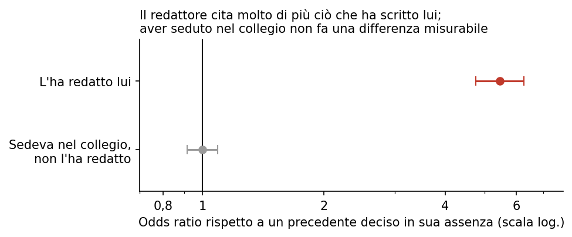

# Chi fa il precedente? La rete delle pronunce della Corte costituzionale, 1956–2026

Umberto Toraldo · Social Media and Web Analytics (EM1421), Università Ca' Foscari Venezia · novembre 2026 · lavoro svolto con Claude Code

> La relazione ha due livelli. La **Parte I** racconta in parole semplici la domanda, che cosa si è fatto, che cosa si è trovato, e risponde ai dubbi di base. La **Parte II** spiega i dettagli con lo stesso linguaggio: dati, metodo, risultati completi, limiti, istruzioni per rifare tutto e corrispondenza con il programma d'esame. Ogni numero viene da uno script del repository; tra parentesi è indicato il file da cui è preso. Ogni risultato porta un'etichetta: *principale* (fissato prima di vedere i dati), *esplorativo* (trovato, aggiunto o cambiato dopo), *descrittivo*. Il tema non è ancora approvato dal docente.

## Parte I — Il lavoro in parole semplici

### La domanda

In Italia una sentenza della Corte costituzionale non obbliga la Corte a decidere allo stesso modo in futuro: il precedente non vincola. Eppure la Corte cita di continuo le proprie decisioni passate. Il lavoro si chiede due cose.

1. **Tra le sue decisioni, la Corte crea dei "precedenti importanti"?** Cioè: alcune decisioni vengono citate moltissimo e altre quasi mai, oppure le citazioni sono sparse più o meno a caso?
2. **Contano le persone?** Ogni decisione è presa da un gruppo di 11–15 giudici (il collegio) e scritta da uno solo di loro (il redattore). La domanda è se l'importanza di un precedente dipenda da chi c'era: un giudice tende a citare le decisioni a cui ha partecipato, o quelle che ha scritto lui?

### Che cosa si è fatto

Il lavoro usa tutte le 22.427 pronunce della Corte dal 1956 al 2026 (le decisioni della Corte si chiamano pronunce: sentenze e ordinanze). Dal loro testo sono state ricavate le citazioni di pronunce precedenti: 93.467 legami, cioè chi cita chi. Poi ogni pronuncia è stata collegata al giudice che l'ha scritta e ai giudici che sedevano nel collegio.

Un numero da solo non dice se qualcosa è tanto o poco. Per questo ogni risultato è confrontato con ciò che succederebbe se le citazioni andassero a caso, rifacendo il calcolo su molte versioni dei dati rimescolate. Le regole principali sono state scritte prima di vedere i risultati; ciò che è stato aggiunto dopo è segnato come *esplorativo* (sezione 2.9).

### Che cosa si è trovato

**1. Alcuni precedenti contano molto più di altri, ma durano poco.**

- L'1% delle pronunce più citate raccoglie il 10,3% delle citazioni. Se ogni citazione andasse a una pronuncia presa a caso tra quelle depositate nello stesso anno, quell'1% ne raccoglierebbe il 3,4%, e il 4,2% tenendo conto che le ordinanze sono citate molto meno delle sentenze.
- Quasi una pronuncia su tre non viene mai citata.
- Un precedente è citato soprattutto nei primi anni: la frequenza di citazione è massima a un anno dal deposito e si dimezza in 3 anni, e metà delle citazioni va a precedenti con meno di 3,5 anni. Resta un piccolo nucleo: il 13,4% delle pronunce con almeno trent'anni viene citato ancora dopo trent'anni.
- **Dimenticato o sostituito?** Quando un precedente smette di essere citato, il suo posto lo prendono in parte le pronunce che lo avevano citato nei primi anni: più tardi queste vengono citate il 43% in più di pronunce simili (stesso anno, stesso tipo, stessa materia) che non lo avevano citato (esplorativo; dettagli e cautele nei chiarimenti qui sotto).
- Un'avvertenza: che le citazioni siano concentrate è normale in quasi tutte le reti di citazioni. Chiamarla "gerarchia" è un'interpretazione, non una prova.
- Due affermazioni pubblicate sulla Corte italiana non reggono al controllo: la distribuzione delle citazioni non segue una "legge di potenza", e le pronunce più "autorevoli" secondo l'algoritmo HITS non coincidono con le più citate (sezione 3.2).

**2. Aver partecipato a una decisione non conta; averla scritta sì.** È il risultato principale, deciso prima di guardare i dati.

- Un giudice che scrive una nuova pronuncia non cita di più le pronunce a cui ha partecipato rispetto a quelle prese mentre era assente. Un giudice in carica manca dal 6,3% delle pronunce, e sono queste assenze a rendere possibile il confronto. La differenza misurata è zero (in termini tecnici: odds ratio 1,00, intervallo di confidenza al 95% da 0,92 a 1,09). Il dato esclude effetti superiori al 9% circa in più o all'8% in meno; non dimostra che l'effetto sia esattamente zero.
- Cita invece molto di più quelle che ha scritto lui: circa 5 volte e mezzo di più (odds ratio 5,47 (4,76–6,27)), a parità di età e materia del precedente. Questo non era tra le ipotesi fissate prima: è esplorativo.
- Gran parte di questo effetto ha una spiegazione semplice: le questioni che si ripetono (la stessa legge contestata più volte) vengono affidate allo stesso giudice, che poi richiama la sua decisione precedente. Infatti il 40,0% dei precedenti scritti dallo stesso redattore che vengono citati riguarda la stessa disposizione impugnata. A parità di disposizione impugnata l'odds ratio scende a 3,27 (2,95–3,63), cioè a circa 3 volte. Resta un effetto vero, ma non si sa se sia preferenza personale o specializzazione per materia.

**3. Presi uno per uno, i giudici pesano poco.**

**Pochi redattori si distinguono.** Su 113 giudici, dopo la correzione di Holm le pronunce di 6 sono citate più di pronunce prese a caso dello stesso anno e quelle di 7 meno. Esplorativo.

La correzione di Holm serve perché si fanno 113 confronti insieme, e qualcuno risulterebbe "diverso" per puro caso. Per tutti gli altri giudici la differenza non si distingue dal caso. Anche l'appartenenza a un gruppo conta poco: tra giudici con la stessa provenienza professionale (professori, magistrati) le citazioni sono il 4,9% più frequenti dell'atteso, molto meno del 20% fissato prima come soglia minima d'interesse; tra giudici nominati dallo stesso organo non c'è differenza (sezione 3.6).

**In una frase:** la Corte costruisce dei precedenti importanti ma di breve vita, che in parte passano il testimone alle pronunce che li citano. L'autorità di una pronuncia non passa dal collegio che l'ha decisa; passa in parte da chi l'ha scritta, soprattutto perché gli stessi giudici trattano le stesse questioni.

### Chiarimenti di base

**Le 22.427 pronunce sono tutte quelle prese dalla Corte, o ne mancano?** Sono tutte, per il periodo coperto, con un controllo interno. La Corte numera le pronunce anno per anno, con un'unica numerazione per sentenze e ordinanze: in nessun anno mancano numeri e non ci sono doppioni (`reports/data_inspection.md`), quindi una pronuncia assente dai file lascerebbe un buco nella numerazione. L'ultimo anno è incompleto: i dati sono stati scaricati l'8 novembre 2026, e del 2026 ci sono le pronunce fino alla numero 191, depositata il 2026-11-06. Il lavoro riguarda solo le pronunce (sentenze e ordinanze), non gli altri atti della Corte.

**Perché un collegio ha 11, 12, 13, 14 o 15 giudici?** La Corte ha 15 giudici; per decidere ne servono almeno 11 (legge 87/1953, art. 16). Il collegio è formato dai giudici presenti all'udienza o alla camera di consiglio in cui la causa è trattata. Si scende sotto i 15 per due motivi: un seggio è vuoto (un giudice ha finito il mandato e il successore non è ancora entrato), oppure un giudice in carica è assente. Nei dati il 70,4% delle pronunce ha meno di 15 giudici; in media ci sono 14,6 giudici in carica, 13,7 nel collegio e 0,9 assenti. Tra i collegi con meno di 15 giudici, il 39,2% cade in un periodo con un seggio vuoto e l'84,1% ha almeno un giudice assente (le due cose possono accadere insieme). Il motivo delle singole assenze (malattia, impedimento, astensione) non è nei dati.

**Come si distingue il giudice che ha scritto una pronuncia da uno che era assente?** Ogni pronuncia riporta in testa l'elenco dei giudici che l'hanno decisa, cioè il collegio. Dal dicembre 1986 riporta anche il nome del giudice che l'ha scritta (il redattore), in un campo dei dati o nelle firme in fondo al testo. Un giudice che in quel periodo era in carica (compare in collegi prima e dopo) ma non è nell'elenco era assente. Il redattore, invece, è sempre nell'elenco. Prima del dicembre 1986 il nome del redattore non c'è: si usa quello del relatore, il giudice che ha studiato la causa e che di regola la scrive.

**Che cosa vuol dire "le pronunce scritte da un giudice", se a decidere è il collegio?** La decisione è del collegio, che vota a maggioranza in camera di consiglio. Dopo il voto, uno dei giudici, il redattore, scrive il testo con le motivazioni, e il collegio lo approva. "Pronunce redatte da X" vuol dire pronunce di cui X ha scritto il testo, non pronunce che X ha deciso da solo. Anche le citazioni nel testo sono approvate dal collegio: il lavoro misura se chi scrive lascia comunque un'impronta su quali precedenti vengono citati.

**Come è stata verificata la "stessa provenienza" dei giudici?** Non è stata verificata a mano. La provenienza è ricavata in automatico dalla breve biografia ufficiale di ogni giudice (anagrafica della Corte): se contiene parole come "professore", "docente" o "ordinario di", il giudice è classificato come professore; se contiene "magistrato", "consigliere", "presidente di sezione" o "procuratore", come magistrato; se contiene "avvocato", come avvocato. Nessuno ha controllato la classificazione riga per riga: è un limite, ed eventuali errori tenderebbero a nascondere un effetto, non a crearlo. L'organo che ha nominato il giudice (Parlamento, Presidente della Repubblica, magistrature) viene invece da un campo ufficiale dei dati.

**Un precedente viene dimenticato, o lo sostituisce chi lo ha citato?** La domanda è stata verificata (esplorativo, con regole fissate prima: sezione 3.3).
- Sono stati presi 1.606 precedenti depositati tra il 1970 e il 2010 e citati almeno 5 volte entro 4 anni dal deposito. Entro 4 anni ricevono in media 8,4 citazioni; tra 4 e 8 anni 2,5; tra 12 e 16 anni 1,0.
- Per ognuno si sono guardate le pronunce che lo avevano citato entro 4 anni (i "successori") e, per ciascuna, una pronuncia simile (stesso anno, stesso tipo, stessa materia) che non lo aveva citato.
- Tra 4 e 15 anni dopo il precedente, contando solo le citazioni da pronunce che non citano più il precedente, i successori ricevono 1,43 volte le citazioni delle pronunce simili (intervallo 1,37–1,49).
- Che cosa vuol dire: chi ha citato un precedente diventa a sua volta più citato del normale, proprio mentre il precedente viene lasciato da parte. È coerente con un passaggio di testimone. Ma è coerente anche con un'altra spiegazione: le pronunce che citano precedenti importanti sono di per sé pronunce più importanti. Questi dati non distinguono le due letture.
- La seconda condizione della regola fissata prima (i successori, tutti insieme, ricevono più citazioni del precedente: 36,7 contro 4,7 in media) è risultata poco utile, perché vale anche per le pronunce simili (25,7): dipende soprattutto dal fatto che i successori sono tanti.

### Che cosa aggiunge il lavoro

1. **Un risultato nullo fissato prima e misurato con precisione** (principale). L'ipotesi su cui il progetto era costruito non trova sostegno, con un margine stretto e con il criterio scritto prima dei risultati. Accanto c'è un effetto forte dei precedenti scritti dallo stesso redattore, in buona parte spiegato dalle questioni ripetute (esplorativo). Il contrasto sta in una figura (Figura 8).
2. **Un fatto dei dati datato diversamente dalla dottrina** (descrittivo). Il 23 dicembre 1986, tra la pronuncia 286 e la 287, la Corte smette di far firmare tutti i giudici e comincia a indicare il redattore. Il cambio si vede al giorno nei testi, mentre la dottrina lo data alla norma del luglio 1987. Senza questo controllo, metà dell'analisi sui giudici avrebbe usato un dato che per quelle pronunce non esiste.
3. **Due risultati pubblicati messi alla prova** (esplorativo). La legge di potenza e l'identità tra authority e citazioni, entrambe di Agnoloni e Pagallo (2016), sono testate contro alternative e modelli nulli, come chiede la critica di Frankenreiter (2017): non reggono, con le cautele sulla replica dette nella sezione 3.2.

### Che cosa resta aperto

- **Il controllo di una persona sulle citazioni estratte** (36 pronunce, foglio pronto). Oggi la qualità dell'estrazione l'ha giudicata l'assistente automatico che ha scritto anche l'estrattore: un controllo indipendente è il passo più importante prima di qualsiasi estensione.
- **Il controllo di una persona sulla polarità delle citazioni** (67 passi), solo come verifica: lo strumento non ha superato la soglia fissata prima e non è stato usato (sezione 3.9).
- **L'approvazione del tema da parte del docente**, con le sue indicazioni su lingua, forma della consegna e uso dell'intelligenza artificiale.
- **I limiti principali** (sezione 4): i relatori non sono assegnati a caso; la materia è misurata in modo grossolano; il motivo delle assenze non è nei dati; citare non vuol dire approvare.

## Parte II — I dettagli, spiegati

Questa parte racconta ogni passaggio con più dettaglio: da dove vengono i dati, come sono stati trattati, come è stato misurato ogni risultato e quanto ci si può fidare. Ogni termine tecnico è spiegato la prima volta che compare, e tutti sono raccolti alla fine ("Le parole tecniche, spiegate"). Tra parentesi c'è il file del repository da cui viene ogni numero.

## 1. I dati

### 1.1 Da dove vengono

Tutti i dati vengono dal portale open data della Corte costituzionale ([dati.cortecostituzionale.it](https://dati.cortecostituzionale.it)), cioè il sito su cui la Corte pubblica i propri dati perché chiunque li possa riusare. La licenza (CC BY-SA 3.0) permette di usarli citando la fonte e pubblicando i dati derivati con la stessa licenza.

I dati sono stati scaricati l'8 novembre 2026 con uno script del progetto (`src/ingest/download.py`). Per ogni file lo script annota l'indirizzo, la data e un'impronta del contenuto (un codice SHA-256, che cambia se cambia anche un solo carattere) in `data/raw/MANIFEST.csv`. Così si sa sempre quale versione dei dati ha prodotto i risultati.

Gli archivi sono tre.

| Archivio | Che cosa contiene | Quanto |
| --- | --- | --- |
| Pronunce | Il testo completo di ogni decisione, con anno, numero, tipo, presidente, relatore, redattore, data della decisione e del deposito, elenco dei giudici del collegio | 22.427 pronunce: 11.735 sentenze e 10.692 ordinanze, dal 1956 al 2026 |
| Massime | I riassunti dei principi stabiliti da ogni pronuncia, scritti da un ufficio della Corte (l'Ufficio del massimario); indicano anche il tipo di giudizio | 46.658 massime |
| Giudici | Nome, chi li ha nominati, date di giuramento e di fine mandato, breve biografia | 125 giudici |

Le pronunce sono di due tipi. La sentenza decide in via definitiva; l'ordinanza ha una motivazione breve (legge 87/1953, art. 18). Nei file non ci sono altri tipi di atti.

In più sono stati interrogati due servizi che rispondono a domande fatte da un programma (si chiamano API):

- la banca dati della Corte interrogabile con il linguaggio SPARQL, da cui viene l'esito delle pronunce dal 2005 (6.741 pronunce, 33 tipi di esito) e, come controllo, l'elenco dei giudici presenti alle udienze;
- Wikipedia in italiano, per sapere quali pronunce sono citate in una voce dell'enciclopedia (283 pronunce).

### 1.2 Com'è fatta una pronuncia

Ogni pronuncia ha un'intestazione con i dati principali e un testo diviso in parti:

- il **collegio**: l'elenco dei giudici che hanno deciso, da 11 a 15;
- l'**epigrafe**: chi ha portato la questione davanti alla Corte e su quale legge;
- nelle sentenze, il **«Ritenuto in fatto»**, che riassume gli argomenti delle parti, e il **«Considerato in diritto»**, che è il ragionamento della Corte;
- il **dispositivo**: la decisione vera e propria, seguita dalle firme.

Nelle ordinanze il ragionamento della Corte comincia con le parole «Considerato che…».

### 1.3 Che cosa bisogna sapere prima di leggere i dati

Una pronuncia non è l'opera di un solo giudice. La decide il collegio a maggioranza, in camera di consiglio (la riunione riservata dei giudici); il voto non è pubblico e non esistono opinioni dissenzienti. Poi un giudice, il **redattore**, scrive il testo con le motivazioni, e il collegio lo approva. Di regola il redattore è il **relatore**, il giudice che ha studiato la causa e l'ha presentata ai colleghi. Per questo nella relazione si scrive sempre "pronunce redatte da X", mai "decisioni di X".

Guardando i file si sono scoperte tre cose che cambiano il lavoro (`reports/data_inspection.md`):

- **Il nome di chi ha scritto la pronuncia c'è solo dal 23 dicembre 1986** (Figura 2). Fino alla pronuncia 286/1986 firmavano tutti i giudici, e si conosce solo il relatore. Dalla 287/1986 al 2001 il redattore compare solo nelle firme in fondo al testo; dal 2002 è un campo dei dati.
- **L'anno e il numero di una pronuncia seguono il giorno del deposito** (il giorno in cui la pronuncia diventa pubblica), non quello della decisione. La numerazione riparte ogni anno, è unica per sentenze e ordinanze e non ha buchi: anno e numero bastano per identificare una pronuncia.
- **L'elenco ufficiale dei giudici ha errori**: 33 date di fine mandato mancanti e alcune sbagliate (Spagnoli, Granata, Chiarelli, Mezzanotte). Per questo l'inizio e la fine dell'attività di ogni giudice si ricavano dai collegi (sezione 2.5).


*Figura 1. Pronunce depositate ogni anno, per tipo. Il picco del 1987–1989 è lo smaltimento delle cause arretrate.*


*Figura 2. Da dove si ricava il nome di chi ha scritto la pronuncia, anno per anno.*

## 2. Come si è lavorato

### 2.1 Il piano, scritto prima

Il piano di lavoro è stato scritto prima di guardare i risultati, e poi rivisto più volte (`docs/decisions.md`, che registra ogni scelta con la data e il motivo). Le revisioni hanno cambiato quattro cose importanti:

- **il confronto principale.** Un giudice siede in quasi tutti i collegi del suo periodo, quindi "sedeva nel collegio" vuol dire quasi sempre "il precedente è recente". Per non confondere le due cose si confrontano solo precedenti decisi mentre il giudice era in carica, con lui presente oppure assente;
- **un confronto con il caso diverso per ogni domanda**, sempre rispettando l'ordine del tempo (una pronuncia può citare solo pronunce più vecchie);
- **le regole decise prima**: il risultato principale, le soglie di qualità e i criteri per leggere i risultati sono stati fissati prima dei risultati (ma dopo aver guardato com'erano fatti i file);
- **l'allargamento a materia, API e Wikipedia**, per coprire gli argomenti del corso.

### 2.2 Preparare i testi

Script: `src/ingest/build_pronunce.py`.

- **Spazi e a capo.** Sono stati uniformati. Senza questa operazione un controllo dava un risultato sbagliato: la formula «Considerato che» sembrava presente solo nel 50% delle ordinanze, mentre c'è nel 96%.
- **Che cosa si legge.** Ogni testo è stato diviso nelle sue parti. Le citazioni si cercano nel **testo di base**: il ragionamento della Corte più il dispositivo («Considerato in diritto» nelle sentenze, «Considerato che» nelle ordinanze). Il «Ritenuto in fatto» resta fuori, perché riporta le citazioni fatte dalle parti, non dalla Corte.
- **Testi non divisi.** In 322 testi (1,4% delle pronunce: 305 ordinanze e 17 sentenze) la divisione non è riuscita, e si usa il testo intero (`reports/numbers.json`).

### 2.3 Trovare le citazioni nel testo

Script: `src/extract/citations.py`. Un programma (l'estrattore) cerca nel testo le forme con cui la Corte cita una propria pronuncia: una parola come sentenza, ordinanza, sent. o ord., seguita da un numero e da un anno. Riconosce:

- la forma semplice: "sentenza n. 120 del 2019";
- gli elenchi con l'anno detto una volta sola: "sentenze n. 26 e n. 320 del 2007";
- la barra e gli spazi mancanti: "n.4/2008", "sent. 174/1972";
- le forme antiche con la data: "sentenza 19 giugno 1956, n. 9";
- "in pari data", per le pronunce depositate lo stesso giorno.

Scarta ciò che non è una pronuncia della Corte: le ordinanze con cui un giudice porta una questione alla Corte (citate come "reg. ord."), le sentenze di altre corti (Cassazione, Consiglio di Stato, tribunali amministrativi, Corte europea) e gli atti amministrativi.

**Che cosa ne è uscito** (`data/processed/`). Una "menzione" è ogni volta che un numero di pronuncia compare nel testo; un "legame" è la coppia "A cita B", contata una sola volta anche se A nomina B più volte.

| Voce | Numero |
| --- | --- |
| Menzioni valide in tutto il testo | 155.982 |
| Menzioni scartate dal filtro (altre corti, ordinanze di rimessione, senza anno) | 9.174 |
| Menzioni di pronunce che non esistono o che sono successive a chi cita (errori) | 1.950 |
| Menzioni tra pronunce depositate lo stesso giorno, tenute da parte | 268 |
| **Legami distinti nel testo di base** | **93.467**, da 16.944 pronunce |

Nell'1,3% delle menzioni il tipo scritto (sentenza o ordinanza) non corrisponde al tipo vero della pronuncia citata: conta il numero con l'anno, che identifica la pronuncia.

### 2.4 Quanto è affidabile l'estrazione

Per sapere se l'estrattore funziona servono due misure:

- la **precisione**: delle citazioni trovate, quante sono vere. Se l'estrattore trova 100 citazioni e 95 sono vere, la precisione è 0,95;
- il **richiamo**: delle citazioni vere, quante ne trova. Se nel testo ce ne sono 100 e ne trova 90, il richiamo è 0,90.

Le soglie fissate prima erano una precisione di almeno 0,95 e un richiamo di almeno 0,90.

Per misurarle bisogna sapere quali sono le citazioni vere in un campione di testi, leggendoli. Questa lettura di riferimento l'ha fatta l'assistente automatico (Claude), **non una persona**, prima di far girare l'estrattore su quei testi; e ha letto solo i passi con una parola chiave, non i testi interi. È il limite più importante di questa parte. Le parole chiave somigliano a quelle dell'estrattore: una forma di citazione che nessuno dei due riconosce sfuggirebbe a entrambi, e il richiamo risulterebbe più alto del vero. Per questo è pronto un foglio per il controllo di una persona: 36 pronunce mai usate prima, con il testo intero e senza il risultato dell'estrattore (`data/validation/human_check.md`; quadro in `reports/validation.md`).

Tra parentesi, nella tabella, c'è l'intervallo di confidenza al 95%: l'insieme dei valori compatibili con i dati, dato che il campione è piccolo.

| Campione | Pronunce | Citazioni vere | Precisione (intervallo) | Richiamo (intervallo) |
| --- | --- | --- | --- | --- |
| Primo campione, tutti i decenni | 64 | 270 | 1,000 (0,985–1,000) | 0,941 (0,906–0,963) |
| di cui pronunce fino alla 286/1986 | 27 | 40 | 1,000 | **0,750**: sotto la soglia |
| Secondo campione, solo fino alla 286/1986, dopo la correzione dell'estrattore | 48 | 72 | 0,985 (0,920–0,997) | 0,917 (0,830–0,961) |

Il primo campione ha mostrato che l'estrattore perdeva le forme antiche di citazione. Come previsto dalle regole, il lavoro si è fermato: l'estrattore è stato corretto e poi verificato su un secondo campione mai visto. In tutto le citazioni controllate sono 342, meno delle 460 previste, e quindi gli intervalli sono più larghi del previsto, soprattutto per i testi vecchi. Per i testi fino al 1986 il valore stimato supera la soglia, ma il limite inferiore dell'intervallo (0,830) no.

**Un controllo in più.** Anche le massime elencano i precedenti citati, e le scrive un ufficio diverso. Passandole allo stesso estrattore si trovano 46.737 coppie: il 95,4% è già nella rete ricavata dal testo di base. Le 2.129 coppie in più (il 2,3% della rete) servono per una delle prove di robustezza di D3 (`reports/massime_citations.json`, script `src/extract/citations_massime.py`).

### 2.5 Giudici, redattori e collegi

Script: `src/judges/build_judges.py`.

- **Chi ha scritto la pronuncia.** Il nome viene dal campo dei dati (8.384 pronunce), dalle firme in fondo al testo (8.349) o, fino alla 286/1986, dal relatore, usato al suo posto (5.678). Il nome è stato collegato all'elenco ufficiale dei giudici nel 99,84% delle pronunce (soglia: 98%).
- **Chi sedeva nel collegio.** Nell'elenco in testa alla pronuncia si cercano i cognomi dei giudici in carica in quel periodo. Il collegio è riconosciuto per intero nel 98,85% delle pronunce (soglia: 98%). I due giudici con lo stesso cognome in carica insieme (i due Reale, nel 1977) sono distinti dal nome.
- **Quando un giudice era in carica.** Le date di fine mandato dell'elenco ufficiale non sono affidabili, quindi l'inizio e la fine dell'attività di ogni giudice sono la sua prima e la sua ultima presenza in un collegio.

Due controlli con la banca dati SPARQL della Corte, una fonte ufficiale diversa dai file: il relatore coincide nel 97,12% dei casi, e le differenze sono due errori di grafia nei file; i giudici presenti alle udienze compaiono nel collegio ricavato dal testo nel 99,1% dei casi (`reports/sparql_reconciliation.md`, `reports/collegio_vs_sedute.json`).

### 2.6 Le reti

Script: `src/networks/build.py`. Una rete è fatta di **nodi** (le cose) e **legami** (le relazioni tra le cose). Per ogni rete del lavoro: che cosa è un nodo, che cosa è un legame, se il legame ha un verso, se ha un peso.

| Rete | Nodi | Legame | Verso | Peso |
| --- | --- | --- | --- | --- |
| Citazioni | Pronunce | A cita B nel testo di base | Da chi cita a chi è citato, sempre verso il passato | Nessuno: una coppia conta una volta |
| Redazione | Giudici e pronunce | Il giudice ha scritto la pronuncia | — | — |
| Collegio | Giudici e pronunce | Il giudice sedeva nel collegio | — | — |
| Influenza tra giudici | Giudici | Le pronunce scritte da A citano pronunce scritte da B | Da A a B | Numero di citazioni |

**Perché una rete.** L'importanza di un precedente non è scritta in nessun campo dei dati: si vede da chi lo cita. E il peso di un giudice si vede solo mettendo insieme chi cita, chi è citato e chi era presente.

### 2.7 La materia di ogni pronuncia

Script: `src/analysis/topics.py`. Per confrontare precedenti "della stessa materia" serve sapere di che cosa parla ogni pronuncia. La materia è ricavata dai testi delle massime con un programma che raggruppa in "temi" le parole che compaiono spesso insieme (un modello di topic, detto LDA).

- **Quanti temi.** Sono stati provati 10, 20, 30, 40, 50 e 60 temi; è stato scelto il numero più piccolo i cui temi erano coerenti quasi quanto i migliori (entro il 2%): **20**.
- **La materia di una pronuncia** è la media dei temi delle sue massime: per esempio, 60% lavoro e 40% processo civile.
- **Controlli.** I temi vanno d'accordo con i titoli delle massime (0,31 su una scala di accordo da 0 a 1, contro 0,03 con i temi rimescolati a caso) e con gli articoli della Costituzione invocati (0,18 contro 0,01).

Esempi di temi: lavoro e pensioni; processo penale; competenze delle Regioni; imposte; conflitti tra poteri dello Stato. Alcuni temi però raccolgono formule ricorrenti di scrittura più che una materia, e ripetendo il calcolo con un altro punto di partenza i temi cambiano parecchio (somiglianza tra ripetizioni 0,31): è un limite (`reports/topics.md`).

### 2.8 Come si decide che un risultato non è dovuto al caso

**Il principio: confrontare con il caso.** Un numero da solo non dice se qualcosa è tanto o poco. Per esempio: l'1% delle pronunce più citate raccoglie il 10% delle citazioni. È tanto? Dipende da quanto ne raccoglierebbe se le citazioni andassero a caso. Per saperlo si costruiscono molte versioni rimescolate dei dati (si chiamano modelli nulli): conservano ciò che è ovvio, per esempio quante citazioni fa ogni pronuncia e quanto sono vecchi i precedenti che cita, e mescolano a caso il resto. Se il dato vero sta fuori dall'intervallo dei dati rimescolati, c'è qualcosa che il caso non spiega. Le versioni rimescolate sono 1.000 (10.000 per i giudici di D2, 100 per alcune misure secondarie), sempre con lo stesso punto di partenza del generatore casuale, così che chiunque rifacendo il calcolo ottiene gli stessi numeri.

Le domande del lavoro hanno un nome breve: D1 (le citazioni sono concentrate?), D2 (le pronunce di un giudice sono più citate del normale?), D3 (conta aver partecipato o aver scritto?), D4 (ci si cita tra giudici simili?).

| Domanda | Che cosa si misura | Con che cosa si confronta |
| --- | --- | --- |
| D1: le citazioni sono concentrate? | Quota di citazioni dell'1% più citato; quota di pronunce mai citate; indice di Gini (da 0, tutte uguali, a 1, tutto a una sola) | Ogni citazione resta a chi cita, ma va a una pronuncia presa a caso tra quelle dello stesso anno del bersaglio vero (variante: stesso anno e stesso tipo) |
| D1: che forma ha la distribuzione delle citazioni? | Legge di potenza contro lognormale (due forme matematiche), con il metodo di Clauset, Shalizi e Newman | Un test statistico tra le due forme |
| D1: le pronunce "autorevoli" sono le più citate? | Algoritmi HITS e PageRank; quante pronunce stanno nell'1% più alto di entrambe le classifiche | Citazioni scambiate tra coppie con gli stessi anni (alla Uzzi), che conservano quante citazioni fa e riceve ogni pronuncia |
| D1: l'"autorevolezza" aiuta a prevedere le citazioni? | Previsione delle citazioni dell'anno dopo, stimata fino al 2010 e provata sul 2011–2025 | Lo stesso modello senza autorevolezza; criterio fissato prima: almeno il 2% di errore in meno |
| D1b: quanto dura un precedente? | Frequenza di citazione per età del precedente; tempo fino all'ultima citazione | Una scelta a caso tra tutti i precedenti disponibili, senza badare all'età |
| D2: le pronunce di un giudice sono citate più del normale? | Citazioni ricevute diviso citazioni attese, senza le citazioni del giudice a sé stesso | Le pronunce di ogni anno riassegnate a caso tra i giudici di quell'anno (10.000 volte); correzione di Holm per i 113 confronti |
| D3: conta aver partecipato o aver scritto? | Un modello statistico (regressione logistica condizionata) | Dentro ogni pronuncia che cita: i precedenti citati contro 50 non citati, estratti a caso |
| D4: ci si cita tra giudici simili? | Quota di citazioni tra giudici dello stesso gruppo | I gruppi riassegnati a caso tra giudici entrati nello stesso decennio |

**D3 nel dettaglio**, perché è il risultato principale. Per ogni pronuncia che cita, scritta dal giudice R:

1. si prendono i precedenti decisi mentre R era in carica e depositati prima della pronuncia che cita;
2. si separano quelli citati da quelli non citati, e tra i non citati se ne estraggono 50 a caso;
3. per ogni precedente si annota: R l'ha scritto? R sedeva nel collegio senza scriverlo? Quanti anni ha? Quanto è simile per materia?
4. il modello stima quanto ciascuna di queste caratteristiche cambia la probabilità di essere citato, confrontando solo precedenti dentro la stessa pronuncia che cita.

Il confronto decisivo è tra precedenti in cui R **sedeva** e precedenti in cui R era **assente** pur essendo in carica: stesso periodo, stesso giudice, cambia solo la presenza. Le assenze non sono rare (un giudice in carica manca dal 6,3% delle pronunce; i collegi hanno da 11 a 15 giudici), e questo rende possibile il confronto. Il calcolo dell'incertezza tiene conto che le pronunce scritte dallo stesso giudice si somigliano tra loro (errori standard raggruppati per redattore).

### 2.9 Che cosa era deciso prima e che cosa è cambiato dopo

Il piano, le soglie di qualità e il risultato principale sono stati scritti prima di vedere i risultati (`docs/decisions.md`, con la data di ogni decisione). Quello che è stato aggiunto o cambiato dopo è elencato qui sotto con il motivo, e nelle sezioni dei risultati porta l'etichetta *esplorativo*: va letto come un'indicazione, non come una prova.

**Come si può verificare che una regola è venuta prima dei risultati.** Il repository (l'archivio del codice con la storia di ogni modifica) è nato il 18/11/2026: per le regole scritte da quel giorno lo dice l'ordine delle modifiche registrate. Per quelle precedenti, comprese le soglie di qualità e il disegno di D3, la prova sta solo nel registro della sessione di lavoro con l'assistente (Claude Code), che non fa parte del repository. Per esempio, lì le righe sul disegno di D3 risultano scritte nel registro delle decisioni il 16/11/2026 alle 10:48, e lo script di D3 risulta avviato per la prima volta alle 17:21 dello stesso giorno (ora italiana). Le regole sono state scritte dallo stesso assistente che poi ha fatto le analisi, su delega di Umberto Toraldo (sezione 8).

| Parte | Deciso prima | Cambiato o aggiunto dopo i risultati, e perché | Come si legge |
| --- | --- | --- | --- |
| D3, risultato principale | Il confronto tra precedenti decisi con il giudice presente o assente, a parità di "l'ha scritto lui", età e materia; 50 precedenti non citati per pronuncia; incertezza raggruppata per giudice | Il modo di fare il calcolo: un calcolo esatto al posto di un'approssimazione (di Breslow) che, quando una pronuncia cita molti precedenti, avvicina a 1 gli effetti forti (da 1,03 a 1,00; "l'ha scritto lui" da 3,01 a 5,47). La domanda non è cambiata | Principale |
| D3, altre stime | Sei prove di robustezza; un secondo confronto che usa anche la data di arrivo del giudice | Aggiunti: la stessa legge impugnata, gli articoli della Costituzione invocati, la descrizione delle assenze, il controllo del secondo confronto | Esplorative o descrittive |
| D1 | Confronto con citazioni mandate a caso tra le pronunce dello stesso anno; confronto di HITS con citazioni scambiate; criterio di previsione (almeno il 2% di errore in meno) | Aggiunto un secondo confronto, con lo stesso anno e lo stesso tipo; ritirata la lettura "conta chi ti cita", dopo aver visto che HITS concentra l'autorevolezza in un solo gruppo di pronunce | Il primo confronto resta quello di riferimento |
| D2 | Giudici con almeno 30 pronunce; citazioni entro 10 anni dal deposito; ogni citazione mandata a caso tra le pronunce dello stesso anno | Il confronto è diventato il rimescolamento dei giudici, perché quello fissato ignorava quanto diversamente sono citate le pronunce; la finestra di 10 anni, decisa ma non applicata nel primo calcolo, è stata applicata; aggiunta la prova dal 1987 | Esplorativo |
| D4 | Effetto minimo d'interesse del 20%; probabilità di accorgersi di un effetto di quella misura (potenza) di almeno 0,80; correzione di Holm sui due confronti | Nessun cambiamento | Come deciso |
| Misure del corso | Non previste | Aggiunte per coprire gli argomenti dei libri di testo | Esplorative |
| Sostituzione dei precedenti (sezione 3.3) | Non prevista | Aggiunta su domanda, con le regole decise prima di fare il calcolo | Esplorativa |
| Polarità delle citazioni | Soglia di precisione 0,80, campione di prova estratto a caso, regola d'arresto | Nessuno: la soglia non è stata superata e, come stabilito, non si sono fatte analisi | Come deciso |
| Qualità dell'estrazione | Precisione almeno 0,95 e richiamo almeno 0,90, su almeno 460 citazioni | 342 citazioni invece di 460; dopo il primo campione l'estrattore è stato corretto e riverificato su un secondo campione; quando ci sarà, la lettura di una persona diventerà il riferimento | Da completare |

## 3. I risultati, uno per uno

### 3.1 La rete in numeri

(`reports/network_basic.json`)

- **22.427 pronunce, 93.467 citazioni, nessun ciclo.** "Nessun ciclo" vuol dire che non si torna mai al punto di partenza seguendo le citazioni: una pronuncia cita solo pronunce più vecchie.
- **La rete è rada.** Ogni pronuncia cita in media 4,2 precedenti, e la densità è 0,00037: dei legami possibili verso il passato ne esiste lo 0,037%.
- **Quasi tutto è collegato.** L'86% delle pronunce forma un unico blocco, in cui da ogni pronuncia si arriva a ogni altra seguendo le citazioni in un senso o nell'altro; 2.629 pronunce (12%) non citano nulla e non sono mai citate.
- **Sentenze e ordinanze sono citate in modo molto diverso.** Una sentenza riceve in media 6,4 citazioni, un'ordinanza 1,7.
- **Si cita sempre di più.** Negli anni Cinquanta una pronuncia citava in media 1 precedente, negli anni Venti di questo secolo 14,7.
- **Si cita il recente.** Metà delle citazioni va a precedenti con meno di 3,5 anni; solo il 9% a precedenti con più di 20 anni.
- **La catena più lunga** di pronunce che si citano una dopo l'altra ha 148 anelli.

### 3.2 Le citazioni sono concentrate (D1)

(`reports/d1_results.json`)

La tabella confronta il dato vero con due versioni "a caso". Nella prima ogni citazione va a una pronuncia presa a caso tra quelle dello stesso anno del precedente vero. Nella seconda, a caso tra quelle dello stesso anno e dello stesso tipo (sentenza o ordinanza). Tra parentesi c'è l'intervallo in cui cadono 95 versioni casuali su 100.

| Misura | Dato vero | A caso, stesso anno (intervallo) | A caso, stesso anno e tipo (intervallo) |
| --- | --- | --- | --- |
| Quota delle citazioni che va all'1% delle pronunce più citate | 10,3% | 3,4% (3,4–3,5) | 4,2% (4,1–4,2) |
| Indice di Gini (disuguaglianza: 0 tutte uguali, 1 tutto a una sola) | 0,66 | 0,37 (0,37–0,37) | 0,48 (0,48–0,48) |
| Pronunce mai citate | 29,5% | 4,3% (4,1–4,5) | 12,8% (12,5–13,0) |
| Citazioni ricevute dalla pronuncia più citata | 113 | 21 (18–23) | 25 (22–28) |

**Come si legge.** In ogni riga il dato vero è molto lontano da entrambe le versioni casuali: le citazioni si concentrano su poche pronunce molto più di quanto farebbe il caso. Una parte della differenza viene dal tipo di pronuncia: non è mai citato il 45,7% delle ordinanze e il 14,8% delle sentenze. Il primo confronto, deciso prima, non ne tiene conto; il secondo, aggiunto dopo, sì. Con il secondo il divario si riduce, ma resta grande: la concentrazione non è solo la differenza tra sentenze e ordinanze. Un'avvertenza: quasi tutte le reti di citazioni battono un confronto di questo tipo, quindi la concentrazione in sé è un fatto atteso; chiamarla "gerarchia" è un'interpretazione.


*Figura 4. Concentrazione delle citazioni ricevute: dato vero e valore atteso se le citazioni andassero a caso tra le pronunce dello stesso anno (la barra mostra l'intervallo su 1.000 versioni casuali).*

Le pronunce più citate sono la 303/2003, la 401/2007 e la 383/2005: tutte decise in giudizi in via principale (il tipo di giudizio in cui lo Stato o una Regione impugna direttamente una legge, secondo le massime), dopo la riforma costituzionale del 2001.

**La distribuzione non è una "legge di potenza".** Una legge di potenza è una forma matematica in cui pochissimi casi sono enormi e gli altri piccolissimi, con una regola precisa che lega le due cose. La letteratura l'aveva proposta per le citazioni della Corte italiana. Il test confronta due forme possibili per le pronunce molto citate, e un'altra forma (la lognormale) le descrive meglio (test: rapporto di verosimiglianza −7,5, p < 0,001; esponente stimato 2,92 da 10 citazioni in su). Agnoloni e Pagallo (2016, pp. 142–143) avevano proposto una legge di potenza (con esponente 2,414) guardando un grafico, senza un test e senza confronti con altre forme, e su una rete diversa: le sole pronunce di un tipo di giudizio, in via incidentale, cioè le questioni sollevate da un giudice durante una causa (16.320 nodi) (Figura 3).

**Le pronunce "più autorevoli" non sono le più citate, e i dati dicono perché.** HITS è un algoritmo che dà a ogni pronuncia un punteggio di autorevolezza (authority): è alto se la pronuncia è citata da pronunce che citano molti precedenti autorevoli. Sulla rete completa, l'1% più autorevole secondo HITS e l'1% più citato hanno in comune il 41,5% delle pronunce; se l'autorevolezza dipendesse solo dal numero di citazioni, ci si aspetterebbe il 55,7% (intervallo 53,1–58,0) (Figura 6). Il motivo però non è che "conta chi ti cita". Su questa rete HITS concentra l'autorevolezza in un solo gruppo di pronunce molto collegate tra loro: il 95,1% dell'1% più autorevole sta in un solo gruppo (2.045 pronunce, anno mediano 2013), che raccoglie il 91,6% dell'autorevolezza totale, mentre l'1% più citato è sparso in 22 gruppi (`reports/extras.json`). Le versioni casuali mescolano le citazioni e cancellano i gruppi: il confronto misura soprattutto che i gruppi esistono. PageRank, un altro algoritmo dello stesso genere, fa l'opposto e premia le pronunce antiche (anno mediano 1970 nel suo 1% più alto). Sulle sole pronunce studiate da Agnoloni e Pagallo la sovrapposizione è quella del caso (20% contro 20%).

**La verifica del lavoro di Agnoloni e Pagallo non riesce.** Loro scrivono che le prime 30 pronunce per citazioni sono le stesse prime 30 per autorevolezza. Sul loro insieme (sentenze in via incidentale fino al 2014: 6.561 pronunce) qui solo 4 delle prime 30 per autorevolezza sono tra le prime 30 per citazioni. Il loro insieme però non è identico a quello usato qui, e il loro calcolo non è descritto. Nella loro tabella 5 le pronunce con lo stesso numero di citazioni hanno esattamente la stessa autorevolezza (p. 144): segno che la loro misura coincideva con il semplice numero di citazioni.

**L'autorevolezza non aiuta a prevedere.** Aggiungerla al modello che prevede quante citazioni riceverà una pronuncia l'anno dopo **non** riduce l'errore di previsione: lo aumenta dello 0,27% (intervallo 0,10–0,42). Il criterio deciso prima (almeno il 2% di errore in meno) non è raggiunto. Quindi HITS trova un nucleo diverso, ma per sapere quanto sarà citata una pronuncia basta contare quanto è già stata citata. Un limite di HITS su questa rete: un terzo delle pronunce ha autorevolezza zero.

**Filoni.** Un programma che cerca gruppi di pronunce collegate più tra loro che con il resto (metodo di Leiden) divide la rete in 34 gruppi con almeno 50 pronunce, che coprono l'86% dei nodi. Quanto la divisione è netta si misura con la modularità: 0,68, contro 0,29 (intervallo 0,287–0,292) in 100 reti rimescolate a caso con le stesse citazioni fatte e ricevute. I gruppi seguono in parte la materia: l'accordo con i temi è 0,22, contro 0,006 del caso (`reports/extras.json`). Con un secondo metodo (Infomap) i gruppi sono più piccoli e più numerosi (63 con almeno 50 pronunce, che coprono solo il 28% dei nodi); l'accordo tra i due metodi è 0,71 su una scala da 0 a 1, e quello con i temi 0,35. Che i filoni seguano in parte la materia non dipende dal metodo; quanti siano, sì.

**Da esplorare.** [`reports/rete_interattiva.html`](rete_interattiva.html) mostra le 400 pronunce più citate e le 2.170 citazioni tra di loro: si apre in un browser, senza installare nulla.

### 3.3 Quanto dura un precedente (D1b)

- **Il picco è a un anno.** La frequenza di citazione è massima a un anno dal deposito (5,8 volte quella che darebbe una scelta a caso tra tutti i precedenti disponibili, senza badare all'età), si dimezza in 3 anni e scende sotto la scelta a caso dopo 9 (Figura 5).
- **La vita di una pronuncia.** Il tempo dal deposito all'ultima citazione ricevuta è, per metà delle pronunce, al massimo 6 anni: 19 per le sentenze, 1 per le ordinanze. Una pronuncia si considera "uscita di scena" se passano 10 anni dall'ultima citazione senza che ne arrivino altre; quelle troppo recenti per saperlo sono trattate a parte (curva di sopravvivenza di Kaplan–Meier).
- **Dimenticato o sostituito?** (esplorativo, regole decise prima, `src/analysis/precedent_succession.py`). Sono stati presi 1.606 precedenti del 1970–2010 citati almeno 5 volte entro 4 anni dal deposito. Le pronunce che li avevano citati in quei 4 anni, più tardi (quando il precedente ha tra 4 e 15 anni), e contando solo le citazioni da pronunce che non citano più il precedente, ricevono 1,43 volte le citazioni di pronunce dello stesso anno, tipo e tema principale che non lo avevano citato (intervallo 1,37–1,49). È coerente con un passaggio di testimone; ma è coerente anche con il fatto che chi cita precedenti importanti è importante di suo. La seconda condizione della regola (i successori, tutti insieme, più citati del precedente: 36,7 contro 4,7 in media) vale anche per le pronunce di confronto (25,7), quindi non distingue nulla.
- **Un nucleo che resta.** Il 13,4% delle pronunce con almeno trent'anni è stato citato ancora dopo trent'anni.


*Figura 5. Frequenza di citazione per età del precedente, rispetto a una scelta a caso tra i precedenti disponibili (linea tratteggiata).*

### 3.4 Il risultato principale: aver partecipato non conta, aver scritto sì (D3)

(`reports/d3_results.md`)

**La domanda.** Quando un giudice scrive una pronuncia, cita di più i precedenti decisi da collegi in cui sedeva? Per rispondere si confrontano, per lo stesso giudice e nello stesso periodo, i precedenti decisi con lui presente e quelli decisi mentre era assente. La misura è l'**odds ratio**. Gli odds di essere citato sono la probabilità di essere citato divisa per quella di non esserlo; l'odds ratio dice quante volte sono più alti in un gruppo che nell'altro. Vale 1 se non c'è differenza, 2 se sono doppi, 0,5 se sono la metà.

| Precedente, rispetto a uno deciso mentre il giudice era assente | Odds ratio | Intervallo al 95% | Valore p |
| --- | --- | --- | --- |
| **deciso da un collegio in cui il giudice sedeva, senza scriverlo** (risultato principale) | **1,00** | 0,92–1,09 | 1,00 |
| scritto dal giudice stesso | 5,47 | 4,76–6,27 | < 0,001 |

Il valore p è la probabilità di vedere una differenza almeno così grande se in realtà non ci fosse nessuna differenza: sotto 0,05 la differenza si considera reale.

**Su che cosa si regge.** Base: 13.654 pronunce che citano, 46.969 citazioni, di cui 1.658 a precedenti decisi in assenza del giudice che scrive; 122 giudici. Restano fuori, come pronunce che citano e come precedenti, le 320 pronunce senza materia (271 ordinanze e 49 sentenze): 266 hanno solo massime di rinvio, lunghe 50 caratteri o meno (per esempio "Ved. ord. 84/57 B.", cioè "vedi l'ordinanza 84 del 1957"), tutte tra il 1957 e il 2009; 54 non hanno ancora massime, e 51 di queste sono del 2026 (`reports/numbers.json`).

**Come si legge.** Aver partecipato alla decisione di un precedente non lo rende più citato da quel giudice: la differenza misurata è zero, e i dati escludono differenze superiori al 9% circa. Averlo scritto, invece, lo rende citato molto di più. L'idea di partenza ("un precedente circola attraverso le persone che lo hanno deciso") non trova sostegno; ne resta in piedi una più stretta, ancora da spiegare: un precedente circola attraverso chi lo ha scritto.



*Figura 8. Quanto è più probabile che un giudice citi un precedente scritto da lui, e uno deciso da un collegio in cui sedeva, rispetto a uno deciso mentre era assente; in blu, i precedenti scritti da lui a parità di legge impugnata (esplorativo). Le barre sono gli intervalli al 95%.*

**Le assenze, descritte** (`src/analysis/d3_absences.py`, `reports/d3_absences.json`). Il risultato si regge sulle assenze, quindi conviene sapere quante sono e dove cadono.

- Su 327.252 coppie giudice–pronuncia decisa mentre il giudice era in carica (tra la sua prima e la sua ultima presenza in un collegio), il giudice manca nel 6,3% dei casi.
- La quota cambia poco con il tipo di giudizio (dal 3,9% dei giudizi sul referendum al 6,6% di quelli in via incidentale; 10,0% nelle 200 coppie del tipo "altro"), con l'articolo della Costituzione invocato più spesso nella pronuncia (dal 5,0% dell'art. 117 al 7,0% dell'art. 53, tra i dieci più frequenti) e con la materia (dal 3,9% al 7,3% tra i 20 temi). Cambia di più con il decennio (dal 3,4% degli anni 2020 al 7,2% degli anni 1980 e 1990). Una misura di quanto la presenza dipende da queste categorie (la V di Cramér, da 0 a 1) vale al massimo 0,049, per il decennio: pochissimo.
- I precedenti non citati decisi con il giudice presente e quelli decisi in sua assenza si somigliano per età, materia, articoli invocati, tipo e anno. La differenza più grande, misurata in unità di variabilità (differenza standardizzata), è 0,097, per l'età: 2,35 anni in media contro 2,54.
- Le assenze non sono collegi letti male: solo lo 0,6% dei precedenti decisi in assenza del giudice ha un collegio riconosciuto con meno di 11 giudici, il minimo per decidere (lo 0,1% di quelli con il giudice presente).
- Non dipendono da pochi giudici: 106 dei 122 giudici citano almeno un precedente deciso in loro assenza, e i cinque che ne citano di più raccolgono il 21% di queste citazioni.
- Che cosa non si sa: il motivo delle singole assenze (malattia, astensione, altri impegni) non è registrato, quindi non si può escludere un legame tra il motivo di un'assenza e la tendenza a citare quel precedente.
- Un collegio letto male potrebbe far sembrare assente un giudice presente, e questo avvicinerebbe il risultato a zero. Dal confronto con l'elenco ufficiale dei presenti alle udienze (dal 2004), al massimo il 13,5% delle assenze potrebbe essere una presenza non riconosciuta: un effetto vero del +10% apparirebbe come +8,5%. Non basta a spiegare un risultato pari a zero.

**Il calcolo.** Il modello confronta, dentro ogni pronuncia che cita, i precedenti citati con quelli non citati, e stima quanto ogni caratteristica cambia la probabilità di essere citato (regressione logistica condizionata). Il calcolo è esatto: considera tutti i modi in cui la pronuncia poteva scegliere i precedenti che cita tra quelli disponibili. Una prima versione usava un'approssimazione (di Breslow) che, quando una pronuncia cita molti precedenti, avvicina a 1 gli effetti forti: dava 1,03 e 3,01. Il risultato del calcolo del progetto coincide con quello di un secondo programma indipendente (statsmodels) sugli stessi dati. Dopo una correzione numerica del calcolo, tutte le stime sono state rifatte e coincidono con quelle precedenti.

**Regge in tutte le prove** (Figura 7). Il risultato principale è stato ricalcolato in molti modi diversi:

- senza le citazioni del giudice a pronunce scritte da lui: 0,99 (0,91–1,08);
- solo dal 1987, dove il nome di chi scrive è noto davvero: 1,01 (0,93–1,10);
- senza gli anni dell'arretrato, quando la Corte decideva molte più cause del solito: 1,04 (0,96–1,13);
- leggendo le citazioni nel testo intero, anche nel «Ritenuto in fatto»: 0,99 (0,90–1,09);
- aggiungendo le citazioni delle massime: 0,99 (0,91–1,08);
- a parità di legge impugnata: 0,99 (0,91–1,07);
- a parità di articoli della Costituzione invocati: 0,99 (0,91–1,08);
- con altri cinque campioni di precedenti non citati: tra 0,98 e 1,01.

In nessun caso il risultato si allontana da 1.


*Figura 7. L'effetto di "sedeva nel collegio senza scriverlo" nel calcolo principale (in rosso) e nelle prove di robustezza.*

**Un secondo confronto, con la data di arrivo del giudice.** Qui i precedenti decisi mentre il giudice era in carica si confrontano con quelli della stessa età decisi prima che arrivasse alla Corte. I primi sono citati meno, sia quando il giudice sedeva nel collegio (0,88; 0,80–0,96) sia quando era assente (0,88; 0,77–1,01). Ma presenza e assenza, di nuovo, non differiscono: il rapporto tra le due stime è 0,99 (0,88–1,11) (`reports/d3_full_check.json`).

**Da dove viene quel 0,88** (esplorativo; prove e regola per leggerle decise prima, `src/analysis/d3_full_check.py`).

- Che cosa misura: dentro una pronuncia che cita, "deciso mentre il giudice era in carica" vuol dire "più giovane degli anni di servizio del giudice". Il numero si può stimare solo perché il modello assume che l'effetto dell'età sia lo stesso per giudici con anni di servizio diversi.
- Non dipende da come si misura l'età: con classi di età di tre mesi nei primi due anni, dove la frequenza di citazione sale fino al picco di un anno, la stima non si sposta (0,87; 0,80–0,95).
- È più marcato nelle pronunce che citano fino al 2000 (0,80; 0,71–0,91) che in quelle dal 2001 (0,95; 0,86–1,05), e più marcato nelle ordinanze che citano (0,78; 0,66–0,92) che nelle sentenze (0,95; 0,87–1,04). Gli intervalli però si sovrappongono e la differenza tra i gruppi non è stata provata: è una descrizione, non una prova. È lo stesso andamento dell'effetto "l'ha scritto lui", più forte nelle ordinanze e prima del 2001.
- Si spiega con le questioni in comune: tenendo conto della stessa legge impugnata e degli articoli della Costituzione invocati, la stima sale a 0,98 (0,89–1,07), e secondo la regola decisa prima il 0,88 si attribuisce a questo. L'intervallo non comprende la stima del modello di base. Per questa prova il calcolo parte dai valori del modello di base ed è stato reso più preciso: la variabile "stesso articolo impugnato" separa quasi del tutto i precedenti citati dagli altri, e con il calcolo precedente la stima si fermava prima del valore giusto.
- Con altri due campioni di precedenti non citati la stima è 0,86 e 0,90. In tutte le prove il rapporto tra presenza e assenza resta vicino a 1 (stime da 0,92 a 1,04).
- Una spiegazione possibile, non verificata a parte: durante il mandato le questioni ripetute vanno spesso allo stesso giudice, quindi i precedenti sulla stessa questione decisi in quel periodo sono soprattutto suoi e contano come "l'ha scritto lui", mentre quelli dei colleghi riguardano più spesso altre questioni. Il 0,88 non tocca il risultato principale.

**Perché chi scrive conta tanto: la cautela sul 5,47.** I relatori li sceglie il Presidente della Corte, con criteri non pubblici. Due spiegazioni non si escludono: un giudice che segue sempre la stessa materia cita i propri precedenti perché sono quelli pertinenti; e le questioni che si ripetono (la stessa legge portata alla Corte da più giudici) possono essere affidate allo stesso relatore, che poi richiama la propria decisione. L'effetto è più forte nelle ordinanze (9,83) che nelle sentenze (3,53), e prima del 2001 (8,74) che dopo (3,64): è proprio l'andamento che ci si aspetta dalle questioni ripetute, spesso chiuse con un'ordinanza. La materia è nel modello, ma i temi sono grossolani.

**La prova delle questioni ripetute** (esplorativa, aggiunta dopo i risultati). Le massime indicano per ogni pronuncia le leggi impugnate, cioè le norme di cui si discute se sono costituzionali (legge 87/1953, art. 23).

- Il 40,0% dei precedenti scritti dallo stesso giudice e citati riguarda la stessa legge impugnata della pronuncia che cita, contro il 7,8% dei precedenti decisi in collegi in cui sedeva e il 9,8% di quelli decisi in sua assenza; tra i precedenti non citati la quota è sotto l'1%.
- Tenendo conto della stessa legge e dello stesso articolo impugnati, l'effetto di "l'ha scritto lui" scende da 5,47 a 3,27 (2,95–3,63), mentre "sedeva nel collegio" resta 0,99 (0,91–1,07).
- Quanto pesi questa discesa dipende da come la si misura: la parte che supera 1 passa da 4,47 a 2,27, cioè si riduce del 49%; sulla scala dei logaritmi, quella in cui il modello fa i conti, si riduce del 30%.
- Le questioni ripetute spiegano quindi una parte importante dell'effetto, non tutto. Il 3,27 che resta può essere preferenza personale, specializzazione per materia o legami tra questioni che le massime non registrano. È il valore massimo possibile dell'effetto "personale".

**La materia più fine** (esplorativa, aggiunta dopo i risultati). Usando gli articoli della Costituzione invocati nelle massime, pesati in modo che quelli molto comuni (come l'art. 3) contino poco, l'effetto di "l'ha scritto lui" scende a 4,78 (4,18–5,47): la materia ne spiega una piccola parte, molto meno della legge impugnata in comune.

### 3.5 I singoli giudici: pochi si distinguono (D2, esplorativo)

(`reports/d2_results.json`)

**Come si misura.** Per ogni giudice si contano le citazioni che ricevono, nei 10 anni dopo il deposito, le pronunce che ha scritto (senza contare le citazioni fatte da lui stesso), e si dividono per quelle attese. L'atteso si ottiene riassegnando a caso le pronunce di ogni anno tra i giudici di quell'anno: ogni pronuncia porta con sé le citazioni che ha davvero ricevuto. Un rapporto di 1 vuol dire "citato come ci si aspetta"; 1,5 vuol dire il 50% in più. Le riassegnazioni sono 10.000, e dicono quanto un rapporto può allontanarsi da 1 per puro caso.

- **Pochi giudici si distinguono.** Su 113 giudici con almeno 30 pronunce scritte, dopo la correzione di Holm le pronunce di **6** sono citate più dell'atteso e quelle di **7** meno; per tutti gli altri la differenza non si distingue dal caso (Figura 9). La correzione di Holm serve perché con 113 confronti alcuni risulterebbero "diversi" per puro caso: alza l'asticella in modo che la probabilità anche di un solo falso allarme resti sotto il 5%.
- **Ma le differenze ci sono.** Nel complesso i giudici differiscono tra loro più di quanto farebbero per caso: la variabilità dei rapporti è 3,0 volte quella attesa (p < 0,001).
- **I primi tre**: Baldassarre (1,88; intervallo 1,60–2,17), Onida (1,61; 1,28–1,99), De Siervo (1,48; 1,21–1,80).
- **Tenendo conto di altro, i giudici che si distinguono diminuiscono.** Tenendo conto anche del tipo di pronuncia, 2 sopra e 4 sotto; anche della materia, 1 e 3; anche dell'articolo della Costituzione invocato più spesso (prova esplorativa), 0 e 3. Con le sole pronunce dalla 287/1986, dove il nome di chi scrive è noto davvero, 7 e 7 su 74 giudici.
- **Dopo il mandato.** Per gli 87 giudici usciti entro il 2015, chi era citato più dell'atteso durante il mandato lo è anche nei dieci anni successivi: l'accordo tra le due classifiche (correlazione tra ranghi, da −1 a 1) è 0,66. Una parte è meccanica, perché le stesse pronunce continuano a essere citate: con pronunce prese a caso dello stesso anno l'accordo sarebbe 0,37 (95%: 0,16–0,55). Il dato vero sta sopra (p < 0,001); tenendo conto anche di tipo e materia, 0,62 contro 0,32 (0,12–0,51) (Figura 10). Con la prova che usa l'articolo della Costituzione, invece, l'accordo è 0,42 e resta dentro quello atteso (0,32; 0,11–0,51). Quella prova separa giudice e materia solo in parte: l'86,1% delle pronunce dei giudici studiati sta in gruppi con almeno due giudici diversi, e il resto non si può riassegnare, il che avvicina i rapporti a 1 (`reports/d2_strata_check.json`). Se il peso di un giudice duri dopo il mandato resta quindi incerto.


*Figura 9. Citazioni ricevute divise per citazioni attese, per le pronunce scritte da ciascun giudice, con l'intervallo al 95%. In blu i giudici che si distinguono dal caso dopo la correzione di Holm.*


*Figura 10. Citazioni ricevute divise per citazioni attese durante il mandato e nei dieci anni dopo, per i giudici usciti entro il 2015.*

**Perché D2 è esplorativo.** Il confronto deciso prima (ogni citazione mandata a caso tra le pronunce dello stesso anno) dà lo stesso valore atteso, ma ignora quanto diversamente sono citate le singole pronunce. Con quel confronto i giudici fuori dall'atteso erano 22 e 26, con una variabilità 15 volte quella del caso: un risultato gonfiato. Cambiare confronto è stato il secondo cambiamento fatto in D2 dopo aver visto i risultati (il primo, sul modo di calcolare i valori p, è stato poi superato): per questo D2 va letto come esplorativo. Entrambi i confronti restano nel file dei risultati. Resta il limite della materia: i temi sono grossolani, e i relatori non sono assegnati a caso.

### 3.6 Ci si cita tra giudici simili? Poco (D4)

(`reports/d4_results.json`) Prima del test si è controllato che i dati bastassero a vedere un effetto del 20%: con una simulazione, la probabilità di accorgersene (la potenza) è 1,00 sia per l'organo di nomina sia per la provenienza, quindi il test si poteva fare. Le regole erano decise prima: un effetto minimo d'interesse del 20% e la correzione di Holm sui due confronti.

- **Organo di nomina** (Presidente della Repubblica, Parlamento, magistrature): le citazioni tra giudici nominati dallo stesso organo sono il 32,4%, contro il 31,6% atteso (30,7–32,7); p = 0,074, 0,074 con la correzione di Holm. Nessun effetto.
- **Provenienza** (professori, magistrati; gli avvocati sono solo 3): 48,4% contro 46,1% (44,4–48,0); p = 0,011, 0,022 con la correzione di Holm. L'eccesso è del 4,9%: è reale ma piccolo, molto sotto il 20% fissato come soglia d'interesse. La provenienza è ricavata in automatico dalla biografia ufficiale dei giudici, senza controllo a mano (vedi i chiarimenti di base nella Parte I).

### 3.7 Due risultati in più, con le API

- **Esito.** Tra le pronunce del 2006–2015, quelle che dichiarano incostituzionale una legge ricevono in dieci anni 10,9 citazioni in media, le altre 4,0: 2,7 volte tanto (intervallo 2,5–2,9). Tra le sole sentenze, 1,6 volte (1,4–1,7).
- **Wikipedia.** Solo l'1,3% delle pronunce è citato in una voce di Wikipedia. Tra l'1% più autorevole secondo HITS la quota è l'8,5%, tra l'1% più citato il 10,7%: le pronunce importanti nella rete sono anche quelle note fuori. La differenza tra le due quote è di poche pronunce e non dice quale misura funzioni meglio: è un confronto descrittivo, su pochi casi.

### 3.8 Le misure dei libri di testo del corso (esplorative)

(`reports/course_measures.json`, script `src/analysis/course_measures.py`) Aggiunte dopo i risultati principali, per usare gli strumenti dei libri di testo del corso: non erano nel piano deciso prima. Ognuna ha il suo termine di confronto.

- **Chi è ricco diventa più ricco** (attaccamento preferenziale). La domanda: una pronuncia già molto citata attira nuove citazioni più delle altre? Confrontando ogni pronuncia solo con quelle depositate nello stesso anno, le citazioni nuove di un anno crescono con quelle già ricevute come (1 + citazioni)^a, con a = 1,12 (intervallo 1,11–1,14). Con a = 1 le citazioni nuove crescerebbero in proporzione a quelle già ricevute; qui crescono un po' più che in proporzione. Nelle reti rimescolate di D1, dove le citazioni passate non contano per costruzione, la stessa stima dà 0,00: è solo un controllo che il calcolo funziona, non un vero termine di confronto. Limite: una pronuncia può essere molto citata perché è importante di suo, e questo si confonde con l'effetto "ricco diventa più ricco"; quindi a ne è il valore massimo.
- **Chiusura dei triangoli.** Se una pronuncia cita due precedenti, quanto spesso uno dei due cita anche l'altro? La misura (transitività) è 0,151, contro 0,009 (0,008–0,009) nelle 100 reti rimescolate che conservano le citazioni fatte, ricevute e la loro età: tutte molto sotto il dato vero. La media di una misura simile pronuncia per pronuncia (clustering locale) è 0,241 contro 0,005. Si usa la rete senza verso, perché in una rete in cui si cita solo il passato la versione con il verso non ha senso.
- **Chi è molto citato cita chi è molto citato?** (correlazioni di grado). Le pronunce molto citate citano pronunce molto citate? Correlazione 0,201, contro 0,076 (0,070–0,082) nelle reti rimescolate. Le pronunce che citano molto citano precedenti molto citati? 0,173 contro 0,105 (0,101–0,110).
- **Piccolo mondo.** Nel blocco principale (86,2% delle pronunce; in media ogni pronuncia ha 8,3 legami) due pronunce distano in media 5,30 passi, contro 4,96 in una rete a caso con gli stessi nodi e lo stesso numero di legami; la chiusura dei triangoli è 0,151 contro 0,0003. Distanze brevi quasi come in una rete a caso, e molti più triangoli chiusi. Nei due libri di testo "piccolo mondo" indica la prima proprietà, le distanze brevi (Easley e Kleinberg, cap. 20, p. 611; Barabási, §3.8, eq. 3.19); molti triangoli chiusi insieme a distanze brevi sono ciò che riproduce il modello di Watts e Strogatz (Easley e Kleinberg, §20.2, pp. 612–616; Barabási, §3.9 e box 3.9). La rete delle pronunce ha entrambe le cose. Un'avvertenza: le distanze sono misurate ignorando il verso delle citazioni, quindi mescolano "cita" e "è citato da", e il loro significato giuridico è limitato.
- **Le pronunce ponte tra filoni.** Una misura (betweenness) dice quante volte una pronuncia sta sul cammino più breve tra altre due. Le pronunce nell'1% più alto per questa misura hanno in media il 37,9% dei loro vicini in altri gruppi, contro il 22,5% dell'1% più citato e il 16,0% di tutte le pronunce collegate: sono davvero i ponti tra i filoni. Le due liste (più "ponte" e più citate) hanno in comune il 39,7% delle pronunce.
- **Robustezza.** Togliendo le pronunce più citate la rete si spezza più in fretta che togliendone a caso, ma senza crolli: non c'è un piccolo nucleo di pronunce da cui dipende tutto.

| Pronunce tolte | Blocco principale rimasto, togliendo le più citate | Togliendo a caso (min–max su 10 prove) |
| --- | --- | --- |
| 1% | 83,8% | 85,2% (85,1%–85,2%) |
| 5% | 77,4% | 81,0% (80,8%–81,2%) |
| 10% | 69,2% | 75,7% (75,5%–76,0%) |
| 20% | 50,9% | 65,5% (65,0%–66,1%) |

Prima di togliere nulla, il blocco principale contiene l'86,2% delle pronunce.

### 3.9 Seguire o prendere le distanze: la polarità delle citazioni (lo strumento non supera la soglia)

(`reports/polarity_validation_claude.md`, script in `src/polarity/`) La voce "sentiment analysis" del programma del corso (capire se un testo esprime un giudizio positivo o negativo) è stata adattata a una corte: la **polarità delle citazioni**, cioè se una pronuncia segue il precedente che cita o se ne distingue. Leggendo qualche decina di passi si è visto che di solito una citazione richiama un precedente per seguirlo, senza parole particolari. Si è quindi cercato il caso raro, la **distinzione o distacco**: il precedente è dichiarato non pertinente, riferito a un caso diverso, non un vero precedente, oppure superato.

**Come.** Un elenco di regole scritte a mano (`src/polarity/lexicon.py`), costruito leggendo metà delle pronunce che citano, scelte a caso. Ogni regola deve riferirsi al precedente: entro 120 caratteri dalla citazione, nella stessa frase, senza negazioni né forme ipotetiche, non nelle parole del giudice che ha sollevato la questione o delle parti. Prima della prova sono state fissate la soglia (precisione di almeno 0,80), il campione e che cosa fare se la soglia non fosse superata.

**Esito.** Sull'altra metà delle pronunce, i 37 passi segnalati dalle regole sono stati letti senza sapere che cosa avevano deciso le regole, mescolati a 30 passi non segnalati: 28 su 37 sono vere distinzioni, una precisione di 0,76 (intervallo al 95% 0,60–0,87), **sotto la soglia**. Come stabilito, non si fanno analisi con questo strumento: niente stima di quante citazioni sono distinzioni, niente equilibrio strutturale, niente elenco dei precedenti da cui la Corte si distingue di più.

**L'equilibrio strutturale, e perché andrebbe comunque adattato.** È una teoria dei libri di testo sulle reti con legami positivi e negativi (amicizia e inimicizia): un triangolo è "equilibrato" se i suoi tre legami sono positivi o se lo è uno solo (Easley e Kleinberg, §5.1, p. 122), e la definizione vale anche per reti in cui non tutte le coppie sono collegate (§5.5, pp. 134–135). La teoria però riguarda legami senza verso. Le citazioni hanno un verso, e gli stessi autori osservano che con legami di questo tipo (come la fiducia e la sfiducia tra gli utenti di un sito di recensioni) le previsioni della teoria possono non valere (§5.3, p. 128). Anche con uno strumento affidabile, l'analisi andrebbe adattata, non applicata così com'è.

**Quanto è solido il verdetto.** Poco: mancano due passi per arrivare a 0,80, l'intervallo comprende la soglia, e chi ha letto i passi (l'assistente) aveva anche scritto le regole. Il controllo di una persona sullo stesso campione servirà solo come verifica: per una regola scritta prima non cambia l'esito, così che non diventi un secondo tentativo.

**Che cosa si impara comunque.**

- Con numeri piccoli, quindi solo come indicazione: le regole "non pertinente" sono precise (19 su 21) e "caso diverso" quasi (7 su 8); "superamento" no (2 su 7), perché scambia per un superamento quello negato o riferito a un'altra pronuncia.
- Le regole perdono distinzioni: tra i 30 passi non segnalati che contengono una parola di distinzione, 5 lo sono davvero.
- Per andare avanti servono due cose: il controllo di una persona sul foglio già pronto (`data/validation/polarity_human_check.md`, 67 passi) e una nuova versione delle regole, decisa prima e provata su dati mai visti.

## 4. I limiti

Ogni riga dice qual è il problema, quale risultato tocca e in che direzione può spostarlo.

| Limite | Che cosa tocca | Che effetto può avere |
| --- | --- | --- |
| La lettura di riferimento per giudicare l'estrattore l'ha fatta l'assistente automatico, non una persona, e ha letto solo i passi con parole chiave; le citazioni controllate sono 342 invece di 460. Il controllo di una persona è pronto ma non ancora fatto, e con circa 100 citazioni può solo smentire le soglie, non confermarle | Tutta la rete | Se assistente ed estrattore sbagliano allo stesso modo, precisione e richiamo risultano più alti del vero |
| L'estrattore trova meno citazioni nei testi fino al 1986 (richiamo 0,92, limite inferiore 0,83) | La durata dei precedenti, D2 per i giudici più antichi | Citazioni ai precedenti antichi contate un po' meno del vero |
| Prima del 1987 il nome di chi ha scritto la pronuncia non c'è, e si usa il relatore | D2, D3 | Attenua le differenze tra giudici; la prova dal 1987 dà lo stesso risultato per D3 |
| I relatori non sono assegnati a caso | Il 5,47 di D3 (3,27 a parità di legge impugnata), le classifiche di D2 | Gonfia l'effetto di chi scrive |
| Le assenze dal collegio possono non essere casuali | Il risultato principale di D3 | Descritte nella sezione 3.4: variano poco per tipo di giudizio, articolo invocato e materia, di più per decennio (dal 3,4% al 7,2%); i precedenti con e senza il giudice sono simili. Il motivo delle assenze non è nei dati, quindi la direzione resta incerta; nel secondo confronto presenza e assenza non differiscono (rapporto 0,99; 0,88–1,11) |
| I temi sono 20, alcuni sono formule di scrittura, e cambiano ripetendo il calcolo | Il controllo per materia in D2 e D3 | Controllo imperfetto. Con gli articoli della Costituzione invocati il risultato principale non cambia, l'effetto di chi scrive scende a 4,78, e in D2 la durata dopo il mandato diventa incerta |
| Citare non vuol dire approvare | Tutto | Un precedente può essere citato per prenderne le distanze; il tentativo di misurarlo (sezione 3.9) non ha superato la soglia di qualità |
| Le pronunce recenti hanno avuto meno tempo per essere citate | D1, D2 | Gestito confrontando pronunce dello stesso anno e contando le citazioni in finestre di tempo fisse; le pronunce dal 2020 dicono ancora poco |
| HITS dà autorevolezza zero a un terzo delle pronunce e concentra il resto in un solo gruppo | Il confronto tra autorevolezza e citazioni | La differenza dal caso misura soprattutto l'esistenza dei gruppi; PageRank, che non ha zeri, premia le pronunce antiche |
| In D2 il confronto con il caso è cambiato dopo aver visto i risultati | D2 | Esplorativo: nessuna conclusione certa |
| Provenienza dei giudici ricavata in automatico dalle biografie | D4 | Eventuali errori nascondono un effetto, non lo creano |
| La verifica della sostituzione dei precedenti non distingue tra passaggio di testimone e importanza propria di chi cita | Sezione 3.3 | Il 43% in più può venire in parte dall'una e in parte dall'altra |

## 5. Che cosa si potrebbe fare ancora

**Previsto e non fatto, e perché.**

- Un secondo tipo di confronto con il caso (il modello di Karrer e Newman) come prova aggiuntiva: su una rete in cui si cita solo il passato bisognerebbe ricostruirlo rispettando l'ordine delle date, e una versione fatta in fretta darebbe un confronto sbagliato, peggio di nessuno. Il confronto usato conserva già le citazioni fatte e ricevute e gli anni.
- Il calcolo dell'autorevolezza su finestre di più anni: richiede di rifare il calcolo di HITS per 61 anni; non cambia il risultato principale, e il criterio di previsione è già fallito con margine.
- Il confronto delle citazioni scambiate anno per anno: 1.000 ripetizioni per 61 anni, circa 60 volte il tempo di calcolo attuale; è fatto sulla rete finale, e l'andamento anno per anno resta descrittivo.
- 118 citazioni controllate in meno delle 460 previste: ora serve la lettura di una persona, non altre citazioni controllate dallo stesso assistente.

**Serve una persona o un permesso esterno.**

- Il controllo a mano dell'estrazione, già preparato: 36 pronunce con il testo intero, circa 100 citazioni (`data/validation/human_check.md`, istruzioni in testa al foglio).
- Il controllo a mano della polarità: 67 passi (`data/validation/polarity_human_check.md`).
- La risposta del docente su tema, perimetro, lingua e regole sull'uso dell'intelligenza artificiale.
- Gli articoli a pagamento non letti (Black e Spriggs 2013; Agnoloni e Pagallo 2015): finché non sono letti non si possono citare.
- La traduzione in inglese, se il corso la chiede.

**Estensioni possibili.**

- *Utili, costo medio*: una seconda versione delle regole di polarità, decisa prima e provata su dati mai visti con la lettura di una persona (se superasse la soglia, darebbe un segno ai legami; l'equilibrio strutturale andrebbe comunque adattato, sezione 3.9); lo studio dei 93 casi in cui il relatore è stato sostituito da un altro giudice nella scrittura, per vedere se queste pronunce sono citate diversamente.
- *Interessanti, esito incerto*: una rete tra la Corte costituzionale e altre quattro corti (Cassazione, Consiglio di Stato, Corte europea dei diritti dell'uomo, Corte di giustizia dell'Unione europea). Il controllo di che cosa fa ogni corte e di come pubblica i dati è fatto (`docs/context_corti.md`), e il lavoro è impostato: un programma registra ogni volta che la Corte nomina un'altra corte, distinguendo le citazioni di una decisione precisa dai riferimenti generici e dai casi in cui l'altra corte è quella che ha sollevato la questione (`src/courts/mentions.py`). Le regole sono ancora in prova su metà delle pronunce; l'altra metà resta chiusa per il controllo finale, che richiede la lettura di una persona. Con dati aperti si può costruire solo il verso "la Corte costituzionale cita le altre corti"; il verso opposto, in principio, solo per la Corte di giustizia. Altre idee: l'effetto del Presidente, che sceglie i relatori (i relatori scelti da uno stesso Presidente si citano di più?); un confronto con il Tribunale costituzionale tedesco, che ha dati simili.
- *Da non fare*: usare la polarità delle citazioni nelle analisi finché uno strumento non supera la soglia di qualità; attribuire "idee" o "voti" ai singoli giudici, perché i dati non lo permettono e il voto è segreto.

## 6. Come rifare tutto

I comandi, nell'ordine. Tutti i passaggi casuali partono da un seme fisso, quindi rifacendoli si ottengono gli stessi numeri.

```
python3.12 -m venv .venv
.venv/bin/pip install -r requirements.lock
.venv/bin/python -I src/ingest/download.py
.venv/bin/python src/ingest/inspect_raw.py
.venv/bin/python src/ingest/build_pronunce.py
.venv/bin/python src/extract/citations.py
.venv/bin/python src/extract/citations_massime.py
.venv/bin/python src/validation/evaluate.py test
.venv/bin/python src/validation/evaluate.py test2
.venv/bin/python src/judges/build_judges.py
.venv/bin/python src/analysis/topics.py
.venv/bin/python src/analysis/parametri.py
.venv/bin/python src/networks/build.py
.venv/bin/python src/ingest/fetch_api.py
.venv/bin/python src/analysis/d1_pronunce.py
.venv/bin/python src/analysis/d2_d4_giudici.py
.venv/bin/python src/analysis/d2_strata_check.py
.venv/bin/python src/analysis/d3_memoria_collegiale.py
.venv/bin/python src/analysis/d3_absences.py
.venv/bin/python src/analysis/d3_full_check.py
.venv/bin/python src/analysis/precedent_succession.py
.venv/bin/python src/analysis/extras.py
.venv/bin/python src/analysis/course_measures.py
.venv/bin/python src/analysis/figures.py
.venv/bin/python src/analysis/interactive.py
.venv/bin/python src/report/report_numbers.py
.venv/bin/python src/courts/sizing.py
.venv/bin/python src/polarity/contexts.py
.venv/bin/python src/polarity/evaluate.py claude
.venv/bin/python -m pytest
```

L'ultimo comando controlla, tra l'altro, che i numeri di questa relazione coincidano con i file dei risultati: se un'analisi cambia, il controllo fallisce finché il testo non viene aggiornato.

Il campione di prova della polarità è già estratto e letto: `src/polarity/draw_sample.py` non va rilanciato (si rifiuta di sovrascriverlo). Per il controllo a mano dell'estrazione: `.venv/bin/python src/validation/human_sheet.py` prepara il foglio; dopo la lettura, `.venv/bin/python src/validation/evaluate.py human` calcola precisione e richiamo.

Fonti e letteratura, con lo stato di lettura di ogni voce: `docs/sources.md`. Decisioni e cambiamenti rispetto al piano, con le date: `docs/decisions.md`.

## 7. Il programma d'esame, punto per punto

Il programma 2026/27 elenca sei voci, senza sotto-argomenti. L'elenco più fine di concetti, misure e modelli viene dagli indici dei due libri di testo (Easley e Kleinberg; Barabási); i capitoli citati nella relazione sono stati letti, con le pagine in `docs/sources.md`. L'elenco delle lezioni, su Moodle, va ancora confrontato. La mappa completa, concetto per concetto, è in `docs/course_mapping.md`.

| Voce del programma | Stato | Dove |
| --- | --- | --- |
| Introduzione alla data science e alla social media analysis | Data science sì; dati dei social network no | Sezioni 1–2; il tema va concordato con il docente |
| Social network analysis | Applicata | Sezioni 2.6, 2.8 e 3, comprese le misure dei libri di testo (3.8) |
| Lavorare con API | Applicato | Banca dati SPARQL della Corte e API di Wikipedia: sezioni 1.1, 2.5, 3.7 |
| Data and information visualisation | Applicata | Figure 1–10 e rete interattiva (sezione 3.2) |
| Topic extraction | Applicata | Sezione 2.7 |
| Sentiment analysis | Applicata come metodo, con esito negativo | Polarità delle citazioni con regole provate alla cieca (sezione 3.9): precisione 0,76, sotto la soglia di 0,80 decisa prima, quindi nessuna analisi |

## 8. Uso dell'intelligenza artificiale

Il lavoro è stato svolto con Claude Code, un assistente di programmazione basato su un modello linguistico. L'assistente ha scritto il codice, eseguito le analisi e redatto i testi, compresa questa relazione, su richiesta e sotto la direzione di Umberto Toraldo. Umberto ha scelto il tema, la domanda e le estensioni, e ha preso o delegato le scelte di metodo. Il registro delle decisioni (`docs/decisions.md`) indica per ogni scelta chi l'ha presa; quelle delegate all'assistente sono segnate come tali.

Tre conseguenze per chi legge i risultati:

- la lettura di riferimento usata per misurare la qualità dell'estrazione delle citazioni e della polarità è dell'assistente, non di una persona; i controlli di una persona sono preparati ma non ancora fatti (sezioni 2.4 e 3.9);
- le regole decise prima dei risultati sono state scritte dallo stesso assistente che poi ha fatto le analisi (sezione 2.9);
- le regole del corso sull'uso dell'intelligenza artificiale non sono ancora note: la domanda è nella bozza della mail al docente, non ancora inviata; questa sezione va adattata alla sua risposta.

## Le parole tecniche, spiegate

- **API.** Un servizio che risponde a domande fatte da un programma invece che da una persona.
- **Collegio, relatore, redattore.** Il collegio è il gruppo di giudici (da 11 a 15) che decide una pronuncia. Il relatore studia la causa e la presenta ai colleghi. Il redattore scrive il testo della pronuncia dopo la decisione; di solito è il relatore.
- **Correzione di Holm.** Quando si fanno molti confronti insieme, alcuni risultano "diversi" per puro caso. La correzione alza l'asticella in modo che la probabilità anche di un solo falso allarme resti sotto il 5%.
- **Esplorativo.** Un risultato trovato, aggiunto o cambiato dopo aver visto i dati: è un'indicazione da verificare, non una prova.
- **HITS e PageRank.** Due algoritmi che danno a ogni pronuncia un punteggio di importanza in base a chi la cita. In HITS (autorevolezza, o authority) conta essere citati da pronunce che citano molti precedenti autorevoli; in PageRank conta essere citati da pronunce a loro volta citate.
- **Indice di Gini.** Misura quanto è disuguale una distribuzione: 0 se tutte le pronunce ricevono lo stesso numero di citazioni, 1 se una sola le riceve tutte.
- **Intervallo di confidenza al 95%.** L'insieme dei valori compatibili con i dati. Se un intervallo per un rapporto non comprende 1, la differenza si considera reale.
- **Legge di potenza e lognormale.** Due forme matematiche che descrivono distribuzioni in cui pochi casi sono enormi e molti piccoli. Si confrontano con un test, non a occhio su un grafico.
- **Massima.** Il riassunto, scritto da un ufficio della Corte, del principio stabilito da una pronuncia.
- **Modello nullo, o versione casuale.** I dati rimescolati a caso, conservando ciò che è ovvio. Dice che cosa ci si aspetterebbe se non ci fosse nulla oltre il caso.
- **Modularità, Leiden, Infomap.** Leiden e Infomap sono due metodi per dividere una rete in gruppi di nodi collegati più tra loro che con il resto; la modularità misura quanto la divisione è netta.
- **Odds e odds ratio.** Gli odds di un evento sono la sua probabilità divisa per la probabilità che non accada (20% diventa 0,25). L'odds ratio è il rapporto tra gli odds di due gruppi: 1 nessuna differenza, 2 il doppio, 0,5 la metà.
- **Precisione e richiamo.** La precisione è la quota di citazioni trovate che sono vere; il richiamo è la quota di citazioni vere che vengono trovate.
- **Pronuncia, sentenza, ordinanza.** Pronuncia è ogni decisione della Corte. La sentenza decide in via definitiva; l'ordinanza ha una motivazione breve.
- **Regressione logistica condizionata.** Il modello statistico di D3: confronta, dentro ogni pronuncia che cita, i precedenti citati con quelli non citati, e stima quanto ogni caratteristica cambia la probabilità di essere citato.
- **Rete, nodo, legame.** Una rete è un insieme di cose (nodi) e di relazioni tra loro (legami). Qui i nodi sono le pronunce e un legame è una citazione.
- **Temi (modello di topic, LDA).** Un programma che raggruppa in temi le parole che compaiono spesso insieme; qui serve a capire di che materia parla una pronuncia.
- **Valore p.** La probabilità di vedere una differenza almeno così grande se in realtà non ci fosse nessuna differenza. Sotto 0,05 la differenza si considera reale.
