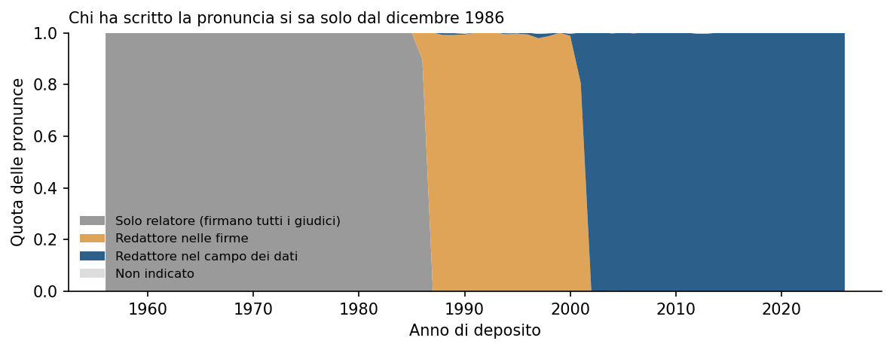
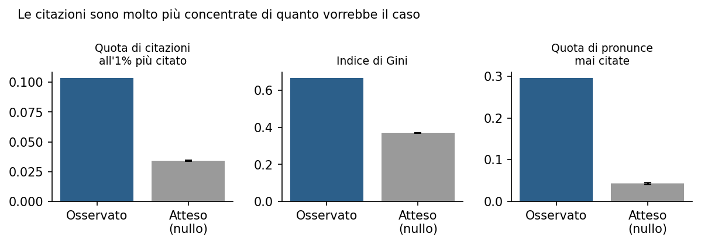
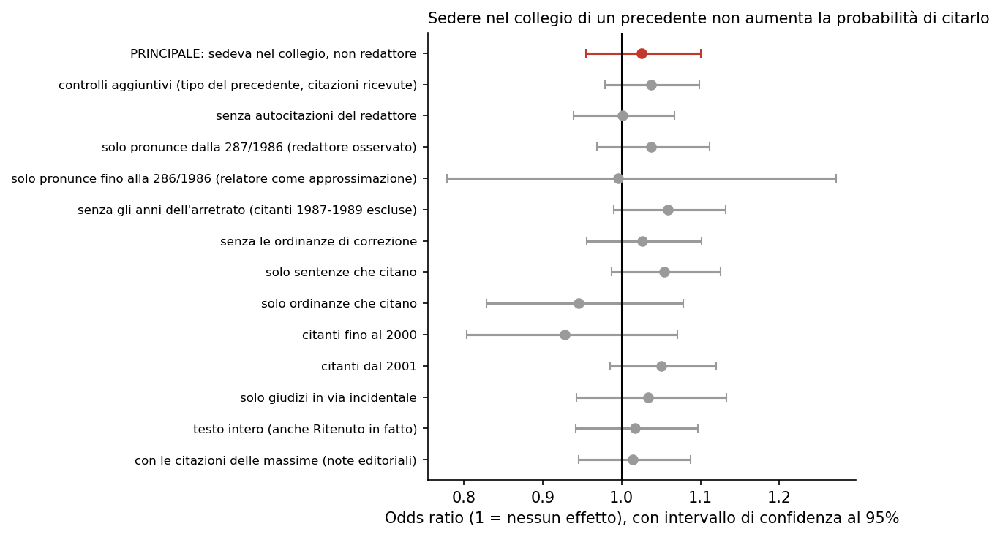

# Chi fa il precedente? La rete delle pronunce della Corte costituzionale, 1956–2026

**Relazione "for dummies"** · 16 novembre 2026 · Umberto Toraldo, con Claude Code

> Questa relazione spiega tutto il lavoro a chi non lo ha seguito: da quali dati siamo partiti, cosa abbiamo fatto e perché, cosa abbiamo trovato, cosa resta da fare. Ogni numero viene da uno script del repository; il file da cui è preso è indicato tra parentesi. Il tema non è ancora stato approvato dal docente.

## In una pagina

**La domanda.** In un ordinamento in cui il precedente non vincola, la Corte costituzionale costruisce comunque una gerarchia di precedenti? E quanto di quell'autorità passa attraverso i giudici che redigono e decidono le pronunce?

**Cosa abbiamo fatto.** Abbiamo preso tutte le 22.427 pronunce della Corte dal 1956 al 2026, abbiamo estratto dal testo le citazioni tra pronunce (93.467 legami) e le abbiamo incrociate con chi ha scritto ogni pronuncia e chi sedeva nel collegio che l'ha decisa.

**Cosa abbiamo trovato.**

1. **Risultato principale: nessuna "memoria collegiale" misurabile.** Un redattore non cita di più i precedenti decisi da collegi in cui sedeva, rispetto a quelli decisi mentre era in carica ma assente: odds ratio 1,00, intervallo di confidenza al 95% da 0,92 a 1,09. Il dato esclude effetti superiori al 9% circa in più o all'8% in meno; non dimostra che l'effetto sia esattamente zero.
2. **Però un redattore cita molto di più ciò che ha scritto lui**: odds ratio 5,47 (4,76–6,27), a parità di età e materia del precedente. È un risultato esplorativo, e la spiegazione resta aperta: una preferenza personale o la prassi di affidare allo stesso relatore le questioni che si ripetono (sezione 3.4).
3. **Una gerarchia di fatto esiste.** Le citazioni sono molto più concentrate di quanto vorrebbe il caso: l'1% delle pronunce più citate raccoglie il 10,3% delle citazioni, contro il 3,4% atteso.
4. **Pochi redattori si distinguono.** Su 113 giudici, dopo la correzione di Holm le pronunce di 7 sono citate più di pronunce prese a caso dello stesso anno e quelle di 8 meno; e chi è citato più dell'atteso in carica lo resta dopo il mandato, più di quanto darebbero le sole pronunce. Esplorativo.
5. **Due risultati della letteratura sulla Corte italiana non reggono**: la distribuzione delle citazioni non è una legge di potenza, e le pronunce più "autorevoli" secondo l'algoritmo HITS non coincidono con le più citate.

**Il "fattore wow"** è nella sezione 5.

## 1. Da dove siamo partiti: i dati

### 1.1 La fonte

Tutti i dati vengono dal portale open data della Corte costituzionale ([dati.cortecostituzionale.it](https://dati.cortecostituzionale.it)), con licenza CC BY-SA 3.0. Li abbiamo scaricati l'8 novembre 2026 con lo script `src/ingest/download.py`, che registra indirizzo, data e impronta SHA-256 di ogni file in `data/raw/MANIFEST.csv`: così si sa esattamente quale versione dei dati ha prodotto i risultati.

| Archivio | Cosa contiene | Quanto |
| --- | --- | --- |
| Pronunce | Il testo completo di ogni decisione, con anno, numero, tipo, presidente, relatore, redattore, date di decisione e di deposito, elenco dei giudici del collegio | 22.427 pronunce: 11.735 sentenze e 10.692 ordinanze, un file XML per anno, 1956–2026 |
| Massime | I riassunti dei principi di diritto di ogni pronuncia, scritti dall'Ufficio del massimario, con il tipo di giudizio | 46.658 massime |
| Giudici | Nome, organo che li ha eletti o nominati, date di giuramento e cessazione, breve biografia | 125 giudici |

In più, tramite due servizi di interrogazione (API):

- l'**endpoint SPARQL** della Corte, per l'esito delle pronunce dal 2005 (6.741 pronunce, 33 tipi di esito) e per i membri delle sedute, usati come controllo;
- le **API di Wikipedia** in italiano, per sapere quali pronunce sono richiamate da una voce dell'enciclopedia (283 pronunce).

### 1.2 Com'è fatta una pronuncia

Ogni pronuncia ha un'intestazione con i campi strutturati e un testo diviso in parti:

- il **collegio**: l'elenco dei giudici che hanno deciso, da 11 a 15;
- l'**epigrafe**: chi ha sollevato la questione e su quale norma;
- nelle sentenze, il **«Ritenuto in fatto»**, che riassume gli argomenti delle parti, e il **«Considerato in diritto»**, che è il ragionamento della Corte;
- il **dispositivo**: la decisione, seguita dalle firme.

Nelle ordinanze il ragionamento («Considerato che…») sta dentro l'epigrafe.

### 1.3 Cosa i dati non dicono, e bisogna sapere

Una pronuncia non è l'opera di un giudice. La decide un collegio a maggioranza, in camera di consiglio; il voto non è pubblico e non esistono opinioni dissenzienti. Poi un giudice, il **redattore**, scrive la motivazione, e il collegio approva il testo. Di regola il redattore è il **relatore**, cioè il giudice che ha studiato la causa. Per questo nella relazione si scrive sempre "pronunce redatte da X", mai "decisioni di X".

Ispezionando i file abbiamo scoperto tre cose che cambiano il lavoro (`reports/data_inspection.md`):

- **Il redattore è registrato solo dal 23 dicembre 1986** (Figura 2). Fino alla pronuncia 286/1986 firmavano tutti i giudici e si conosce solo il relatore. Dalla 287/1986 al 2001 il redattore compare solo nelle firme in fondo al testo; dal 2002 è un campo dei dati.
- **L'anno e il numero di una pronuncia seguono il deposito**, non la decisione. La numerazione riparte ogni anno, è unica per sentenze e ordinanze e non ha buchi: anno più numero identifica una pronuncia senza ambiguità.
- **L'anagrafica dei giudici ha errori**: 33 date di cessazione mancanti e alcune sbagliate (Spagnoli, Granata, Chiarelli, Mezzanotte).


*Figura 1. Pronunce depositate per anno, per tipo. Fonte: archivio delle pronunce.*



*Figura 2. Da dove si ricava il nome di chi ha scritto la pronuncia, per anno di deposito.*

## 2. Cosa abbiamo fatto, passo per passo

### 2.1 Il piano, e come è stato messo alla prova

Il piano è stato scritto prima dei risultati e sottoposto a più revisioni (`docs/decisions.md`). Le revisioni hanno cambiato quattro cose importanti:

- il disegno di D3: "sedeva nel collegio" coincide quasi con "il precedente è recente", quindi si confrontano solo precedenti decisi durante il mandato del redattore, con lui presente oppure assente;
- un modello nullo diverso per ogni statistica, sempre rispettoso del tempo;
- il risultato principale, le soglie di qualità e i criteri di decisione fissati **prima** di guardare i dati;
- l'allargamento a topic, API e Wikipedia, per aderire ai contenuti del corso.

### 2.2 Preparazione dei testi

Script: `src/ingest/build_pronunce.py`.

- Gli spazi e gli a capo dei testi sono stati normalizzati. Un controllo fatto senza questa operazione dava un dato sbagliato ("Considerato che" solo nel 50% delle ordinanze); con gli spazi normalizzati la formula compare nel 96%.
- Ogni testo è stato diviso in sezioni. Il **testo di base** per le citazioni è il ragionamento della Corte più il dispositivo: «Considerato in diritto» nelle sentenze, «Considerato che» nelle ordinanze. Il «Ritenuto in fatto» è escluso, perché riporta le citazioni delle parti e non della Corte.
- In 322 testi (1,4% delle pronunce: 305 ordinanze e 17 sentenze) la divisione non è riuscita e si usa il testo intero (`reports/numbers.json`).

### 2.3 Estrazione delle citazioni

Script: `src/extract/citations.py`. Una citazione è una parola chiave (sentenza, ordinanza, sent., ord., decisione…) seguita da uno o più numeri con il loro anno. L'estrattore riconosce:

- la forma semplice: "sentenza n. 120 del 2019";
- gli elenchi con l'anno detto una volta sola: "sentenze n. 26 e n. 320 del 2007", "nn. 26 e 320 del 2007";
- la barra e gli spazi mancanti: "n.4/2008", "sent. 174/1972";
- le forme antiche con la data: "sentenza 19 giugno 1956, n. 9";
- "in pari data", per le pronunce depositate lo stesso giorno.

Scarta ciò che non è una pronuncia della Corte: le ordinanze dei giudici che sollevano la questione ("reg. ord."), le sentenze di altre corti (Cassazione, Consiglio di Stato, TAR, Corte europea) e gli atti amministrativi.

**Cosa ne è uscito** (`data/processed/`):

| Voce | Numero |
| --- | --- |
| Menzioni valide in tutto il testo | 155.982 |
| Menzioni scartate dal filtro (altre corti, ordinanze di rimessione, senza anno) | 9.174 |
| Menzioni verso pronunce inesistenti o successive | 1.950 |
| Menzioni tra pronunce depositate lo stesso giorno, tenute a parte | 268 |
| **Legami distinti nel testo di base** | **93.467**, da 16.944 pronunce |

Nell'1,3% delle menzioni il tipo scritto (sentenza o ordinanza) non coincide con il tipo vero della pronuncia citata.

### 2.4 Validazione dell'estrazione

Le soglie erano fissate prima: precisione almeno 0,95 e richiamo almeno 0,90. La **precisione** è la quota di citazioni estratte che sono vere; il **richiamo** è la quota di citazioni vere che l'estrattore trova.

L'annotazione di riferimento l'ha fatta Claude, **non una persona**, prima di far girare l'estrattore su quei testi, e leggendo solo i passi che contengono una parola chiave o un richiamo, non i testi interi. È il limite più importante di questa parte: le parole chiave del filtro somigliano a quelle dell'estrattore, quindi una forma di citazione che nessuno dei due riconosce sfuggirebbe a entrambi, e il richiamo risulterebbe più alto del vero. Per questo è pronto un foglio per il controllo di una persona: 36 pronunce mai usate, con il testo intero e senza il risultato dell'estrattore (`data/validation/human_check.md`; quadro in `reports/validation.md`).

| Campione | Pronunce | Coppie vere | Precisione (IC 95%) | Richiamo (IC 95%) |
| --- | --- | --- | --- | --- |
| Primo campione di verifica, tutti i decenni | 64 | 270 | 1,000 (0,985–1,000) | 0,941 (0,906–0,963) |
| di cui pronunce fino alla 286/1986 | 27 | 40 | 1,000 | **0,750**: sotto soglia |
| Secondo campione indipendente, solo fino alla 286/1986, dopo la correzione dell'estrattore | 48 | 72 | 0,985 (0,920–0,997) | 0,917 (0,830–0,961) |

Il primo campione ha mostrato che l'estrattore perdeva le forme antiche. Come previsto dalle regole, ci siamo fermati, lo abbiamo corretto e lo abbiamo verificato su un secondo campione mai visto. Le coppie annotate sono 342 in tutto, meno delle 460 previste: gli intervalli sono più larghi di quanto pianificato, soprattutto per i testi più vecchi (quadro in `reports/validation.md`; dettagli in `validation_round1.md` e `validation_test2.md`). Per i testi fino al 1986 la stima supera la soglia, ma il limite inferiore dell'intervallo (0,830) no.

**Un controllo in più, indipendente.** Anche le massime, scritte dall'Ufficio del massimario, elencano i precedenti citati. Passandole allo stesso estrattore si trovano 46.737 coppie: il 95,4% è già nella rete estratta dal testo di base. Le 2.129 coppie in più (il 2,3% della rete) servono per una variante di D3 (`reports/massime_citations.json`, script `src/extract/citations_massime.py`).

### 2.5 Giudici, redattori e collegi

Script: `src/judges/build_judges.py`.

- **Redattore**: preso dal campo (8.384 pronunce), dalle firme (8.349) o, fino alla 286/1986, dal relatore come approssimazione (5.678). Abbinato all'anagrafica nel **99,84%** delle pronunce (soglia 98%).
- **Collegio**: i cognomi dei giudici in carica cercati nell'elenco in testa alla pronuncia. Collegio riconosciuto per intero nel **98,85%** delle pronunce (soglia 98%).
- **Mandati**: le date di fine dell'anagrafica non sono affidabili, quindi l'inizio e la fine dell'attività di ogni giudice sono la sua prima e ultima comparsa in un collegio.

Due controlli con una seconda fonte ufficiale, l'endpoint SPARQL: il relatore coincide nel 97,12% dei casi, e le differenze sono due errori di grafia nei file; i giudici delle sedute compaiono nel collegio estratto nel 99,1% dei casi (`reports/sparql_reconciliation.md`, `reports/collegio_vs_sedute.json`).

### 2.6 Le reti

Script: `src/networks/build.py`. Per ogni rete: cos'è un nodo, cos'è un legame, se ha un verso, se ha un peso.

| Rete | Nodo | Legame | Verso | Peso |
| --- | --- | --- | --- | --- |
| Citazioni | Pronuncia | A cita B nel testo di base | Da chi cita a chi è citato, sempre verso il passato | Nessuno (una coppia conta una volta) |
| Redazione | Giudice e pronuncia | Il giudice ha redatto la pronuncia | — | — |
| Collegio | Giudice e pronuncia | Il giudice sedeva nel collegio | — | — |
| Influenza tra giudici | Giudice | Le pronunce redatte da A citano pronunce redatte da B | Da A a B | Numero di citazioni |

**Perché una rete.** L'autorità di un precedente non sta scritta in nessun campo: emerge da chi lo cita. E il contributo di un giudice si vede solo incrociando chi cita, chi è citato e chi era presente.

### 2.7 La materia: un modello di topic

Script: `src/analysis/topics.py`. Per confrontare precedenti "a parità di materia" serve la materia di ogni pronuncia. L'abbiamo ricavata dai testi delle massime con un modello LDA, che raggruppa le parole che compaiono insieme in "temi".

- Numero di temi: provati 10, 20, 30, 40, 50, 60; scelto il più piccolo con coerenza entro il 2% della migliore: **20**.
- La materia di una pronuncia è la media dei temi delle sue massime.
- Verifica: i temi concordano con i titoli delle massime (informazione mutua 0,31 contro 0,03 rimescolando) e con gli articoli della Costituzione invocati (0,18 contro 0,01).

Esempi di temi: lavoro e pensioni; processo penale; competenze delle Regioni; imposte; conflitti tra poteri. Alcuni temi però raccolgono formule di stile più che una materia, e la stabilità tra ripetizioni è modesta (0,31): è un limite (`reports/topics.md`).

### 2.8 Le misure e i modelli, uno per domanda

**Il principio comune: confrontare con il caso.** Un numero da solo non dice nulla. Ogni risultato è confrontato con un **modello nullo**: una versione rimescolata dei dati che conserva ciò che è ovvio (quante citazioni fa ogni pronuncia, quanto sono vecchi i precedenti citati) e distrugge il resto. Se il dato vero sta fuori dall'intervallo dei dati rimescolati, c'è qualcosa oltre il caso. Ripetizioni: 1.000 (10.000 per i giudici di D2, 100 per alcune misure secondarie), seed fisso.

| Domanda | Misura | Con cosa si confronta |
| --- | --- | --- |
| D1: le citazioni sono concentrate? | Indice di Gini, quota di citazioni all'1% più citato, quota di pronunce mai citate | Ogni citazione mantiene chi cita e l'anno del bersaglio; il bersaglio è ripescato a caso tra le pronunce di quell'anno (variante: dello stesso anno e tipo) |
| D1: che forma ha la distribuzione? | Legge di potenza contro lognormale, metodo di Clauset, Shalizi e Newman | Test del rapporto di verosimiglianza |
| D1: authority e citazioni coincidono? | HITS e PageRank; correlazione tra le classifiche, sovrapposizione nell'1% più alto | Scambi di citazioni tra coppie con gli stessi anni (alla Uzzi), che conservano le citazioni fatte e ricevute da ognuno |
| D1: l'authority aggiunge informazione? | Previsione delle citazioni dell'anno dopo, stimata fino al 2010 e verificata sul 2011–2025 | Stesso modello senza authority; criterio fissato prima: almeno il 2% di errore in meno |
| D1b: quanto dura un precedente? | Frequenza di citazione per età; curva di sopravvivenza (Kaplan–Meier) | Scelta uniforme tra i precedenti disponibili |
| D2: le pronunce di un redattore sono citate più dell'atteso? | Citazioni osservate / attese, senza autocitazioni | Redattori rimescolati tra le pronunce dello stesso anno, che conservano le citazioni ricevute (10.000 volte); correzione di Holm per 113 test |
| D3: memoria collegiale | Regressione logistica condizionata, verosimiglianza esatta | Dentro ogni pronuncia che cita: i precedenti citati contro 50 non citati |
| D4: ci si cita tra simili? | Quota di citazioni tra giudici dello stesso gruppo | Etichette rimescolate tra giudici entrati nello stesso decennio |

**D3 in dettaglio**, perché è il risultato principale. Per ogni pronuncia che cita, con redattore R:

1. si prendono i precedenti decisi mentre R era in attività e depositati prima;
2. si separano quelli citati dai non citati, e dei non citati se ne estraggono 50 a caso;
3. per ogni precedente si registra: R l'ha redatto? R sedeva nel collegio senza redigerlo? Quanti anni ha? Quanto è simile per materia?
4. il modello stima quanto ciascuna caratteristica aumenta la probabilità di essere citato, confrontando solo precedenti dentro la stessa pronuncia che cita.

Il confronto decisivo è tra precedenti in cui R **sedeva** e precedenti in cui R era **assente** pur essendo in carica: stessa epoca, stesso giudice, cambia solo la presenza. Le assenze sono frequenti (i collegi hanno da 11 a 15 giudici), e questo rende il confronto possibile. Gli errori standard tengono conto che le pronunce dello stesso redattore si somigliano.

## 3. Risultati

### 3.1 La rete, descritta

(`reports/network_basic.json`)

- 22.427 pronunce, 93.467 citazioni, nessun ciclo.
- La rete è sparsa: ogni pronuncia cita in media 4,2 precedenti, e la densità è 0,00037 (lo 0,037% dei legami possibili verso il passato).
- L'86% delle pronunce forma un unico blocco connesso; 2.629 (12%) non citano e non sono citate.
- Una sentenza riceve in media 6,4 citazioni, un'ordinanza 1,7.
- Si cita sempre di più: da 1 precedente per pronuncia negli anni Cinquanta a 14,7 negli anni Venti di questo secolo.
- Si cita il recente: metà delle citazioni va a precedenti con meno di 3,5 anni; solo il 9% a precedenti con più di 20.
- La catena più lunga di precedenti che si citano l'un l'altro ha 148 anelli.

### 3.2 D1 — Esiste una gerarchia di fatto

(`reports/d1_results.json`)

| Misura | Osservato | Atteso dal caso, bersaglio dello stesso anno (IC 95%) | Atteso dal caso, bersaglio dello stesso anno e tipo (IC 95%) |
| --- | --- | --- | --- |
| Quota di citazioni all'1% più citato | 10,3% | 3,4% (3,4–3,5) | 4,2% (4,1–4,2) |
| Indice di Gini | 0,66 | 0,37 (0,37–0,37) | 0,48 (0,48–0,48) |
| Pronunce mai citate | 29,5% | 4,3% (4,1–4,5) | 12,8% (12,5–13,0) |
| Citazioni della pronuncia più citata | 113 | 21 (18–23) | 25 (22–28) |

Le ordinanze sono citate molto meno delle sentenze: non è mai citato il 45,7% delle ordinanze e il 14,8% delle sentenze. Il primo modello nullo, fissato prima, non ne tiene conto; il secondo, aggiunto dopo il check del 17/11/2026, ripesca il bersaglio anche tra pronunce dello stesso tipo. Il divario si riduce ma resta ampio: la gerarchia non è solo la differenza tra sentenze e ordinanze.



*Figura 4. Concentrazione delle citazioni ricevute, osservata e attesa sotto il modello nullo (barra d'errore: intervallo al 95% su 1.000 ripetizioni).*

Le pronunce più citate sono la 303/2003, la 401/2007 e la 383/2005: tutte decise in giudizi in via principale (il tipo di giudizio indicato nelle massime), dopo la riforma del 2001.

**Non è una legge di potenza.** La lognormale descrive la coda meglio della legge di potenza (rapporto di verosimiglianza −7,5, p < 0,001; esponente stimato 2,92 da 10 citazioni in su). Agnoloni e Pagallo (2016, pp. 142–143) avevano proposto una legge di potenza (α = 2,414) adattata sulla scala log-log, senza test formali né confronto con altre distribuzioni, e su una rete diversa: le sole pronunce in via incidentale, 16.320 nodi (Figura 3).

**Le più autorevoli non sono le più citate.** Sulla rete completa, l'1% più autorevole secondo HITS e l'1% più citato si sovrappongono per il 41,5%; a parità di citazioni ricevute, il caso darebbe il 55,7% (53,1–58,0). Chi ti cita conta, non solo quante volte (Figura 6).

**La replica di Agnoloni e Pagallo non riesce.** Loro scrivono che le prime 30 pronunce per citazioni sono le stesse prime 30 per authority. Sul loro sottoinsieme (sentenze in via incidentale fino al 2014: 6.561 pronunce) solo 4 delle prime 30 per authority sono tra le prime 30 per citazioni. Il loro sottoinsieme però non è identico al nostro, e il loro calcolo non è descritto. Nella loro tabella 5 le pronunce con lo stesso numero di citazioni hanno esattamente la stessa authority (p. 144): segno che la loro misura coincideva con il numero di citazioni.

**Ma l'authority non aiuta a prevedere.** Aggiungerla al modello che prevede le citazioni dell'anno dopo **non** riduce l'errore: lo aumenta dello 0,27% (0,10–0,42). Il criterio fissato prima (almeno il 2% in meno) non è soddisfatto. Quindi HITS individua un nucleo diverso, ma per sapere quanto sarà citata una pronuncia basta contare quanto è già stata citata. Un limite di HITS su questa rete: un terzo delle pronunce ha authority nulla.

**Filoni.** La rete si divide in 34 comunità con almeno 50 pronunce, che coprono l'86% dei nodi (modularità 0,68, contro 0,29 di una rete rimescolata). Le comunità seguono la materia: accordo con i topic 0,22, contro 0,006 del caso (`reports/extras.json`). Con un secondo metodo, Infomap, le comunità sono più piccole e più numerose (63 con almeno 50 pronunce, che coprono solo il 28% dei nodi), l'accordo con Leiden è 0,71 su una scala da 0 a 1 e quello con i topic 0,35: che i filoni seguano la materia non dipende dal metodo, quanti siano sì.

**Da esplorare.** [`reports/rete_interattiva.html`](rete_interattiva.html) mostra le 400 pronunce più citate e le 2.170 citazioni tra di loro: si apre in un browser, senza installare nulla.

### 3.3 D1b — Un precedente invecchia in fretta

- La frequenza di citazione è massima a un anno dal deposito (5,8 volte la scelta uniforme), si dimezza in 3 anni e scende sotto la scelta uniforme dopo 9 (Figura 5).
- La "vita" mediana di una pronuncia, dal deposito all'ultima citazione ricevuta, è 6 anni: 19 per le sentenze, 1 per le ordinanze.
- Un'ossatura stabile esiste: il 13,4% delle pronunce con almeno trent'anni è stato citato ancora dopo trent'anni.


*Figura 5. Frequenza di citazione per età del precedente, rispetto alla scelta uniforme tra i precedenti disponibili (linea tratteggiata).*

### 3.4 D3 — Risultato principale: non c'è memoria collegiale, c'è la penna

(`reports/d3_results.md`)

| Il redattore, rispetto a un precedente deciso in sua assenza | Odds ratio | IC 95% | p |
| --- | --- | --- | --- |
| **sedeva nel collegio senza averlo redatto** (risultato principale) | **1,00** | 0,92–1,09 | 1,00 |
| l'ha redatto lui | 5,47 | 4,76–6,27 | < 0,001 |

Base: 13.654 pronunce che citano, 46.969 citazioni, di cui 1.658 a precedenti decisi in assenza del redattore; 122 redattori.

**Il calcolo.** Il modello è la regressione logistica condizionata con la verosimiglianza esatta, che considera tutti i modi in cui i precedenti citati da una pronuncia potevano essere scelti tra quelli disponibili. Fino al 17/11/2026 si usava un'approssimazione (di Breslow) che, quando una pronuncia cita molti precedenti, schiaccia verso 1 gli effetti forti: dava 1,03 e 3,01. La verosimiglianza calcolata dal nostro codice coincide con quella di una seconda implementazione indipendente (statsmodels) sugli stessi dati.


*Figura 8. Odds ratio di citazione per i precedenti redatti dal redattore e per quelli decisi da un collegio in cui sedeva, rispetto ai precedenti decisi in sua assenza. Barre: intervalli al 95%.*

**Come si legge.** Avere partecipato alla decisione di un precedente non lo rende più citato da quel giudice: le differenze compatibili con i dati sono piccole, entro il 9% circa. Averlo scritto sì, e di molto. L'ipotesi di partenza ("il precedente circola attraverso le persone che lo hanno deciso") non trova sostegno; resta in piedi una forma più stretta, ancora da spiegare: il precedente circola attraverso chi lo ha scritto.

**Tiene in tutte le varianti** (Figura 7): senza autocitazioni 0,99 (0,91–1,08); solo dal 1987, dove il redattore è osservato, 1,01 (0,93–1,10); senza gli anni dell'arretrato 1,04 (0,96–1,13); sul testo intero 0,99 (0,90–1,09); aggiungendo le citazioni delle massime 0,99 (0,91–1,08); con altri cinque campioni di controlli tra 0,98 e 1,01. Nessuna variante esclude l'1.

Nel modello completo, che usa anche la soglia del giuramento, i precedenti decisi durante il mandato del redattore sono citati meno di quelli della stessa età decisi prima del suo arrivo, sia quando sedeva (0,88; 0,80–0,96) sia quando era assente (0,88; 0,77–1,01). Presenza e assenza, di nuovo, non differiscono.



*Figura 7. Odds ratio di "sedeva nel collegio senza redigere" nell'analisi principale (in rosso) e nelle varianti.*

**Cautela sul 5,47.** I relatori li sceglie il Presidente, con criteri non pubblici. Due spiegazioni non si escludono: un giudice che segue sempre la stessa materia cita i propri precedenti perché sono quelli pertinenti; e le questioni che si ripetono (la stessa norma portata alla Corte da più giudici) possono essere affidate allo stesso relatore, che poi richiama la propria decisione. L'effetto è più forte nelle ordinanze (9,83) che nelle sentenze (3,53), e prima del 2001 (8,74) che dopo (3,64): è il profilo che ci si aspetta dalle questioni ripetute, spesso decise con ordinanza. La somiglianza di materia è nel modello, ma i topic sono grossolani. Il 5,47 è quindi un limite superiore dell'effetto "personale".

### 3.5 D2 — Pochi redattori si distinguono (esplorativo)

(`reports/d2_results.json`)

**Come si misura.** Per ogni giudice: citazioni ricevute dalle pronunce che ha redatto, escluse le autocitazioni, divise per quelle attese. L'atteso e la variabilità vengono dal rimescolamento dei redattori: le pronunce di ogni anno si riassegnano a caso tra i redattori di quell'anno, e ogni pronuncia porta con sé le citazioni che ha davvero ricevuto da pronunce di altri redattori. 10,000 rimescolamenti; i valori p vengono dal loro conteggio.

- Su 113 giudici con almeno 30 pronunce, dopo la correzione di Holm le pronunce di **7** sono citate più dell'atteso e quelle di **8** meno; per gli altri la differenza non si distingue dal caso (Figura 9).
- Le differenze tra giudici sono comunque più ampie di quelle dei rimescolamenti: la varianza del logaritmo del rapporto è 3,6 volte quella attesa (p < 0,001).
- In testa: Baldassarre (1,95; 1,66–2,27), Onida (1,73; 1,39–2,09), Crisafulli (1,67; 1,28–2,10); l'atteso è 1.
- Tenendo conto anche del tipo di pronuncia, 4 sopra e 6 sotto; anche della materia, 2 e 5. Con le sole pronunce dalla 287/1986, dove il redattore è osservato, 7 e 8 su 74 giudici.
- **Dopo il mandato.** Per gli 87 giudici usciti entro il 2015, chi era citato più dell'atteso in carica lo è anche nei dieci anni successivi: correlazione tra ranghi 0,66. Una parte è meccanica, perché le stesse pronunce restano citate: con pronunce prese a caso dello stesso anno la correlazione sarebbe 0,37 (95%: 0,16–0,55). Il dato osservato sta sopra (p < 0,001); a parità anche di tipo e materia, 0,62 contro 0,32 (0,12–0,51) (Figura 10).


*Figura 9. Rapporto tra citazioni osservate e attese per le pronunce redatte da ciascun giudice, con l'intervallo al 95% ottenuto ricampionando le sue pronunce. In blu i giudici che si distinguono dal caso dopo la correzione di Holm.*


*Figura 10. Rapporto tra citazioni osservate e attese durante il mandato e nei dieci anni dopo, per i giudici usciti entro il 2015.*

**Perché D2 è esplorativo.** Il modello nullo fissato prima (ogni citazione ripescata a caso tra le pronunce dello stesso anno) dà lo stesso atteso, ma ignora quanto diversamente sono citate le pronunce: con quel nullo i giudici fuori dall'atteso erano 27 e 39, con una dispersione 29 volte il caso. Passare al rimescolamento dei redattori è il secondo cambiamento fatto in D2 dopo aver visto i risultati (il primo, i valori p dalle deviazioni standard, è ora superato): per questo D2 va letto come esplorativo. Entrambi i nulli restano nel file dei risultati.

Resta il limite della materia: i topic sono grossolani, e i redattori non sono assegnati a caso.

### 3.6 D4 — Poca omofilia

(`reports/d4_results.json`) La potenza simulata per un effetto del 20% è 1,00 per l'organo e 1,00 per la provenienza: il test si poteva fare. Le soglie erano fissate prima: un effetto minimo d'interesse del 20% e la correzione di Holm sui due test.

- **Organo di nomina** (Presidente della Repubblica, Parlamento, magistrature): le citazioni tra giudici dello stesso gruppo sono il 32,4%, contro il 31,6% atteso (30,7–32,7); p = 0,074, 0,074 con Holm. Nessun effetto.
- **Provenienza** (professori, magistrati; gli avvocati sono solo 3): 48,4% contro 46,1% (44,4–48,0); p = 0,011, 0,022 con Holm. L'eccesso è del 4,9%, molto sotto l'effetto minimo d'interesse: omofilia trascurabile, non una scoperta. La provenienza è codificata in automatico dalla nota biografica dell'anagrafica dei giudici.

### 3.7 Due risultati in più, con le API

- **Esito.** Tra le pronunce del 2006–2015, quelle che dichiarano un'illegittimità costituzionale ricevono in dieci anni 10,9 citazioni in media, le altre 4,0: 2,7 volte (2,5–2,9). Tra le sole sentenze, 1,6 volte (1,4–1,7).
- **Wikipedia.** Solo l'1,3% delle pronunce è richiamato da una voce. Tra l'1% più autorevole la quota è 8,5%, tra l'1% più citato 10,7%: le pronunce importanti nella rete sono anche quelle note fuori, e di nuovo il conteggio delle citazioni fa almeno bene quanto HITS. È un confronto descrittivo, su pochi casi.

## 4. Cosa risponde alla domanda

- **La Corte costruisce una gerarchia di precedenti?** Sì, di fatto: poche pronunce concentrano le citazioni molto oltre il caso, un'ossatura resta citata per decenni, la rete si organizza in filoni per materia. Ma il grosso dei precedenti è consumato in pochi anni.
- **Quanto passa dai giudici?** Dal collegio, nulla che si riesca a misurare. Dal redattore, molto: le probabilità (odds) che citi ciò che ha scritto sono circa cinque volte e mezzo quelle di un precedente deciso in sua assenza, e le pronunce di pochi redattori pesano più di quanto darebbe il caso, anche dopo che hanno lasciato la Corte (esplorativo).

## 5. Il "fattore wow"

Tre cose che un docente di analisi delle reti difficilmente si aspetta, tutte verificabili nel repository:

1. **Un risultato nullo preannunciato.** L'ipotesi su cui il progetto era costruito non trova sostegno, con un intervallo che esclude effetti superiori al 9% circa (0,92–1,09) e con il criterio scritto prima dei risultati. Accanto c'è un effetto forte (5,47) per i precedenti scritti di proprio pugno: trovato guardando i dati, quindi esplorativo, e con due spiegazioni possibili (sezione 3.4). Il contrasto sta in una figura (Figura 8).
2. **Una scoperta fatta guardando i dati, non in letteratura.** Il 23 dicembre 1986, tra la pronuncia 286 e la 287, la Corte smette di far firmare tutti i giudici e comincia a indicare il redattore. Il cambio si vede al giorno nei testi, mentre la dottrina lo data alla norma del luglio 1987. Senza accorgersene, metà dell'analisi sui giudici sarebbe stata costruita su un dato che non esiste.
3. **Due risultati pubblicati che non reggono al controllo**: la legge di potenza e l'identità tra authority e citazioni, entrambi di Agnoloni e Pagallo. Qui sono testati contro alternative e modelli nulli, come chiede la critica di Frankenreiter (2017).

Sono risultati esplorativi, non preannunciati, solo il punto 2 e la replica al punto 3: vanno presentati come tali.

## 6. Limiti

| Limite | Quale risultato tocca | In che direzione |
| --- | --- | --- |
| L'annotazione di riferimento è di Claude, non di una persona; 342 coppie invece di 460 | Tutta la rete | Se l'annotatore e l'estrattore sbagliano allo stesso modo, precisione e richiamo sono sovrastimati |
| Richiamo più basso nei testi fino al 1986 (0,92; limite inferiore 0,83) | D1b, D2 per i giudici più antichi | Citazioni ai precedenti antichi sottostimate |
| Prima del 1987 il redattore è approssimato dal relatore | D2, D3 | Attenua le differenze; la variante dal 1987 dà lo stesso risultato per D3 |
| I relatori non sono assegnati a caso | Il 5,47 di D3, le classifiche di D2 | Gonfia l'effetto del redattore |
| Le assenze dal collegio possono non essere casuali | D3 principale | Incerta; nel modello completo, che usa anche la soglia del giuramento, presenza e assenza non differiscono (0,88 in entrambi i casi) |
| I topic sono 20, in parte formule di stile, poco stabili | Il controllo per materia in D2, D3 | Controllo imperfetto |
| Citare non vuol dire approvare | Tutto | Un precedente può essere citato per discostarsene |
| Le pronunce recenti hanno avuto meno tempo per essere citate | D1, D2 | Gestito con percentili per annata e finestre fisse; le pronunce dal 2020 restano poco informative |
| HITS dà authority nulla a un terzo delle pronunce | Confronto authority e citazioni | PageRank, senza zeri, dà una sovrapposizione ancora più bassa (22%) |
| Provenienza dei giudici codificata in automatico | D4 | Errori di codifica attenuano l'effetto |

## 7. Cosa si potrebbe fare in più

**Fatto in questa sessione perché si poteva fare:** estrazione e validazione, tutti e tre gli strati, D1–D4, topic, esito via SPARQL, Wikipedia, comunità, sei varianti di D3.

**Aggiunto dopo la revisione finale, perché si poteva fare:**

- variante di D3 con le citazioni delle massime (note editoriali): 0,99 (0,91–1,08), stessa conclusione;
- Infomap accanto a Leiden;
- vista interattiva del nucleo della rete (`reports/rete_interattiva.html`);
- intervallo per la correlazione dopo il mandato e correzione di Holm sui due test di D4.

**Non fatto, pur essendo previsto, e perché:**

- modello nullo di Karrer e Newman come variante: su una rete orientata nel tempo richiede di ricostruire i blocchi rispettando l'ordine delle date; un'implementazione affrettata darebbe un nullo sbagliato, peggio di nessuno. Il nullo usato conserva già gradi e anni;
- percentile dell'authority su finestra di più anni: richiede di rifare il pannello annuale di D1 (HITS per 61 anni); non cambia il risultato principale e il criterio di previsione è già fallito con margine;
- nullo degli scambi anno per anno: 1.000 ripetizioni per 61 anni, circa 60 volte il costo attuale; è calcolato sulla rete finale, la serie annuale resta descrittiva;
- 118 coppie annotate in meno delle 460 previste: l'annotazione utile adesso è quella di una persona, non altre coppie annotate da me.

**Serve una persona o un accesso che non ho:**

- un'annotazione umana di un campione di citazioni, anche solo 100 coppie, per confermare la validazione;
- la risposta del docente su tema, perimetro, lingua e regole sull'uso dell'intelligenza artificiale;
- gli articoli a pagamento non letti (Black e Spriggs 2013; Agnoloni e Pagallo 2015): oggi non si possono citare;
- la traduzione in inglese, se il corso la chiede.

**Magari** (utile, costo medio):

- distinguere le citazioni di adesione da quelle di distacco ("contrariamente a quanto affermato nella sentenza…");
- una materia più fine, usando gli articoli della Costituzione invocati, già presenti nell'86% delle massime;
- studiare i 93 casi in cui il relatore è stato sostituito: le pronunce "con dissenso" sono citate diversamente?

**Forse** (interessante, esito incerto):

- le citazioni di altre corti (Cassazione, Corte europea), che l'estrattore oggi scarta: una rete tra corti;
- l'effetto del Presidente, che assegna le cause: i relatori scelti da uno stesso Presidente si citano di più?
- un confronto con il Tribunale costituzionale tedesco, che ha dati simili.

**No:**

- l'analisi del sentiment sulle motivazioni: non ha un significato chiaro per un testo giuridico;
- attribuire "idee" o "voti" ai singoli giudici: i dati non lo permettono, il voto è segreto.

## 8. Come rifare tutto

```
python3 -m venv --system-site-packages .venv
.venv/bin/python -I src/ingest/download.py
.venv/bin/python src/ingest/inspect_raw.py
.venv/bin/python src/ingest/build_pronunce.py
.venv/bin/python src/extract/citations.py
.venv/bin/python src/extract/citations_massime.py
.venv/bin/python src/validation/evaluate.py test
.venv/bin/python src/validation/evaluate.py test2
.venv/bin/python src/judges/build_judges.py
.venv/bin/python src/analysis/topics.py
.venv/bin/python src/networks/build.py
.venv/bin/python src/ingest/fetch_api.py
.venv/bin/python src/analysis/d1_pronunce.py
.venv/bin/python src/analysis/d2_d4_giudici.py
.venv/bin/python src/analysis/d3_memoria_collegiale.py
.venv/bin/python src/analysis/extras.py
.venv/bin/python src/analysis/figures.py
.venv/bin/python src/analysis/interactive.py
```

Fonti e letteratura, con lo stato di lettura di ogni voce: `docs/sources.md`. Decisioni e scostamenti dal piano: `docs/decisions.md`.
