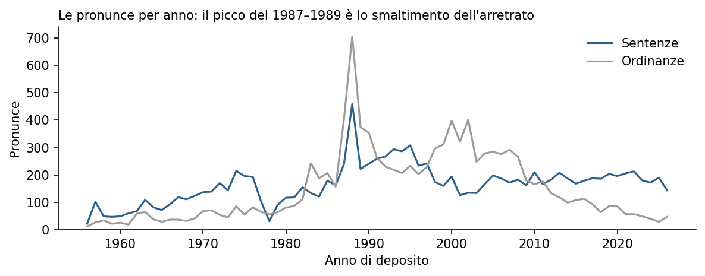
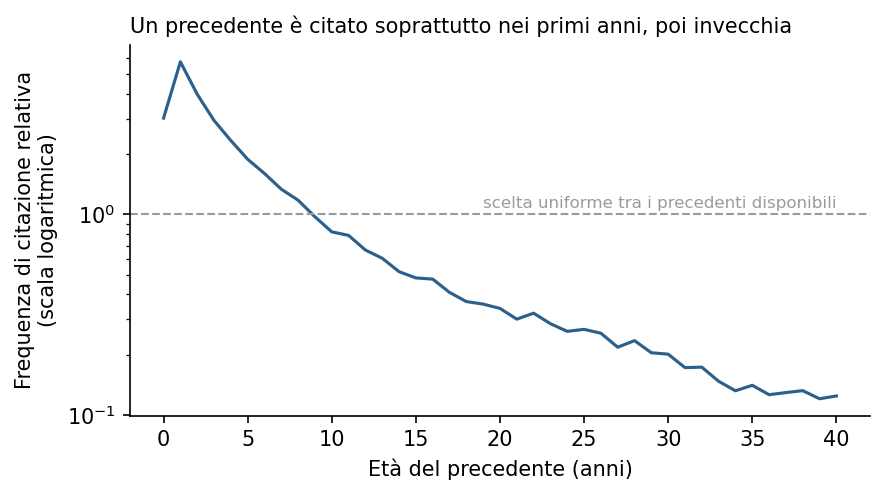
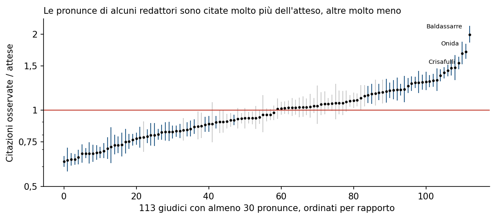
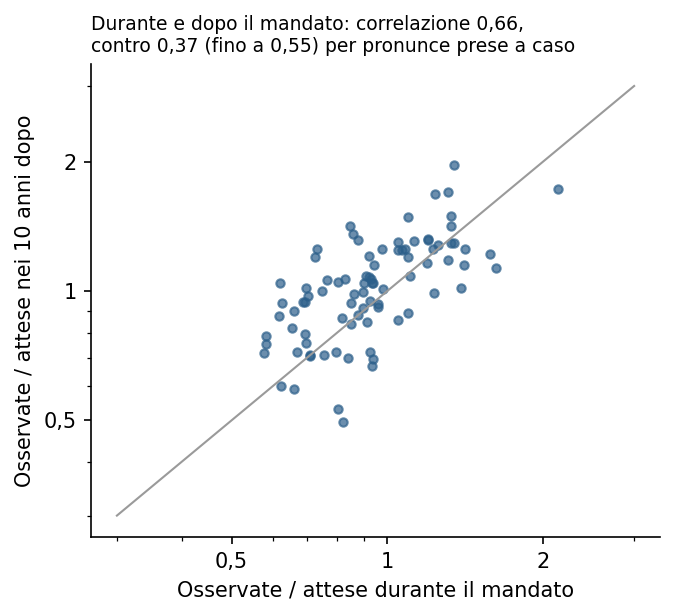

# Chi fa il precedente? La rete delle pronunce della Corte costituzionale, 1956–2026

Umberto Toraldo · Social Media and Web Analytics (EM1421), Università Ca' Foscari Venezia · novembre 2026 · lavoro svolto con Claude Code

> La relazione ha due livelli. La **Parte I** racconta in poche pagine la domanda, i dati e le tre idee principali, senza formule. La **Parte II** è l'appendice tecnica: dati, metodo, risultati completi, limiti, istruzioni per rifare tutto e corrispondenza con il programma d'esame. Ogni numero viene da uno script del repository; tra parentesi è indicato il file da cui è preso. Ogni risultato porta un'etichetta: *principale* (fissato prima di vedere i dati), *esplorativo* (trovato, aggiunto o cambiato dopo), *descrittivo*. Il tema non è ancora approvato dal docente.

## Parte I — Il lavoro in breve

### La domanda

In Italia il precedente non vincola: una pronuncia della Corte costituzionale non obbliga la Corte a decidere allo stesso modo in futuro. La Corte però cita di continuo le proprie pronunce. Da qui la domanda del lavoro, formulata prima di vedere i dati: in un ordinamento in cui il precedente non vincola, la Corte costituzionale costruisce comunque una gerarchia di precedenti? E quanto di quell'autorità passa attraverso i giudici che redigono e decidono le pronunce?

### I dati e il metodo, in breve

Il lavoro usa tutte le 22.427 pronunce della Corte dal 1956 al 2026, scaricate dal portale open data della Corte. Dal testo di ogni pronuncia sono state estratte le citazioni di pronunce precedenti: 93.467 legami. Ogni pronuncia è poi collegata al giudice che ne ha scritto la motivazione (il redattore) e ai giudici del collegio che l'hanno decisa. La pronuncia è della Corte: la decide il collegio, il redattore la scrive. Per questo si parla di "pronunce redatte da" un giudice, mai di sue "decisioni".

Un numero da solo non dice se qualcosa è grande o piccolo. Ogni risultato è quindi confrontato con un **modello nullo**: molte versioni dei dati rimescolate a caso, che conservano ciò che è ovvio (per esempio quante citazioni fa ogni pronuncia e quanto sono vecchi i precedenti citati) e cancellano il resto. Se il dato vero sta fuori dall'intervallo dei dati rimescolati, c'è qualcosa oltre il caso. Il risultato principale, le soglie di qualità e i criteri di decisione sono stati scritti prima dei risultati; ciò che è stato aggiunto o cambiato dopo è elencato nella sezione 2.9 dell'appendice.

### Prima idea: la Corte costruisce una gerarchia di fatto, ma la consuma in fretta

Le citazioni sono molto più concentrate di quanto darebbe il caso. L'1% delle pronunce più citate raccoglie il 10,3% delle citazioni. Se ogni citazione andasse a una pronuncia presa a caso tra quelle depositate nello stesso anno, quell'1% ne raccoglierebbe il 3,4%, e il 4,2% tenendo conto che le ordinanze sono citate molto meno delle sentenze. Esiste anche un'ossatura stabile: il 13,4% delle pronunce con almeno trent'anni viene citato ancora dopo trent'anni. Il grosso dei precedenti però invecchia presto: la frequenza di citazione è massima a un anno dal deposito e si dimezza in 3 anni, e metà delle citazioni va a precedenti con meno di 3,5 anni. La rete si organizza in filoni che in parte seguono la materia (sezioni 3.1–3.3).

Due affermazioni della letteratura sulla Corte italiana non reggono al controllo. La distribuzione delle citazioni ricevute non è una legge di potenza: la descrive meglio una distribuzione lognormale. E le pronunce più "autorevoli" secondo l'algoritmo HITS, che premia le pronunce citate da pronunce che citano molti precedenti autorevoli, non coincidono con le più citate. La differenza però dipende soprattutto da un fatto della rete: HITS vi concentra l'autorità in un solo gruppo di pronunce molto collegate tra loro (sezione 3.2).

### Seconda idea: il collegio non lascia una traccia misurabile; chi scrive sì

È il risultato principale, fissato prima di vedere i dati. La domanda: un giudice che scrive una pronuncia cita di più i precedenti decisi da collegi di cui faceva parte? Il confronto è tra precedenti decisi mentre il giudice era in carica, con lui presente oppure assente: stesso periodo, stesso giudice, cambia solo la presenza. Un giudice in carica manca dal 6,3% delle pronunce, e queste assenze rendono possibile il confronto.

La risposta è no, entro un margine stretto. La misura è l'**odds ratio**. Gli *odds* di essere citato sono la probabilità di essere citato divisa per quella di non esserlo; l'odds ratio dice quante volte sono più alti per un precedente deciso con il giudice presente che per uno deciso in sua assenza, e vale 1 se non c'è differenza. Il risultato è odds ratio 1,00, intervallo di confidenza al 95% da 0,92 a 1,09. Il dato esclude effetti superiori al 9% circa in più o all'8% in meno; non dimostra che l'effetto sia esattamente zero. Il risultato regge in tutte le varianti previste. Nulla indica che le assenze siano un artefatto dei dati: sono distribuite tra quasi tutti i giudici, i precedenti decisi con e senza il giudice si somigliano per età, materia e tipo, e quasi mai vengono da collegi letti male (sezione 3.4).

Chi scrive, invece, conta molto. Un redattore cita ciò che ha scritto lui con odds ratio 5,47 (4,76–6,27), a parità di età e materia del precedente. Non era tra le ipotesi fissate prima: è un risultato esplorativo. Gran parte dell'effetto viene dalle questioni che si ripetono, cioè dalla stessa norma portata davanti alla Corte più volte e affidata allo stesso relatore: il 40,0% dei precedenti scritti dallo stesso redattore che vengono citati riguarda la stessa disposizione impugnata. A parità di disposizione impugnata l'odds ratio scende a 3,27 (2,95–3,63). Quanto pesi questa riduzione dipende dalla scala: l'eccesso rispetto a 1 passa da 4,47 a 2,27, cioè si riduce del 49%; sulla scala logaritmica, quella in cui il modello è stimato, si riduce del 30%. In entrambi i casi resta un effetto netto, che può essere preferenza personale, specializzazione per materia o legame tra questioni che le massime non registrano.

### Terza idea: i giudici, presi uno per uno, pesano poco

**Pochi redattori si distinguono.** Su 113 giudici, dopo la correzione di Holm le pronunce di 6 sono citate più di pronunce prese a caso dello stesso anno e quelle di 7 meno. Esplorativo.

La correzione di Holm tiene conto dei molti test fatti insieme, uno per giudice. Per tutti gli altri giudici la differenza non si distingue dal caso. Le differenze tra giudici restano più ampie di quelle del caso, ma i giudici che si distinguono diventano ancora meno quando si tiene conto del tipo di pronuncia e della materia; se il peso di un giudice duri oltre il mandato resta incerto (sezione 3.5). Anche l'appartenenza a un gruppo conta poco: tra giudici con la stessa provenienza professionale le citazioni sono il 4,9% più frequenti dell'atteso, molto sotto l'effetto minimo d'interesse fissato prima (20%); tra giudici nominati dallo stesso organo non c'è differenza (sezione 3.6).

### Che cosa aggiunge il lavoro

1. **Un risultato nullo fissato prima e misurato con precisione** (principale). L'ipotesi su cui il progetto era costruito non trova sostegno, con un intervallo stretto e con il criterio scritto prima dei risultati. Accanto c'è un effetto forte dei precedenti scritti dallo stesso redattore, in buona parte spiegato dalle questioni ripetute (esplorativo). Il contrasto sta in una figura (Figura 8).
2. **Un fatto dei dati datato diversamente dalla dottrina** (descrittivo). Il 23 dicembre 1986, tra la pronuncia 286 e la 287, la Corte smette di far firmare tutti i giudici e comincia a indicare il redattore. Il cambio si vede al giorno nei testi, mentre la dottrina lo data alla norma del luglio 1987. Senza questo controllo, metà dell'analisi sui giudici avrebbe usato un dato che per quelle pronunce non esiste.
3. **Due risultati pubblicati messi alla prova** (esplorativo). La legge di potenza e l'identità tra authority e citazioni, entrambe di Agnoloni e Pagallo (2016), sono testate contro alternative e modelli nulli, come chiede la critica di Frankenreiter (2017): non reggono, con le cautele sulla replica dette nella sezione 3.2.

### Che cosa resta aperto

- **Il controllo di una persona sull'estrazione delle citazioni** (36 pronunce, foglio pronto). Oggi la qualità dell'estrazione è misurata da un annotatore automatico (Claude) che non è indipendente dallo strumento; quando ci sarà, l'annotazione della persona diventerà il riferimento per le soglie. È il passo più importante prima di qualsiasi estensione.
- **Il controllo di una persona sulla polarità delle citazioni** (67 passi), solo come verifica: lo strumento non ha superato la soglia fissata prima e non è stato usato nelle analisi (sezione 3.9).
- **L'approvazione del tema da parte del docente**, con le sue indicazioni su lingua, forma della consegna e uso dell'intelligenza artificiale.
- **I limiti principali** (sezione 4): i relatori non sono assegnati a caso; la materia è misurata in modo grossolano; il motivo delle assenze non è nei dati; citare non vuol dire approvare.

## Parte II — Appendice tecnica

### Glossario

- **Odds e odds ratio.** Gli odds di un evento sono la sua probabilità divisa per la probabilità che non accada: una probabilità del 20% dà odds 0,25. L'odds ratio è il rapporto tra gli odds di due gruppi: 1 vuol dire nessuna differenza, 2 odds doppi, 0,5 odds dimezzati.
- **Intervallo al 95%.** L'insieme dei valori compatibili con i dati, costruito in modo da contenere il valore vero in 95 ripetizioni dello studio su 100.
- **Modello nullo.** Una versione dei dati rimescolata a caso, che conserva alcune caratteristiche (per esempio quante citazioni fa ogni pronuncia) e ne cancella altre. Ripetuta molte volte con un seme fisso, dice che cosa ci si aspetterebbe per caso.
- **Valore p e correzione di Holm.** Il valore p è la probabilità di osservare un risultato almeno così lontano dall'atteso se valesse il caso. Con molti test, alcuni risultano "significativi" per caso: la correzione di Holm alza la soglia in modo che la probabilità di anche un solo falso positivo resti sotto il 5%.
- **Regressione logistica condizionata.** Un modello che stima quanto una caratteristica aumenta gli odds di essere citato, confrontando ogni precedente solo con gli altri precedenti disponibili per la stessa pronuncia che cita.
- **Verosimiglianza esatta e approssimazione di Breslow.** Due modi di stimare quel modello. Quello esatto considera tutti i modi in cui una pronuncia poteva scegliere i precedenti che cita; l'approssimazione di Breslow è più rapida ma, quando una pronuncia cita molti precedenti, schiaccia verso 1 gli effetti forti.
- **Errori standard raggruppati.** Un calcolo dell'incertezza che tiene conto che le pronunce scritte dallo stesso redattore non sono indipendenti tra loro.
- **Indice di Gini.** La disuguaglianza di una distribuzione, da 0 (tutte le pronunce ricevono lo stesso numero di citazioni) a 1 (una sola le riceve tutte).
- **Legge di potenza e lognormale.** Due forme possibili della coda di una distribuzione, cioè delle pronunce molto citate. Si confrontano con un test del rapporto di verosimiglianza, non a occhio su un grafico in scala logaritmica.
- **HITS, authority e PageRank.** Algoritmi che danno un punteggio a ogni nodo. In HITS una pronuncia ha authority alta se è citata da pronunce che citano molti precedenti con authority alta; PageRank premia le pronunce citate da pronunce a loro volta citate.
- **Comunità, modularità, Leiden, Infomap.** Una comunità è un gruppo di nodi collegati più tra loro che con il resto della rete; la modularità misura quanto la divisione è netta; Leiden e Infomap sono due metodi per trovarla.
- **Betweenness.** Quante volte un nodo sta sul cammino più breve tra altri due: misura quanto fa da ponte.
- **Transitività e clustering.** Quanto spesso due vicini dello stesso nodo sono collegati anche tra loro, cioè quanti triangoli sono chiusi.
- **Componente gigante.** Il gruppo più grande di nodi raggiungibili l'uno dall'altro.
- **Precisione e richiamo.** La precisione è la quota di citazioni estratte che sono vere; il richiamo è la quota di citazioni vere che l'estrattore trova.
- **Topic (LDA).** Un modello che raggruppa in temi le parole che compaiono spesso insieme; qui misura la materia di ogni pronuncia.
- **Differenza standardizzata e V di Cramér.** La prima confronta le medie di due gruppi in unità di deviazione standard; la seconda misura da 0 a 1 quanto una quota dipende da una categoria.
- **Curva di sopravvivenza (Kaplan–Meier).** Stima per quanto tempo una pronuncia continua a essere citata, tenendo conto delle pronunce troppo recenti per saperlo.

## 1. I dati

### 1.1 La fonte

Tutti i dati vengono dal portale open data della Corte costituzionale ([dati.cortecostituzionale.it](https://dati.cortecostituzionale.it)), con licenza CC BY-SA 3.0. Sono stati scaricati l'8 novembre 2026 con lo script `src/ingest/download.py`, che registra indirizzo, data e impronta SHA-256 di ogni file in `data/raw/MANIFEST.csv`: così si sa esattamente quale versione dei dati ha prodotto i risultati.

| Archivio | Cosa contiene | Quanto |
| --- | --- | --- |
| Pronunce | Il testo completo di ogni decisione, con anno, numero, tipo, presidente, relatore, redattore, date di decisione e di deposito, elenco dei giudici del collegio | 22.427 pronunce: 11.735 sentenze e 10.692 ordinanze, un file XML per anno, 1956–2026 |
| Massime | I riassunti dei principi di diritto di ogni pronuncia, scritti dall'Ufficio del massimario, con il tipo di giudizio | 46.658 massime |
| Giudici | Nome, organo che li ha eletti o nominati, date di giuramento e cessazione, breve biografia | 125 giudici |

In più, tramite due servizi di interrogazione (API):

- l'**endpoint SPARQL** della Corte, per l'esito delle pronunce dal 2005 (6.741 pronunce, 33 tipi di esito) e per i membri delle sedute, usati come controllo;
- le **API di Wikipedia** in italiano, per sapere quali pronunce sono richiamate da una voce dell'enciclopedia (283 pronunce).

### 1.2 Com'è fatta una pronuncia

Ogni pronuncia ha un'intestazione con i campi strutturati e un testo diviso in parti:

- il **collegio**: l'elenco dei giudici che hanno deciso, da 11 a 15;
- l'**epigrafe**: chi ha sollevato la questione e su quale norma;
- nelle sentenze, il **«Ritenuto in fatto»**, che riassume gli argomenti delle parti, e il **«Considerato in diritto»**, che è il ragionamento della Corte;
- il **dispositivo**: la decisione, seguita dalle firme.

Nelle ordinanze il ragionamento («Considerato che…») sta dentro l'epigrafe.

### 1.3 Cosa i dati non dicono, e bisogna sapere

Una pronuncia non è l'opera di un giudice. La decide un collegio a maggioranza, in camera di consiglio; il voto non è pubblico e non esistono opinioni dissenzienti. Poi un giudice, il **redattore**, scrive la motivazione, e il collegio approva il testo. Di regola il redattore è il **relatore**, cioè il giudice che ha studiato la causa. Per questo nella relazione si scrive sempre "pronunce redatte da X", mai "decisioni di X".

L'ispezione dei file ha mostrato tre cose che cambiano il lavoro (`reports/data_inspection.md`):

- **Il redattore è registrato solo dal 23 dicembre 1986** (Figura 2). Fino alla pronuncia 286/1986 firmavano tutti i giudici e si conosce solo il relatore. Dalla 287/1986 al 2001 il redattore compare solo nelle firme in fondo al testo; dal 2002 è un campo dei dati.
- **L'anno e il numero di una pronuncia seguono il deposito**, non la decisione. La numerazione riparte ogni anno, è unica per sentenze e ordinanze e non ha buchi: anno più numero identifica una pronuncia senza ambiguità.
- **L'anagrafica dei giudici ha errori**: 33 date di cessazione mancanti e alcune sbagliate (Spagnoli, Granata, Chiarelli, Mezzanotte).



*Figura 1. Pronunce depositate per anno, per tipo. Fonte: archivio delle pronunce.*


*Figura 2. Da dove si ricava il nome di chi ha scritto la pronuncia, per anno di deposito.*

## 2. Il metodo, passo per passo

### 2.1 Il piano, e come è stato messo alla prova

Il piano è stato scritto prima dei risultati e sottoposto a più revisioni (`docs/decisions.md`). Le revisioni hanno cambiato quattro cose importanti:

- il disegno di D3: "sedeva nel collegio" coincide quasi con "il precedente è recente", quindi si confrontano solo precedenti decisi durante il mandato del redattore, con lui presente oppure assente;
- un modello nullo diverso per ogni statistica, sempre rispettoso del tempo;
- il risultato principale, le soglie di qualità e i criteri di decisione fissati **prima** dei risultati (dopo l'ispezione dei dati);
- l'allargamento a topic, API e Wikipedia, per aderire ai contenuti del corso.

### 2.2 Preparazione dei testi

Script: `src/ingest/build_pronunce.py`.

- Gli spazi e gli a capo dei testi sono stati normalizzati. Un controllo fatto senza questa operazione dava un dato sbagliato ("Considerato che" solo nel 50% delle ordinanze); con gli spazi normalizzati la formula compare nel 96%.
- Ogni testo è stato diviso in sezioni. Il **testo di base** per le citazioni è il ragionamento della Corte più il dispositivo: «Considerato in diritto» nelle sentenze, «Considerato che» nelle ordinanze. Il «Ritenuto in fatto» è escluso, perché riporta le citazioni delle parti e non della Corte.
- In 322 testi (1,4% delle pronunce: 305 ordinanze e 17 sentenze) la divisione non è riuscita e si usa il testo intero (`reports/numbers.json`).

### 2.3 Estrazione delle citazioni

Script: `src/extract/citations.py`. Una citazione è una parola chiave (sentenza, ordinanza, sent., ord., decisione…) seguita da uno o più numeri con il loro anno. L'estrattore riconosce:

- la forma semplice: "sentenza n. 120 del 2019";
- gli elenchi con l'anno detto una volta sola: "sentenze n. 26 e n. 320 del 2007", "nn. 26 e 320 del 2007";
- la barra e gli spazi mancanti: "n.4/2008", "sent. 174/1972";
- le forme antiche con la data: "sentenza 19 giugno 1956, n. 9";
- "in pari data", per le pronunce depositate lo stesso giorno.

Scarta ciò che non è una pronuncia della Corte: le ordinanze dei giudici che sollevano la questione ("reg. ord."), le sentenze di altre corti (Cassazione, Consiglio di Stato, TAR, Corte europea) e gli atti amministrativi.

**Cosa ne è uscito** (`data/processed/`):

| Voce | Numero |
| --- | --- |
| Menzioni valide in tutto il testo | 155.982 |
| Menzioni scartate dal filtro (altre corti, ordinanze di rimessione, senza anno) | 9.174 |
| Menzioni verso pronunce inesistenti o successive | 1.950 |
| Menzioni tra pronunce depositate lo stesso giorno, tenute a parte | 268 |
| **Legami distinti nel testo di base** | **93.467**, da 16.944 pronunce |

Nell'1,3% delle menzioni il tipo scritto (sentenza o ordinanza) non coincide con il tipo vero della pronuncia citata.

### 2.4 Validazione dell'estrazione

Le soglie erano fissate prima: precisione almeno 0,95 e richiamo almeno 0,90. La **precisione** è la quota di citazioni estratte che sono vere; il **richiamo** è la quota di citazioni vere che l'estrattore trova.

L'annotazione di riferimento l'ha fatta Claude, **non una persona**, prima di far girare l'estrattore su quei testi, e leggendo solo i passi che contengono una parola chiave o un richiamo, non i testi interi. È il limite più importante di questa parte: le parole chiave del filtro somigliano a quelle dell'estrattore, quindi una forma di citazione che nessuno dei due riconosce sfuggirebbe a entrambi, e il richiamo risulterebbe più alto del vero. Per questo è pronto un foglio per il controllo di una persona: 36 pronunce mai usate, con il testo intero e senza il risultato dell'estrattore (`data/validation/human_check.md`; quadro in `reports/validation.md`).

| Campione | Pronunce | Coppie vere | Precisione (IC 95%) | Richiamo (IC 95%) |
| --- | --- | --- | --- | --- |
| Primo campione di verifica, tutti i decenni | 64 | 270 | 1,000 (0,985–1,000) | 0,941 (0,906–0,963) |
| di cui pronunce fino alla 286/1986 | 27 | 40 | 1,000 | **0,750**: sotto soglia |
| Secondo campione indipendente, solo fino alla 286/1986, dopo la correzione dell'estrattore | 48 | 72 | 0,985 (0,920–0,997) | 0,917 (0,830–0,961) |

Il primo campione ha mostrato che l'estrattore perdeva le forme antiche. Come previsto dalle regole, il lavoro si è fermato: l'estrattore è stato corretto e verificato su un secondo campione mai visto. Le coppie annotate sono 342 in tutto, meno delle 460 previste: gli intervalli sono più larghi di quanto pianificato, soprattutto per i testi più vecchi (quadro in `reports/validation.md`; dettagli in `validation_round1.md` e `validation_test2.md`). Per i testi fino al 1986 la stima supera la soglia, ma il limite inferiore dell'intervallo (0,830) no.

**Un controllo in più, indipendente.** Anche le massime, scritte dall'Ufficio del massimario, elencano i precedenti citati. Passandole allo stesso estrattore si trovano 46.737 coppie: il 95,4% è già nella rete estratta dal testo di base. Le 2.129 coppie in più (il 2,3% della rete) servono per una variante di D3 (`reports/massime_citations.json`, script `src/extract/citations_massime.py`).

### 2.5 Giudici, redattori e collegi

Script: `src/judges/build_judges.py`.

- **Redattore**: preso dal campo (8.384 pronunce), dalle firme (8.349) o, fino alla 286/1986, dal relatore come approssimazione (5.678). Abbinato all'anagrafica nel **99,84%** delle pronunce (soglia 98%).
- **Collegio**: i cognomi dei giudici in carica cercati nell'elenco in testa alla pronuncia. Collegio riconosciuto per intero nel **98,85%** delle pronunce (soglia 98%).
- **Mandati**: le date di fine dell'anagrafica non sono affidabili, quindi l'inizio e la fine dell'attività di ogni giudice sono la sua prima e ultima comparsa in un collegio.

Due controlli con una seconda fonte ufficiale, l'endpoint SPARQL: il relatore coincide nel 97,12% dei casi, e le differenze sono due errori di grafia nei file; i giudici delle sedute compaiono nel collegio estratto nel 99,1% dei casi (`reports/sparql_reconciliation.md`, `reports/collegio_vs_sedute.json`).

### 2.6 Le reti

Script: `src/networks/build.py`. Per ogni rete: cos'è un nodo, cos'è un legame, se ha un verso, se ha un peso.

| Rete | Nodo | Legame | Verso | Peso |
| --- | --- | --- | --- | --- |
| Citazioni | Pronuncia | A cita B nel testo di base | Da chi cita a chi è citato, sempre verso il passato | Nessuno (una coppia conta una volta) |
| Redazione | Giudice e pronuncia | Il giudice ha redatto la pronuncia | — | — |
| Collegio | Giudice e pronuncia | Il giudice sedeva nel collegio | — | — |
| Influenza tra giudici | Giudice | Le pronunce redatte da A citano pronunce redatte da B | Da A a B | Numero di citazioni |

**Perché una rete.** L'autorità di un precedente non sta scritta in nessun campo: emerge da chi lo cita. E il contributo di un giudice si vede solo incrociando chi cita, chi è citato e chi era presente.

### 2.7 La materia: un modello di topic

Script: `src/analysis/topics.py`. Per confrontare precedenti "a parità di materia" serve la materia di ogni pronuncia. È ricavata dai testi delle massime con un modello LDA, che raggruppa le parole che compaiono insieme in "temi".

- Numero di temi: provati 10, 20, 30, 40, 50, 60; scelto il più piccolo con coerenza entro il 2% della migliore: **20**.
- La materia di una pronuncia è la media dei temi delle sue massime.
- Verifica: i temi concordano con i titoli delle massime (informazione mutua 0,31 contro 0,03 rimescolando) e con gli articoli della Costituzione invocati (0,18 contro 0,01).

Esempi di temi: lavoro e pensioni; processo penale; competenze delle Regioni; imposte; conflitti tra poteri. Alcuni temi però raccolgono formule di stile più che una materia, e la stabilità tra ripetizioni è modesta (0,31): è un limite (`reports/topics.md`).

### 2.8 Le misure e i modelli, uno per domanda

**Il principio comune: confrontare con il caso.** Un numero da solo non dice nulla. Ogni risultato è confrontato con un **modello nullo**: una versione rimescolata dei dati che conserva ciò che è ovvio (quante citazioni fa ogni pronuncia, quanto sono vecchi i precedenti citati) e distrugge il resto. Se il dato vero sta fuori dall'intervallo dei dati rimescolati, c'è qualcosa oltre il caso. Ripetizioni: 1.000 (10.000 per i giudici di D2, 100 per alcune misure secondarie), seed fisso.

| Domanda | Misura | Con cosa si confronta |
| --- | --- | --- |
| D1: le citazioni sono concentrate? | Indice di Gini, quota di citazioni all'1% più citato, quota di pronunce mai citate | Ogni citazione mantiene chi cita e l'anno del bersaglio; il bersaglio è ripescato a caso tra le pronunce di quell'anno (variante: dello stesso anno e tipo) |
| D1: che forma ha la distribuzione? | Legge di potenza contro lognormale, metodo di Clauset, Shalizi e Newman | Test del rapporto di verosimiglianza |
| D1: authority e citazioni coincidono? | HITS e PageRank; correlazione tra le classifiche, sovrapposizione nell'1% più alto | Scambi di citazioni tra coppie con gli stessi anni (alla Uzzi), che conservano le citazioni fatte e ricevute da ognuno |
| D1: l'authority aggiunge informazione? | Previsione delle citazioni dell'anno dopo, stimata fino al 2010 e verificata sul 2011–2025 | Stesso modello senza authority; criterio fissato prima: almeno il 2% di errore in meno |
| D1b: quanto dura un precedente? | Frequenza di citazione per età; curva di sopravvivenza (Kaplan–Meier) | Scelta uniforme tra i precedenti disponibili |
| D2: le pronunce di un redattore sono citate più dell'atteso? | Citazioni osservate / attese, senza autocitazioni | Redattori rimescolati tra le pronunce dello stesso anno, che conservano le citazioni ricevute (10.000 volte); correzione di Holm per 113 test |
| D3: memoria collegiale | Regressione logistica condizionata, verosimiglianza esatta | Dentro ogni pronuncia che cita: i precedenti citati contro 50 non citati |
| D4: ci si cita tra simili? | Quota di citazioni tra giudici dello stesso gruppo | Etichette rimescolate tra giudici entrati nello stesso decennio |

**D3 in dettaglio**, perché è il risultato principale. Per ogni pronuncia che cita, con redattore R:

1. si prendono i precedenti decisi mentre R era in attività e depositati prima;
2. si separano quelli citati dai non citati, e dei non citati se ne estraggono 50 a caso;
3. per ogni precedente si registra: R l'ha redatto? R sedeva nel collegio senza redigerlo? Quanti anni ha? Quanto è simile per materia?
4. il modello stima quanto ciascuna caratteristica aumenta la probabilità di essere citato, confrontando solo precedenti dentro la stessa pronuncia che cita.

Il confronto decisivo è tra precedenti in cui R **sedeva** e precedenti in cui R era **assente** pur essendo in carica: stessa epoca, stesso giudice, cambia solo la presenza. Le assenze non sono rare (un giudice in carica manca dal 6,3% delle pronunce; i collegi hanno da 11 a 15 giudici), e questo rende il confronto possibile. Gli errori standard tengono conto che le pronunce dello stesso redattore si somigliano.

### 2.9 Che cosa era fissato prima e che cosa è cambiato dopo

Il piano, le soglie di qualità e il risultato principale sono stati scritti prima di vedere i risultati (`docs/decisions.md`, con la data di ogni decisione). Ciò che è stato aggiunto o cambiato dopo è elencato qui con il motivo; nelle sezioni dei risultati porta l'etichetta *esplorativo*.

**Come si verifica che una regola sia venuta prima dei risultati.** Il repository nasce il 18/11/2026: per le regole scritte da quel giorno lo dice l'ordine dei commit. Per quelle precedenti, comprese le soglie di qualità e il disegno di D3, la prova sta solo nel registro della sessione di lavoro con l'assistente (Claude Code), che non fa parte del repository: per esempio, vi risultano le righe sul disegno di D3 scritte nel registro delle decisioni il 16/11/2026 alle 10:48, e il primo avvio dello script di D3 alle 17:21 dello stesso giorno (ora italiana). Le regole sono state scritte dallo stesso assistente che poi ha eseguito le analisi, su delega di Umberto Toraldo (sezione 8).

| Parte | Fissato prima | Cambiato o aggiunto dopo i risultati, e perché | Come si legge |
| --- | --- | --- | --- |
| D3, risultato principale | Odds ratio di "sedeva nel collegio senza redigere", sui precedenti decisi durante il mandato del redattore, con "l'ha redatto lui", classi di età e somiglianza di materia come controlli; 50 controlli per pronuncia; errori raggruppati per redattore | Il calcolo: la verosimiglianza esatta al posto dell'approssimazione di Breslow, che schiacciava verso 1 gli effetti forti (da 1,03 a 1,00; "l'ha redatto lui" da 3,01 a 5,47). La definizione non è cambiata | Principale |
| D3, altre stime | Sei varianti di robustezza; il modello completo con la soglia del giuramento | Aggiunti: disposizione impugnata in comune, articoli della Costituzione invocati, descrizione delle assenze, controllo del coefficiente del modello completo | Esplorative o descrittive |
| D1 | Concentrazione contro il ripescaggio del bersaglio tra le pronunce dello stesso anno; HITS contro gli scambi di citazioni; criterio di previsione (almeno il 2% di errore in meno) | Aggiunto un secondo nullo, con il bersaglio dello stesso anno e tipo; ritirata la lettura "conta chi ti cita" dopo aver visto che HITS concentra l'autorità in una comunità | Il primo nullo resta il riferimento |
| D2 | Giudici con almeno 30 pronunce; citazioni entro 10 anni dal deposito; ogni citazione ripescata a caso tra le pronunce dello stesso anno | Il nullo è diventato il rimescolamento dei redattori, perché quello fissato ignorava quanto diversamente sono citate le pronunce; la finestra di 10 anni, fissata ma non applicata nella prima esecuzione, è stata applicata; aggiunta la variante dal 1987 | Esplorativo |
| D4 | Effetto minimo d'interesse del 20%, potenza di almeno 0,80, correzione di Holm sui due test | Nessun cambiamento di metodo | Come fissato |
| Misure del corso | Non previste | Aggiunte per coprire gli argomenti dei libri di testo | Esplorative |
| Polarità delle citazioni | Soglia di precisione 0,80, campione di prova estratto a caso, regola d'arresto | Nessuno: la soglia non è stata superata e, come stabilito, non si sono fatte analisi | Come fissato |
| Validazione dell'estrazione | Precisione almeno 0,95 e richiamo almeno 0,90, su almeno 460 coppie | 342 coppie invece di 460; dopo il primo campione l'estrattore è stato corretto e riverificato su un secondo campione; l'annotazione di una persona, quando ci sarà, diventerà il riferimento | Da completare |

## 3. Risultati

### 3.1 La rete, descritta

(`reports/network_basic.json`)

- 22.427 pronunce, 93.467 citazioni, nessun ciclo.
- La rete è sparsa: ogni pronuncia cita in media 4,2 precedenti, e la densità è 0,00037 (lo 0,037% dei legami possibili verso il passato).
- L'86% delle pronunce forma un unico blocco connesso; 2.629 (12%) non citano e non sono citate.
- Una sentenza riceve in media 6,4 citazioni, un'ordinanza 1,7.
- Si cita sempre di più: da 1 precedente per pronuncia negli anni Cinquanta a 14,7 negli anni Venti di questo secolo.
- Si cita il recente: metà delle citazioni va a precedenti con meno di 3,5 anni; solo il 9% a precedenti con più di 20.
- La catena più lunga di precedenti che si citano l'un l'altro ha 148 anelli.

### 3.2 D1 — Esiste una gerarchia di fatto

(`reports/d1_results.json`)

| Misura | Osservato | Atteso dal caso, bersaglio dello stesso anno (IC 95%) | Atteso dal caso, bersaglio dello stesso anno e tipo (IC 95%) |
| --- | --- | --- | --- |
| Quota di citazioni all'1% più citato | 10,3% | 3,4% (3,4–3,5) | 4,2% (4,1–4,2) |
| Indice di Gini | 0,66 | 0,37 (0,37–0,37) | 0,48 (0,48–0,48) |
| Pronunce mai citate | 29,5% | 4,3% (4,1–4,5) | 12,8% (12,5–13,0) |
| Citazioni della pronuncia più citata | 113 | 21 (18–23) | 25 (22–28) |

Le ordinanze sono citate molto meno delle sentenze: non è mai citato il 45,7% delle ordinanze e il 14,8% delle sentenze. Il primo modello nullo, fissato prima, non ne tiene conto; il secondo, aggiunto dopo i risultati, ripesca il bersaglio anche tra pronunce dello stesso tipo. Il divario si riduce ma resta ampio: la gerarchia non è solo la differenza tra sentenze e ordinanze.


*Figura 4. Concentrazione delle citazioni ricevute, osservata e attesa sotto il primo modello nullo della tabella, con il bersaglio dello stesso anno (barra d'errore: intervallo al 95% su 1.000 ripetizioni). Con il secondo nullo, che tiene conto anche del tipo, gli attesi sono più alti ma restano lontani dall'osservato.*

Le pronunce più citate sono la 303/2003, la 401/2007 e la 383/2005: tutte decise in giudizi in via principale (il tipo di giudizio indicato nelle massime), dopo la riforma del 2001.

**Non è una legge di potenza.** La lognormale descrive la coda meglio della legge di potenza (rapporto di verosimiglianza −7,5, p < 0,001; esponente stimato 2,92 da 10 citazioni in su). Agnoloni e Pagallo (2016, pp. 142–143) avevano proposto una legge di potenza (α = 2,414) adattata sulla scala log-log, senza test formali né confronto con altre distribuzioni, e su una rete diversa: le sole pronunce in via incidentale, 16.320 nodi (Figura 3).

**Le più autorevoli non sono le più citate, e i dati dicono perché.** Sulla rete completa, l'1% più autorevole secondo HITS e l'1% più citato si sovrappongono per il 41,5%; a parità di citazioni ricevute, il caso darebbe il 55,7% (53,1–58,0) (Figura 6). Ma il motivo non è che "conta chi ti cita". Su questa rete HITS concentra l'autorità in un solo gruppo di pronunce molto collegate tra loro: il 95,1% dell'1% più autorevole sta in una sola comunità (2.045 pronunce, anno mediano 2013), che raccoglie il 91,6% dell'autorità totale, mentre l'1% più citato è sparso in 22 comunità (`reports/extras.json`). Il modello nullo rimescola le citazioni e cancella le comunità: il confronto misura soprattutto la loro esistenza. PageRank, all'opposto, premia le pronunce antiche (anno mediano 1970 nel suo 1% più alto). Sul sottoinsieme di Agnoloni e Pagallo la sovrapposizione è quella del caso (20% contro 20%).

**La replica di Agnoloni e Pagallo non riesce.** Loro scrivono che le prime 30 pronunce per citazioni sono le stesse prime 30 per authority. Sul loro sottoinsieme (sentenze in via incidentale fino al 2014: 6.561 pronunce) solo 4 delle prime 30 per authority sono tra le prime 30 per citazioni. Il loro sottoinsieme però non è identico a quello usato qui, e il loro calcolo non è descritto. Nella loro tabella 5 le pronunce con lo stesso numero di citazioni hanno esattamente la stessa authority (p. 144): segno che la loro misura coincideva con il numero di citazioni.

**Ma l'authority non aiuta a prevedere.** Aggiungerla al modello che prevede le citazioni dell'anno dopo **non** riduce l'errore: lo aumenta dello 0,27% (0,10–0,42). Il criterio fissato prima (almeno il 2% in meno) non è soddisfatto. Quindi HITS individua un nucleo diverso, ma per sapere quanto sarà citata una pronuncia basta contare quanto è già stata citata. Un limite di HITS su questa rete: un terzo delle pronunce ha authority nulla.

**Filoni.** La rete si divide in 34 comunità con almeno 50 pronunce, che coprono l'86% dei nodi (modularità 0,68, contro 0,29 (0,287–0,292) in 100 reti ricablate che conservano i gradi). Le comunità seguono in parte la materia: accordo con i topic 0,22, contro 0,006 del caso (`reports/extras.json`). Con un secondo metodo, Infomap, le comunità sono più piccole e più numerose (63 con almeno 50 pronunce, che coprono solo il 28% dei nodi), l'accordo con Leiden è 0,71 su una scala da 0 a 1 e quello con i topic 0,35: che i filoni seguano la materia non dipende dal metodo, quanti siano sì.

**Da esplorare.** [`reports/rete_interattiva.html`](rete_interattiva.html) mostra le 400 pronunce più citate e le 2.170 citazioni tra di loro: si apre in un browser, senza installare nulla.

### 3.3 D1b — Un precedente invecchia in fretta

- La frequenza di citazione è massima a un anno dal deposito (5,8 volte la scelta uniforme), si dimezza in 3 anni e scende sotto la scelta uniforme dopo 9 (Figura 5).
- La "vita" mediana di una pronuncia, dal deposito all'ultima citazione ricevuta, è 6 anni: 19 per le sentenze, 1 per le ordinanze.
- Un'ossatura stabile esiste: il 13,4% delle pronunce con almeno trent'anni è stato citato ancora dopo trent'anni.



*Figura 5. Frequenza di citazione per età del precedente, rispetto alla scelta uniforme tra i precedenti disponibili (linea tratteggiata).*

### 3.4 D3 — Risultato principale: nessuna memoria collegiale misurabile; conta chi scrive

(`reports/d3_results.md`)

| Il redattore, rispetto a un precedente deciso in sua assenza | Odds ratio | IC 95% | p |
| --- | --- | --- | --- |
| **sedeva nel collegio senza averlo redatto** (risultato principale) | **1,00** | 0,92–1,09 | 1,00 |
| l'ha redatto lui | 5,47 | 4,76–6,27 | < 0,001 |

Base: 13.654 pronunce che citano, 46.969 citazioni, di cui 1.658 a precedenti decisi in assenza del redattore; 122 redattori. Restano fuori, come pronunce che citano e come precedenti, le 320 pronunce per cui manca la materia (271 ordinanze e 49 sentenze): 266 hanno solo massime di rinvio, di 50 caratteri o meno (per esempio "Ved. ord. 84/57 B."), tutte tra il 1957 e il 2009; 54 non hanno ancora massime, 51 delle quali sono del 2026 (`reports/numbers.json`).

**Le assenze, descritte** (`src/analysis/d3_absences.py`, `reports/d3_absences.json`). Il risultato principale si regge sulle assenze, quindi va detto quante sono e dove cadono. Su 327.252 coppie giudice–pronuncia decisa mentre il giudice era in carica (tra la sua prima e la sua ultima presenza in un collegio), il giudice manca nel 6,3% dei casi. La quota cambia poco con il tipo di giudizio (dal 3,9% dei giudizi sul referendum al 6,6% di quelli in via incidentale; 10,0% nelle 200 coppie del tipo "altro"), con l'articolo della Costituzione invocato più spesso nella pronuncia (dal 5,0% dell'art. 117 al 7,0% dell'art. 53, tra i dieci più frequenti) e con la materia (dal 3,9% al 7,3% tra i 20 topic); cambia di più con il decennio (dal 3,4% degli anni 2020 al 7,2% degli anni 1980 e 1990). La V di Cramér, che misura da 0 a 1 quanto la presenza dipende dalla categoria, è al massimo 0,049, per il decennio. Nella tabella del modello, i precedenti non citati decisi con il redattore presente e quelli decisi in sua assenza si somigliano: la differenza standardizzata (differenza delle medie divisa per la radice quadrata della media delle due varianze) per età, somiglianza di materia, somiglianza degli articoli invocati, quota di sentenze, quota di giudizi in via incidentale e anno è al massimo 0,097 in valore assoluto, per l'età (2,35 contro 2,54 anni). Le assenze non sono collegi letti male: solo lo 0,6% dei precedenti della tabella decisi in assenza del redattore ha un collegio riconosciuto con meno di 11 giudici, il numero legale (lo 0,1% di quelli con il redattore presente). E non dipendono da pochi giudici: 106 dei 122 redattori citano almeno un precedente deciso in loro assenza, e i cinque che ne citano di più raccolgono il 21% di queste citazioni. Resta ciò che i dati non dicono: il motivo delle singole assenze (malattia, astensione, altri impegni) non è registrato, quindi un legame tra il motivo di un'assenza e la propensione a citare quel precedente non si può escludere.

**Il calcolo.** Il modello è la regressione logistica condizionata con la verosimiglianza esatta, che considera tutti i modi in cui i precedenti citati da una pronuncia potevano essere scelti tra quelli disponibili. Una prima versione usava un'approssimazione (di Breslow) che, quando una pronuncia cita molti precedenti, schiaccia verso 1 gli effetti forti: dava 1,03 e 3,01. La verosimiglianza calcolata dal codice del progetto coincide con quella di una seconda implementazione indipendente (statsmodels) sugli stessi dati.


*Figura 8. Odds ratio di citazione per i precedenti redatti dal redattore e per quelli decisi da un collegio in cui sedeva, rispetto ai precedenti decisi in sua assenza; in blu, i precedenti redatti dal redattore a parità di disposizione impugnata (esplorativo). Barre: intervalli al 95%.*

**Come si legge.** Avere partecipato alla decisione di un precedente non lo rende più citato da quel giudice: le differenze compatibili con i dati sono piccole, entro il 9% circa. Averlo scritto sì, e di molto. L'ipotesi di partenza ("il precedente circola attraverso le persone che lo hanno deciso") non trova sostegno; resta in piedi una forma più stretta, ancora da spiegare: il precedente circola attraverso chi lo ha scritto.

**Tiene in tutte le varianti** (Figura 7): senza autocitazioni 0,99 (0,91–1,08); solo dal 1987, dove il redattore è osservato, 1,01 (0,93–1,10); senza gli anni dell'arretrato 1,04 (0,96–1,13); sul testo intero 0,99 (0,90–1,09); aggiungendo le citazioni delle massime 0,99 (0,91–1,08); a parità di disposizione impugnata 0,99 (0,91–1,07); a parità di articoli della Costituzione invocati 0,99 (0,91–1,08); con altri cinque campioni di controlli tra 0,98 e 1,01. Nessuna variante esclude l'1.

Nel modello completo, che usa anche la soglia del giuramento, i precedenti decisi durante il mandato del redattore quando sedeva sono citati meno di quelli della stessa età decisi prima del suo arrivo (0,88; 0,80–0,96); quando era assente la stima è la stessa, con un intervallo più largo (0,88; 0,77–1,01). Presenza e assenza, di nuovo, non differiscono: il rapporto tra le due stime, con l'intervallo calcolato dalla covarianza completa, è 0,99 (0,88–1,11) (`reports/d3_full_check.json`).

**Da dove viene il 0,88** (esplorativo; varianti, regola di lettura e regola di arresto fissate prima delle stime, `src/analysis/d3_full_check.py`). Dentro una pronuncia che cita, "deciso durante il mandato" vuol dire "più giovane dell'anzianità del redattore": il coefficiente si stima solo perché il modello assume la stessa curva dell'età per redattori di anzianità diversa. Con classi di età trimestrali nei primi due anni, dove la frequenza di citazione cresce fino al picco di un anno, la stima non si sposta (0,87; 0,80–0,95). Il deficit è invece più marcato nelle pronunce che citano fino al 2000 (0,80; 0,71–0,91) che in quelle dal 2001 (0,95; 0,86–1,05); ed è più marcato nelle ordinanze che citano (0,78; 0,66–0,92) che nelle sentenze (0,95; 0,87–1,04). La regola fissata prima chiama questo "localizzato", ma non prevede un test della differenza tra i gruppi, e gli intervalli si sovrappongono: è una descrizione, non una prova. È lo stesso profilo dell'effetto "l'ha redatto lui", più forte nelle ordinanze e prima del 2001. A parità di disposizione impugnata e di articoli della Costituzione invocati la stima sale a 0,98 (0,89–1,07): secondo la regola fissata prima, il 0,88 si attribuisce alle questioni in comune. L'intervallo non comprende la stima del modello di base. Per questa variante la stima parte dai valori del modello di base, e il calcolo centra ogni pronuncia che cita in modo da non perdere precisione: "stesso articolo impugnato" separa quasi del tutto i precedenti citati dagli altri, e con il calcolo precedente la stima si fermava prima del massimo. Con altri due campioni di controlli la stima è 0,86 e 0,90. In tutte le varianti il rapporto tra presenza e assenza resta compatibile con 1 (stime da 0,92 a 1,04). Una lettura coerente con questi dati, non verificata separatamente: durante il mandato le questioni ripetute vanno spesso allo stesso relatore, quindi i precedenti sulla stessa questione decisi in quel periodo sono soprattutto suoi e contano come "l'ha redatto lui", mentre quelli dei colleghi riguardano più spesso altre questioni. Il coefficiente non tocca il risultato principale.


*Figura 7. Odds ratio di "sedeva nel collegio senza redigere" nell'analisi principale (in rosso) e nelle varianti.*

**Cautela sul 5,47.** I relatori li sceglie il Presidente, con criteri non pubblici. Due spiegazioni non si escludono: un giudice che segue sempre la stessa materia cita i propri precedenti perché sono quelli pertinenti; e le questioni che si ripetono (la stessa norma portata alla Corte da più giudici) possono essere affidate allo stesso relatore, che poi richiama la propria decisione. L'effetto è più forte nelle ordinanze (9,83) che nelle sentenze (3,53), e prima del 2001 (8,74) che dopo (3,64): è il profilo che ci si aspetta dalle questioni ripetute, spesso decise con ordinanza. La somiglianza di materia è nel modello, ma i topic sono grossolani.

**La prova delle questioni ripetute** (esplorativa, aggiunta dopo i risultati). Le massime indicano per ogni pronuncia le disposizioni impugnate, cioè le norme di legge di cui si discute la legittimità (legge 87/1953, art. 23). Il 40,0% dei precedenti scritti dallo stesso redattore e citati riguarda la stessa disposizione impugnata della pronuncia che cita, contro il 7,8% dei precedenti decisi in collegi in cui sedeva e il 9,8% di quelli decisi in sua assenza; tra i precedenti non citati la quota è sotto l'1%. Aggiungendo al modello due variabili, stessa legge impugnata e stesso articolo impugnato, l'odds ratio di "l'ha redatto lui" scende da 5,47 a 3,27 (2,95–3,63), mentre "sedeva nel collegio" resta 0,99 (0,91–1,07). Le questioni ripetute spiegano quindi una parte importante dell'effetto, non tutto: il 3,27 che resta può essere preferenza personale, specializzazione per materia o legami tra questioni che le massime non registrano. È un limite superiore dell'effetto "personale".

**La materia più fine** (esplorativa, aggiunta dopo i risultati). Con gli articoli della Costituzione invocati nelle massime, pesati in modo che quelli comuni (come l'art. 3) contino poco, l'odds ratio di "l'ha redatto lui" scende a 4,78 (4,18–5,47): la materia ne spiega una piccola parte, molto meno della disposizione impugnata in comune.

### 3.5 D2 — Pochi redattori si distinguono (esplorativo)

(`reports/d2_results.json`)

**Come si misura.** Per ogni giudice: le citazioni che ricevono, nei 10 anni dal deposito, le pronunce che ha redatto, escluse le autocitazioni, divise per quelle attese. L'atteso e la variabilità vengono dal rimescolamento dei redattori: le pronunce di ogni anno si riassegnano a caso tra i redattori di quell'anno, e ogni pronuncia porta con sé le citazioni che ha davvero ricevuto da pronunce di altri redattori. 10.000 rimescolamenti; i valori p vengono dal loro conteggio.

- Su 113 giudici con almeno 30 pronunce, dopo la correzione di Holm le pronunce di **6** sono citate più dell'atteso e quelle di **7** meno; per gli altri la differenza non si distingue dal caso (Figura 9).
- Le differenze tra giudici sono comunque più ampie di quelle dei rimescolamenti: la varianza del logaritmo del rapporto è 3,0 volte quella attesa (p < 0,001).
- In testa: Baldassarre (1,88; 1,60–2,17), Onida (1,61; 1,28–1,99), De Siervo (1,48; 1,21–1,80); l'atteso è 1.
- Tenendo conto anche del tipo di pronuncia, 2 sopra e 4 sotto; anche della materia, 1 e 3; anche dell'articolo della Costituzione invocato più spesso (variante esplorativa), 0 e 3. Con le sole pronunce dalla 287/1986, dove il redattore è osservato, 7 e 7 su 74 giudici.
- **Dopo il mandato.** Per gli 87 giudici usciti entro il 2015, chi era citato più dell'atteso in carica lo è anche nei dieci anni successivi: correlazione tra ranghi 0,66. Una parte è meccanica, perché le stesse pronunce restano citate: con pronunce prese a caso dello stesso anno la correlazione sarebbe 0,37 (95%: 0,16–0,55). Il dato osservato sta sopra (p < 0,001); a parità anche di tipo e materia, 0,62 contro 0,32 (0,12–0,51) (Figura 10). Con la variante per articolo della Costituzione la correlazione è 0,42 e resta dentro quella attesa (0,32; 0,11–0,51). Quella variante separa giudice e materia solo in parte: il 86,1% delle pronunce dei giudici testati sta in gruppi con almeno due redattori diversi, il resto non si può scambiare e spinge i rapporti verso 1 (`reports/d2_strata_check.json`). La persistenza dopo il mandato resta quindi incerta.



*Figura 9. Rapporto tra citazioni osservate e attese per le pronunce redatte da ciascun giudice, con l'intervallo al 95% ottenuto ricampionando le sue pronunce. In blu i giudici che si distinguono dal caso dopo la correzione di Holm.*



*Figura 10. Rapporto tra citazioni osservate e attese durante il mandato e nei dieci anni dopo, per i giudici usciti entro il 2015.*

**Perché D2 è esplorativo.** Il modello nullo fissato prima (ogni citazione ripescata a caso tra le pronunce dello stesso anno) dà lo stesso atteso, ma ignora quanto diversamente sono citate le pronunce: con quel nullo i giudici fuori dall'atteso erano 22 e 26, con una dispersione 15 volte il caso. Passare al rimescolamento dei redattori è il secondo cambiamento fatto in D2 dopo aver visto i risultati (il primo, i valori p dalle deviazioni standard, è ora superato): per questo D2 va letto come esplorativo. Entrambi i nulli restano nel file dei risultati.

Resta il limite della materia: i topic sono grossolani, e i redattori non sono assegnati a caso.

### 3.6 D4 — Poca omofilia

(`reports/d4_results.json`) La potenza simulata per un effetto del 20% è 1,00 per l'organo e 1,00 per la provenienza: il test si poteva fare. Le soglie erano fissate prima: un effetto minimo d'interesse del 20% e la correzione di Holm sui due test.

- **Organo di nomina** (Presidente della Repubblica, Parlamento, magistrature): le citazioni tra giudici dello stesso gruppo sono il 32,4%, contro il 31,6% atteso (30,7–32,7); p = 0,074, 0,074 con Holm. Nessun effetto.
- **Provenienza** (professori, magistrati; gli avvocati sono solo 3): 48,4% contro 46,1% (44,4–48,0); p = 0,011, 0,022 con Holm. L'eccesso è del 4,9%, molto sotto l'effetto minimo d'interesse: omofilia trascurabile, non una scoperta. La provenienza è codificata in automatico dalla nota biografica dell'anagrafica dei giudici.

### 3.7 Due risultati in più, con le API

- **Esito.** Tra le pronunce del 2006–2015, quelle che dichiarano un'illegittimità costituzionale ricevono in dieci anni 10,9 citazioni in media, le altre 4,0: 2,7 volte (2,5–2,9). Tra le sole sentenze, 1,6 volte (1,4–1,7).
- **Wikipedia.** Solo l'1,3% delle pronunce è richiamato da una voce. Tra l'1% più autorevole la quota è 8,5%, tra l'1% più citato 10,7%: le pronunce importanti nella rete sono anche quelle note fuori. La differenza tra le due quote è di poche pronunce: non dice quale misura funzioni meglio. È un confronto descrittivo, su pochi casi.

### 3.8 Le misure del corso (esplorative)

(`reports/course_measures.json`, script `src/analysis/course_measures.py`) Aggiunte dopo i risultati principali, per coprire gli argomenti dei libri di testo del corso: non erano nel piano fissato prima. Ognuna ha il suo termine di confronto.

- **Chi è ricco diventa più ricco** (attaccamento preferenziale). Confrontando ogni pronuncia solo con quelle depositate nello stesso anno, le citazioni nuove di un anno crescono con quelle già ricevute come (1 + citazioni)^a, con a = 1,12 (1,11–1,14). Nelle reti del modello nullo di D1, dove le citazioni passate non contano, la stessa stima dà 0,00. Con a = 1 le citazioni nuove crescerebbero in proporzione a quelle già ricevute; qui crescono un po' più che in proporzione. Limite: l'attrattiva propria di ogni pronuncia, che non dipende da quante citazioni ha già, si confonde con l'attaccamento, quindi a ne è un limite superiore.
- **Chiusura triadica.** Se una pronuncia cita due precedenti, quanto spesso uno dei due cita l'altro? Transitività 0,151, contro 0,009 (0,008–0,009) nelle 100 reti rimescolate che conservano citazioni fatte, ricevute ed età: tutte molto sotto il dato vero; clustering locale medio 0,241 contro 0,005. Si usa la rete non orientata: in un grafo aciclico la versione orientata non ha senso.
- **Correlazioni di grado.** Le pronunce molto citate citano pronunce molto citate? Correlazione 0,201, contro 0,076 (0,070–0,082) nel nullo. Le pronunce che citano molto citano precedenti molto citati? 0,173 contro 0,105 (0,101–0,110).
- **Piccolo mondo.** Nella componente gigante (86,2% delle pronunce, grado medio 8,3) due pronunce distano in media 5,30 passi, contro 4,96 in un grafo casuale con gli stessi nodi e legami; la transitività è 0,151 contro 0,0003. Distanze brevi quasi come in un grafo casuale, e molta più chiusura. Nei due libri di testo "piccolo mondo" indica la prima proprietà, le distanze brevi (Easley e Kleinberg, cap. 20, p. 611; Barabási, §3.8, eq. 3.19); una chiusura molto più alta di quella di un grafo casuale con gli stessi nodi e legami è il tratto delle reti reali che il modello di Watts e Strogatz riproduce insieme alle distanze brevi (Easley e Kleinberg, §20.2, pp. 612–616; Barabási, §3.9 e box 3.9). La rete delle pronunce ha entrambe le proprietà.
- **Ponti tra filoni.** Le pronunce nell'1% più alto per betweenness (quelle che stanno su molti cammini brevi) hanno in media il 37,9% dei vicini in altre comunità, contro il 22,5% dell'1% più citato e il 16,0% di tutte le pronunce collegate: sono davvero i ponti tra i filoni. Le due liste hanno in comune il 39,7% delle pronunce.
- **Robustezza.** Togliendo le pronunce più citate la rete si spezza più in fretta che togliendone a caso, ma senza crolli: non c'è un piccolo nucleo di pronunce da cui dipende tutto.

| Pronunce tolte | Componente gigante, togliendo le più citate | Togliendo a caso (min–max su 10 prove) |
| --- | --- | --- |
| 1% | 83,8% | 85,2% (85,1%–85,2%) |
| 5% | 77,4% | 81,0% (80,8%–81,2%) |
| 10% | 69,2% | 75,7% (75,5%–76,0%) |
| 20% | 50,9% | 65,5% (65,0%–66,1%) |

Prima di togliere nulla, la componente gigante contiene l'86,2% delle pronunce.

### 3.9 La polarità delle citazioni, forma adattata di sentiment: lo strumento non supera la soglia

(`reports/polarity_validation_claude.md`, script in `src/polarity/`) La voce "sentiment analysis" del programma è stata affrontata nella forma che ha senso per una corte: la **polarità delle citazioni**, cioè se una pronuncia segue il precedente che cita o se ne distingue. L'ipotesi di partenza, suggerita dalla lettura di qualche decina di passi, è che il sostegno sia il caso normale: una citazione richiama di solito un precedente come autorità, senza parole che lo segnalino. Si cerca quindi la classe rara, **distinzione o distacco**: il precedente è dichiarato non pertinente, riferito a un caso diverso, non un precedente in termini, oppure superato.

**Come.** Un lessico di regole scritte a mano (`src/polarity/lexicon.py`) sulla metà delle pronunce che citano, scelte a caso. Ogni regola deve essere legata al precedente: entro 120 caratteri dalla menzione, nella stessa frase, senza negazioni né forme ipotetiche, non nelle parole del giudice rimettente o delle parti. Prima del test sono stati fissati nel registro la soglia (precisione almeno 0,80), il campione e cosa fare se la soglia non fosse superata.

**Esito.** Sull'altra metà, i 37 contesti segnalati sono stati annotati senza vedere l'etichetta, mescolati con 30 contesti non segnalati: 28 su 37 sono vere distinzioni, una precisione di 0,76 (intervallo al 95% 0,60–0,87), **sotto la soglia**. Come stabilito prima, non si fanno analisi: niente stima della quota di distinzioni, niente equilibrio strutturale, niente elenco dei precedenti più distinti. Sull'equilibrio strutturale c'è anche un limite di principio. Nei libri di testo la teoria riguarda legami non orientati, con segno positivo o negativo: un triangolo è equilibrato se i suoi tre legami sono positivi o se lo è uno solo (Easley e Kleinberg, §5.1, p. 122), e la definizione si estende alle reti in cui non tutte le coppie sono collegate (§5.5, pp. 134–135). Le citazioni sono orientate, e gli stessi autori osservano che con legami orientati, come la fiducia e la sfiducia tra gli utenti di un sito di recensioni, le previsioni della teoria possono non valere (§5.3, p. 128). Anche con una polarità affidabile, l'analisi andrebbe adattata, non applicata così com'è.

Il verdetto è fragile: mancano due contesti per arrivare a 0,80, l'intervallo comprende la soglia, e chi ha annotato ha anche scritto le regole. Il controllo di una persona sullo stesso campione servirà solo come verifica: per una regola scritta prima del controllo non cambia l'esito sulla soglia, così che non diventi un secondo tentativo.

**Cosa si impara comunque.**

- Con numeri piccoli, quindi solo come indicazione: le regole "non pertinente" sono precise (19 su 21) e "caso diverso" quasi (7 su 8); "superamento" no (2 su 7): scambia per un superamento quello negato o riferito a un'altra pronuncia.
- Il lessico perde distinzioni: tra i 30 contesti non segnalati che hanno una parola di distinzione, 5 lo sono.
- Per andare avanti servono due cose: il controllo di una persona sul foglio già pronto (`data/validation/polarity_human_check.md`, 67 passi) e una nuova versione delle regole, fissata prima e provata su dati mai visti.

## 4. Limiti

| Limite | Quale risultato tocca | In che direzione |
| --- | --- | --- |
| L'annotazione di riferimento è di Claude, non di una persona, e copre solo i passi con parole chiave; 342 coppie invece di 460. Il controllo di una persona è preparato, non ancora fatto | Tutta la rete | Se l'annotatore e l'estrattore sbagliano allo stesso modo, precisione e richiamo sono sovrastimati |
| Richiamo più basso nei testi fino al 1986 (0,92; limite inferiore 0,83) | D1b, D2 per i giudici più antichi | Citazioni ai precedenti antichi sottostimate |
| Prima del 1987 il redattore è approssimato dal relatore | D2, D3 | Attenua le differenze; la variante dal 1987 dà lo stesso risultato per D3 |
| I relatori non sono assegnati a caso | Il 5,47 di D3 (3,27 a parità di disposizione impugnata), le classifiche di D2 | Gonfia l'effetto del redattore |
| Le assenze dal collegio possono non essere casuali | D3 principale | Descritte nella sezione 3.4: variano poco per tipo di giudizio, articolo invocato e materia, di più per decennio (dal 3,4% al 7,2%); i precedenti con e senza il redattore sono simili sulle covariate. Il motivo delle assenze non è nei dati, quindi la direzione resta incerta; nel modello completo presenza e assenza non differiscono (rapporto 0,99; 0,88–1,11) |
| I topic sono 20, in parte formule di stile, poco stabili | Il controllo per materia in D2, D3 | Controllo imperfetto. Con gli articoli della Costituzione invocati (variante esplorativa) il risultato principale non cambia, l'effetto del redattore scende a 4,78 e in D2 la persistenza dopo il mandato diventa incerta |
| Citare non vuol dire approvare | Tutto | Un precedente può essere citato per discostarsene; il tentativo di misurarlo (sezione 3.9) non ha superato la soglia di qualità |
| Le pronunce recenti hanno avuto meno tempo per essere citate | D1, D2 | Gestito con percentili per annata e finestre fisse; le pronunce dal 2020 restano poco informative |
| HITS dà authority nulla a un terzo delle pronunce e concentra il resto in una sola comunità | Confronto authority e citazioni | La differenza dal caso misura soprattutto le comunità; PageRank, senza zeri, premia le pronunce antiche |
| In D2 il modello nullo è cambiato dopo aver visto i risultati | D2 | Esplorativo: nessuna conclusione formale |
| Provenienza dei giudici codificata in automatico | D4 | Errori di codifica attenuano l'effetto |

## 5. Cosa si potrebbe fare in più

**Previsto e non fatto, e perché:**

- modello nullo di Karrer e Newman come variante: su una rete orientata nel tempo richiede di ricostruire i blocchi rispettando l'ordine delle date; un'implementazione affrettata darebbe un nullo sbagliato, peggio di nessuno. Il nullo usato conserva già gradi e anni;
- percentile dell'authority su finestra di più anni: richiede di rifare il pannello annuale di D1 (HITS per 61 anni); non cambia il risultato principale, e il criterio di previsione è già fallito con margine;
- nullo degli scambi anno per anno: 1.000 ripetizioni per 61 anni, circa 60 volte il costo attuale; è calcolato sulla rete finale, e la serie annuale resta descrittiva;
- 118 coppie annotate in meno delle 460 previste: ciò che serve adesso è l'annotazione di una persona, non altre coppie annotate dallo stesso annotatore automatico.

**Serve una persona o un accesso esterno:**

- il controllo umano dell'estrazione, già preparato: 36 pronunce con il testo intero, circa 100 coppie (`data/validation/human_check.md`, istruzioni in testa al foglio);
- il controllo umano della polarità: 67 passi (`data/validation/polarity_human_check.md`);
- la risposta del docente su tema, perimetro, lingua e regole sull'uso dell'intelligenza artificiale;
- gli articoli a pagamento non letti (Black e Spriggs 2013; Agnoloni e Pagallo 2015): oggi non si possono citare;
- la traduzione in inglese, se il corso la chiede.

**Estensioni possibili.**

- *Utili, costo medio*: una seconda versione del lessico di polarità (per esempio senza la regola sul superamento), fissata prima e provata su dati mai visti con un'annotazione umana: se superasse la soglia, darebbe un segno ai legami, e l'equilibrio strutturale andrebbe comunque adattato a legami orientati (sezione 3.9); lo studio dei 93 casi in cui il relatore è stato sostituito, per vedere se le pronunce "con dissenso" sono citate diversamente.
- *Interessanti, esito incerto*: una rete tra corti. Il controllo del contesto e dei dati di Cassazione, Consiglio di Stato, Corte europea dei diritti dell'uomo e Corte di giustizia dell'Unione europea è fatto (`docs/context_corti.md`): con dati aperti si può costruire il verso dalla Corte costituzionale alle altre corti, mentre il verso opposto è possibile in principio solo per la Corte di giustizia. Poi l'effetto del Presidente, che assegna le cause (i relatori scelti da uno stesso Presidente si citano di più?), e un confronto con il Tribunale costituzionale tedesco, che ha dati simili.
- *Da non fare*: usare la polarità delle citazioni nelle analisi finché uno strumento non supera la soglia di qualità (sezione 3.9); attribuire "idee" o "voti" ai singoli giudici, perché i dati non lo permettono e il voto è segreto.

## 6. Come rifare tutto

```
python3.12 -m venv .venv
.venv/bin/pip install -r requirements.lock
.venv/bin/python -I src/ingest/download.py
.venv/bin/python src/ingest/inspect_raw.py
.venv/bin/python src/ingest/build_pronunce.py
.venv/bin/python src/extract/citations.py
.venv/bin/python src/extract/citations_massime.py
.venv/bin/python src/validation/evaluate.py test
.venv/bin/python src/validation/evaluate.py test2
.venv/bin/python src/judges/build_judges.py
.venv/bin/python src/analysis/topics.py
.venv/bin/python src/analysis/parametri.py
.venv/bin/python src/networks/build.py
.venv/bin/python src/ingest/fetch_api.py
.venv/bin/python src/analysis/d1_pronunce.py
.venv/bin/python src/analysis/d2_d4_giudici.py
.venv/bin/python src/analysis/d2_strata_check.py
.venv/bin/python src/analysis/d3_memoria_collegiale.py
.venv/bin/python src/analysis/d3_absences.py
.venv/bin/python src/analysis/d3_full_check.py
.venv/bin/python src/analysis/extras.py
.venv/bin/python src/analysis/course_measures.py
.venv/bin/python src/analysis/figures.py
.venv/bin/python src/analysis/interactive.py
.venv/bin/python src/report/report_numbers.py
.venv/bin/python src/report/render_d2.py
.venv/bin/python src/report/render_d4.py
.venv/bin/python src/report/render_course.py
.venv/bin/python src/report/render_d3_full.py
.venv/bin/python src/courts/sizing.py
.venv/bin/python src/polarity/contexts.py
.venv/bin/python src/polarity/evaluate.py claude
.venv/bin/python -m pytest
```

Il campione di prova della polarità è già estratto e annotato: `src/polarity/draw_sample.py` non va rilanciato (si rifiuta di sovrascriverlo).

Per il controllo umano dell'estrazione: `.venv/bin/python src/validation/human_sheet.py` prepara il foglio; dopo l'annotazione, `.venv/bin/python src/validation/evaluate.py human`.

Fonti e letteratura, con lo stato di lettura di ogni voce: `docs/sources.md`. Decisioni e scostamenti dal piano: `docs/decisions.md`.

## 7. Il programma d'esame, punto per punto

Il programma 2026/27 elenca sei voci, senza sotto-argomenti. L'elenco più fine di concetti, misure e modelli viene dagli indici dei due libri di testo (Easley e Kleinberg; Barabási); i capitoli citati nella relazione sono stati letti, con le pagine in `docs/sources.md`. L'elenco delle lezioni, su Moodle, va ancora confrontato. La mappa completa, concetto per concetto, con lo script, il file dei risultati e la sezione di questa relazione, oppure il motivo per cui un argomento non è applicato, è in `docs/course_mapping.md`.

| Voce del programma | Stato | Dove |
| --- | --- | --- |
| Introduzione alla data science e alla social media analysis | Data science sì; dati social no | Sezioni 1–2; il tema va concordato con il docente |
| Social network analysis | Applicata | Sezioni 2.6, 2.8, 3 (comprese le misure del corso, 3.8) |
| Lavorare con API | Applicato | Endpoint SPARQL della Corte e API di MediaWiki: sezioni 1.1, 2.5, 3.7 |
| Data and information visualisation | Applicata | Figure 1–10 e rete interattiva (sezione 3.2) |
| Topic extraction | Applicata | Sezione 2.7 |
| Sentiment analysis | Applicata come metodo, con esito negativo | Polarità delle citazioni con un lessico validato alla cieca (sezione 3.9): precisione 0,76, sotto la soglia fissata di 0,80, quindi nessuna analisi sui dati |

## 8. Uso dell'intelligenza artificiale

Il lavoro è stato svolto con Claude Code, un assistente di programmazione basato su un modello linguistico. L'assistente ha scritto il codice, eseguito le analisi e redatto i testi, compresa questa relazione, su richiesta e sotto la direzione di Umberto Toraldo, che ha scelto il tema, la domanda e le estensioni e ha preso o delegato le scelte di metodo. Il registro delle decisioni (`docs/decisions.md`) indica per ogni scelta chi l'ha presa; quelle delegate all'assistente sono segnate come tali.

Tre conseguenze per chi legge i risultati:

- le annotazioni di riferimento usate per misurare la qualità dell'estrazione delle citazioni e della polarità sono dell'assistente, non di una persona; i controlli di una persona sono preparati ma non ancora fatti (sezioni 2.4 e 3.9);
- le regole fissate prima dei risultati sono state scritte dallo stesso assistente che poi ha eseguito le analisi (sezione 2.9);
- le regole del corso sull'uso dell'intelligenza artificiale non sono ancora note: la domanda è nella bozza della mail al docente, non ancora inviata; questa sezione va adattata alla sua risposta.
